# Diccionario de datos — `db_test`

> Fuente: `Respaldo 28-10-26.sql`. El encabezado del dump indica MySQL 8.0.42; el objetivo solicitado es 8.0.36. Se extrajo únicamente DDL y se omitieron INSERT y datos.

## Índice

1. [Resumen ejecutivo](#resumen-ejecutivo)
2. [Tablas y columnas](#tablas-y-columnas)
3. [Vistas](#vistas)
4. [Triggers](#triggers)
5. [Procedimientos almacenados](#procedimientos-almacenados)
6. [Funciones almacenadas](#funciones-almacenadas)
7. [Dominios y convenciones](#dominios-y-convenciones)
8. [Observaciones de diseño](#observaciones-de-diseño)
9. [Pendientes por confirmar](#pendientes-por-confirmar)
10. [Diagrama entidad-relación](#diagrama-entidad-relación)

## Resumen ejecutivo

| Elemento | Conteo |
|---|---:|
| Tablas | 27 |
| Vistas | 29 |
| Triggers | 84 |
| Procedimientos | 6 |
| Funciones | 4 |

Conteos comunicados en la solicitud; no se recalculan desde el DDL:

| Tabla | Registros |
|---|---:|
| `tb_logs` | 38 054 |
| `tbd_products_categories` | 23 020 |
| `tb_products` | 15 007 |
| `tbc_categories` | 100 |
| `tb_users` | 16 |
| `tb_people` | 3 |

## Tablas y columnas

Cada columna presenta clasificación ampliada. «No especificado» señala información que no se desprende del DDL.

### `tb_carts`

- **Prefijo/tipo:** tb_ (principal). **Motor:** InnoDB. **Charset/collation:** utf8mb4 / utf8mb4_0900_ai_ci. **Registros:** No indicado; no verificable desde DDL.
- **Propósito de negocio:** Mantiene el carrito de compra de una cuenta, su estado y marcas temporales. Es la cabecera que agrupa artículos antes de completar una compra.

| # | Columna | Tipo / precisión | NULL | Default | Extras | Tipo de llave | Descripción individual | Clasificación ampliada |
|---:|---|---|:---:|---|---|---|---|---|
| 1 | `ID` | `int unsigned` | NO | `No especificado` | AUTO_INCREMENT | PK | Identificador interno de el carrito de compra. Distingue el registro y sostiene las referencias definidas dentro del esquema. En el contexto de el carrito de compra, el dato mantiene su función propia sin confundirse con campos homónimos de otras entidades. | Valor: Monovalor. Origen: Almacenado. Obligatoriedad: Obligatorio. Llave: PK. Naturaleza: Cuantitativa discreta. Composición formal: @PK. Dominio formal: `ID ∈ ℤ⁺`. Identificador interno de el carrito de compra. Distingue el registro y sostiene las referencias definidas dentro del esquema. En el contexto de el carrito de compra, el dato mantiene su función propia sin confundirse con campos homónimos de otras entidades. |
| 2 | `user_ID` | `int` | NO | `No especificado` | — | FK | Identificador de la cuenta de usuario vinculada; permite asociar este dato o actividad a su titular. En el contexto de el carrito de compra, el dato mantiene su función propia sin confundirse con campos homónimos de otras entidades. | Valor: Monovalor. Origen: Almacenado. Obligatoriedad: Obligatorio. Llave: FK (tb_users.ID). Naturaleza: Cuantitativa discreta. Composición formal: #FK. Dominio formal: `user_ID ∈ ℤ`. Identificador de la cuenta de usuario vinculada; permite asociar este dato o actividad a su titular. En el contexto de el carrito de compra, el dato mantiene su función propia sin confundirse con campos homónimos de otras entidades. |
| 3 | `status` | `bit (1)` | SÍ | `b'1'` | — | Ninguna | Indicador del estado operativo de el carrito de compra. Codificación: Interpretación por patrón del esquema: 1 = activo/habilitado; 0 = inactivo/deshabilitado. Las rutinas de baja/restauración confirman este uso para usuarios y productos.. En el contexto de el carrito de compra, el dato mantiene su función propia sin confundirse con campos homónimos de otras entidades. | Valor: Monovalor. Origen: Almacenado. Obligatoriedad: Opcional. Llave: No. Naturaleza: Cualitativa nominal. Composición formal: =. Dominio formal: `status ∈ Cadena/valor binario según tipo`. Indicador del estado operativo de el carrito de compra. Codificación: Interpretación por patrón del esquema: 1 = activo/habilitado; 0 = inactivo/deshabilitado. Las rutinas de baja/restauración confirman este uso para usuarios y productos.. En el contexto de el carrito de compra, el dato mantiene su función propia sin confundirse con campos homónimos de otras entidades. |
| 4 | `creation_date` | `datetime` | NO | `CURRENT_TIMESTAMP` | — | Ninguna | Fecha y hora de creación del registro; el DDL puede asignarla automáticamente mediante DEFAULT CURRENT_TIMESTAMP. En el contexto de el carrito de compra, el dato mantiene su función propia sin confundirse con campos homónimos de otras entidades. | Valor: Monovalor. Origen: Almacenado. Obligatoriedad: Obligatorio. Llave: No. Naturaleza: Cuantitativa temporal. Composición formal: =. Dominio formal: `creation_date ∈ FechaHora`. Fecha y hora de creación del registro; el DDL puede asignarla automáticamente mediante DEFAULT CURRENT_TIMESTAMP. En el contexto de el carrito de compra, el dato mantiene su función propia sin confundirse con campos homónimos de otras entidades. |
| 5 | `last_update` | `datetime` | SÍ | `NULL` | ON UPDATE CURRENT_TIMESTAMP | Ninguna | Marca temporal de modificación; cuando el DDL incluye ON UPDATE CURRENT_TIMESTAMP, el motor la renueva al actualizar la fila. En el contexto de el carrito de compra, el dato mantiene su función propia sin confundirse con campos homónimos de otras entidades. | Valor: Monovalor. Origen: Almacenado. Obligatoriedad: Opcional. Llave: No. Naturaleza: Cuantitativa temporal. Composición formal: =. Dominio formal: `last_update ∈ FechaHora`. Marca temporal de modificación; cuando el DDL incluye ON UPDATE CURRENT_TIMESTAMP, el motor la renueva al actualizar la fila. En el contexto de el carrito de compra, el dato mantiene su función propia sin confundirse con campos homónimos de otras entidades. |

**Restricciones/índices:** PK (`ID`); UNIQUE `uk_cart_user` (`user_ID`); FK `tb_carts_ibfk_1` (`user_ID`) → `tb_users` (`ID`); acción referencial por defecto MySQL
**Relaciones:** `tb_carts_ibfk_1`: `tb_carts` (user_ID) → `tb_users` (ID); cardinalidad 1:1 padre:hija.; Tabla hija `tbd_cart_items` mediante `tbd_cart_items_ibfk_1`; cardinalidad padre:hija 1:N.
**Triggers asociados:** `trg_tb_carts_after_insert`, `trg_tb_carts_after_update`, `trg_tb_carts_after_delete`

### `tb_logs`

- **Prefijo/tipo:** tb_ (principal). **Motor:** InnoDB. **Charset/collation:** utf8mb4 / utf8mb4_0900_ai_ci. **Registros:** 38054.
- **Propósito de negocio:** Conserva eventos de auditoría generados por triggers para dar seguimiento a altas, cambios y bajas. Funciona como historial técnico de las operaciones capturadas.

| # | Columna | Tipo / precisión | NULL | Default | Extras | Tipo de llave | Descripción individual | Clasificación ampliada |
|---:|---|---|:---:|---|---|---|---|---|
| 1 | `ID` | `int` | NO | `No especificado` | AUTO_INCREMENT | PK | Identificador interno de el registro de auditoría. Distingue el registro y sostiene las referencias definidas dentro del esquema. En el contexto de el registro de auditoría, el dato mantiene su función propia sin confundirse con campos homónimos de otras entidades. | Valor: Monovalor. Origen: Almacenado. Obligatoriedad: Obligatorio. Llave: PK. Naturaleza: Cuantitativa discreta. Composición formal: @PK. Dominio formal: `ID ∈ ℤ`. Identificador interno de el registro de auditoría. Distingue el registro y sostiene las referencias definidas dentro del esquema. En el contexto de el registro de auditoría, el dato mantiene su función propia sin confundirse con campos homónimos de otras entidades. |
| 2 | `table_name` | `varchar (100)` | NO | `No especificado` | — | Ninguna | Nombre de la tabla del sistema que identifica el origen del evento de auditoría. En el contexto de el registro de auditoría, el dato mantiene su función propia sin confundirse con campos homónimos de otras entidades. | Valor: Monovalor. Origen: Almacenado. Obligatoriedad: Obligatorio. Llave: No. Naturaleza: Cualitativa nominal. Composición formal: =. Dominio formal: `table_name ∈ Cadena/valor binario según tipo`. Nombre de la tabla del sistema que identifica el origen del evento de auditoría. En el contexto de el registro de auditoría, el dato mantiene su función propia sin confundirse con campos homónimos de otras entidades. |
| 3 | `operation` | `enum ('Create','Read','Update','Delete')` | NO | `No especificado` | — | Ninguna | Operación de base de datos asociada al evento; el conjunto de valores permitidos no se define formalmente. En el contexto de el registro de auditoría, el dato mantiene su función propia sin confundirse con campos homónimos de otras entidades. | Valor: Monovalor. Origen: Almacenado. Obligatoriedad: Obligatorio. Llave: No. Naturaleza: Cuantitativa temporal. Composición formal: =. Dominio formal: `operation ∈ {Create, Read, Update, Delete}`. Operación de base de datos asociada al evento; el conjunto de valores permitidos no se define formalmente. En el contexto de el registro de auditoría, el dato mantiene su función propia sin confundirse con campos homónimos de otras entidades. |
| 4 | `db_user` | `varchar (80)` | NO | `No especificado` | — | Ninguna | Almacena «db user» en el contexto de el registro de auditoría. Tipo y restricciones constan en el DDL; regla funcional más específica: No especificado. | Valor: Monovalor. Origen: Almacenado. Obligatoriedad: Obligatorio. Llave: No. Naturaleza: Cualitativa nominal. Composición formal: =. Dominio formal: `db_user ∈ Cadena/valor binario según tipo`. Almacena «db user» en el contexto de el registro de auditoría. Tipo y restricciones constan en el DDL; regla funcional más específica: No especificado. |
| 5 | `description` | `text` | NO | `No especificado` | — | Ninguna | Texto descriptivo de el registro de auditoría que aporta detalle legible al registro. En el contexto de el registro de auditoría, el dato mantiene su función propia sin confundirse con campos homónimos de otras entidades. | Valor: Monovalor. Origen: Almacenado. Obligatoriedad: Obligatorio. Llave: No. Naturaleza: Cualitativa nominal. Composición formal: =. Dominio formal: `description ∈ Cadena/valor binario según tipo`. Texto descriptivo de el registro de auditoría que aporta detalle legible al registro. En el contexto de el registro de auditoría, el dato mantiene su función propia sin confundirse con campos homónimos de otras entidades. |
| 6 | `operation_date` | `datetime` | NO | `CURRENT_TIMESTAMP` | — | Ninguna | Marca temporal de «operation date» para el registro de auditoría; zona horaria y regla de generación no especificadas por el DDL. | Valor: Monovalor. Origen: Almacenado. Obligatoriedad: Obligatorio. Llave: No. Naturaleza: Cuantitativa temporal. Composición formal: =. Dominio formal: `operation_date ∈ FechaHora`. Marca temporal de «operation date» para el registro de auditoría; zona horaria y regla de generación no especificadas por el DDL. |
| 7 | `operation_status` | `bit (1)` | SÍ | `b'1'` | — | Ninguna | Resultado del evento de auditoría. Codificación: 1 = operación registrada como correcta; 0 = operación marcada como fallida; los triggers AFTER asignan 1 al evento auditado. En el contexto de el registro de auditoría, el dato mantiene su función propia sin confundirse con campos homónimos de otras entidades. | Valor: Monovalor. Origen: Almacenado. Obligatoriedad: Opcional. Llave: No. Naturaleza: Cualitativa nominal. Composición formal: =. Dominio formal: `operation_status ∈ Cadena/valor binario según tipo`. Resultado del evento de auditoría. Codificación: 1 = operación registrada como correcta; 0 = operación marcada como fallida; los triggers AFTER asignan 1 al evento auditado. En el contexto de el registro de auditoría, el dato mantiene su función propia sin confundirse con campos homónimos de otras entidades. |

**Restricciones/índices:** PK (`ID`)
**Relaciones:** No hay relaciones FK declaradas.
**Triggers asociados:** Ninguno.

### `tb_order_cancellations`

- **Prefijo/tipo:** tb_ (principal). **Motor:** InnoDB. **Charset/collation:** utf8mb4 / utf8mb4_0900_ai_ci. **Registros:** No indicado; no verificable desde DDL.
- **Propósito de negocio:** Solicitudes de cancelación de una orden completa, de una orden de vendedor o de ciertos ítems, con su estado de revisión.

| # | Columna | Tipo / precisión | NULL | Default | Extras | Tipo de llave | Descripción individual | Clasificación ampliada |
|---:|---|---|:---:|---|---|---|---|---|
| 1 | `ID` | `int unsigned` | NO | `No especificado` | AUTO_INCREMENT | PK | Identificador interno de order cancellations. | Valor: Monovalor. Origen: Almacenado. Obligatoriedad: Obligatorio. Llave: PK. Naturaleza: Cuantitativa discreta. Composición formal: @PK. Dominio formal: `ID ∈ ℤ⁺`. |
| 2 | `order_ID` | `int unsigned` | SÍ | `NULL` | — | FK | Orden a la que pertenece el registro. Referencia a `tb_orders.ID`. | Valor: Monovalor. Origen: Almacenado. Obligatoriedad: Opcional. Llave: FK (tb_orders.ID). Naturaleza: Cuantitativa discreta. Composición formal: #FK. Dominio formal: `order_ID ∈ ℤ⁺`. |
| 3 | `buyer_order_ID` | `int unsigned` | SÍ | `NULL` | — | FK | Orden de vendedor/comprador (tbd_buyer_orders) a la que pertenece. Referencia a `tbd_buyer_orders.ID`. | Valor: Monovalor. Origen: Almacenado. Obligatoriedad: Opcional. Llave: FK (tbd_buyer_orders.ID). Naturaleza: Cuantitativa discreta. Composición formal: #FK. Dominio formal: `buyer_order_ID ∈ ℤ⁺`. |
| 4 | `requested_by_user_ID` | `int` | SÍ | `NULL` | — | FK | Usuario que solicitó la operación. Referencia a `tb_users.ID`. | Valor: Monovalor. Origen: Almacenado. Obligatoriedad: Opcional. Llave: FK (tb_users.ID). Naturaleza: Cuantitativa discreta. Composición formal: #FK. Dominio formal: `requested_by_user_ID ∈ ℤ`. |
| 5 | `cancellation_scope` | `enum ('WholeOrder','SellerOrder','Items')` | NO | `'WholeOrder'` | — | Ninguna | Alcance de la cancelación: orden completa, orden de vendedor o ítems; el CHECK valida qué referencia debe venir informada. Valores: WholeOrder, SellerOrder, Items. | Valor: Monovalor. Origen: Almacenado. Obligatoriedad: Obligatorio. Llave: No. Naturaleza: Cualitativa nominal. Composición formal: =. Dominio formal: `cancellation_scope ∈ {WholeOrder, SellerOrder, Items}`. |
| 6 | `reason_code` | `varchar (60)` | SÍ | `NULL` | — | Ninguna | Código corto del motivo. | Valor: Monovalor. Origen: Almacenado. Obligatoriedad: Opcional. Llave: No. Naturaleza: Cualitativa nominal. Composición formal: =. Dominio formal: `reason_code ∈ Cadena` (varchar(60)). |
| 7 | `reason_detail` | `varchar (1000)` | SÍ | `NULL` | — | Ninguna | Detalle libre del motivo. | Valor: Monovalor. Origen: Almacenado. Obligatoriedad: Opcional. Llave: No. Naturaleza: Cualitativa nominal. Composición formal: =. Dominio formal: `reason_detail ∈ Cadena` (varchar(1000)). |
| 8 | `cancellation_status` | `enum ('Requested','Approved','Rejected','Completed')` | NO | `'Requested'` | — | Ninguna | Estado de la solicitud de cancelación. Valores: Requested, Approved, Rejected, Completed. | Valor: Monovalor. Origen: Almacenado. Obligatoriedad: Obligatorio. Llave: No. Naturaleza: Cualitativa nominal. Composición formal: =. Dominio formal: `cancellation_status ∈ {Requested, Approved, Rejected, Completed}`. |
| 9 | `requested_at` | `datetime` | NO | `CURRENT_TIMESTAMP` | — | Ninguna | Fecha y hora de la solicitud. | Valor: Monovalor. Origen: Almacenado. Obligatoriedad: Obligatorio. Llave: No. Naturaleza: Cuantitativa temporal. Composición formal: =. Dominio formal: `requested_at ∈ FechaHora`. |
| 10 | `reviewed_at` | `datetime` | SÍ | `NULL` | — | Ninguna | Fecha y hora de revisión de la solicitud. | Valor: Monovalor. Origen: Almacenado. Obligatoriedad: Opcional. Llave: No. Naturaleza: Cuantitativa temporal. Composición formal: =. Dominio formal: `reviewed_at ∈ FechaHora`. |
| 11 | `completed_at` | `datetime` | SÍ | `NULL` | — | Ninguna | Fecha y hora de finalización. | Valor: Monovalor. Origen: Almacenado. Obligatoriedad: Opcional. Llave: No. Naturaleza: Cuantitativa temporal. Composición formal: =. Dominio formal: `completed_at ∈ FechaHora`. |
| 12 | `internal_notes` | `varchar (1000)` | SÍ | `NULL` | — | Ninguna | Notas internas de soporte. | Valor: Monovalor. Origen: Almacenado. Obligatoriedad: Opcional. Llave: No. Naturaleza: Cualitativa nominal. Composición formal: =. Dominio formal: `internal_notes ∈ Cadena` (varchar(1000)). |
| 13 | `creation_date` | `datetime` | NO | `CURRENT_TIMESTAMP` | — | Ninguna | Fecha y hora de creación del registro. | Valor: Monovalor. Origen: Almacenado. Obligatoriedad: Obligatorio. Llave: No. Naturaleza: Cuantitativa temporal. Composición formal: =. Dominio formal: `creation_date ∈ FechaHora`. |
| 14 | `last_update` | `datetime` | SÍ | `NULL` | ON UPDATE CURRENT_TIMESTAMP | Ninguna | Marca temporal de la última modificación del registro. | Valor: Monovalor. Origen: Almacenado. Obligatoriedad: Opcional. Llave: No. Naturaleza: Cuantitativa temporal. Composición formal: =. Dominio formal: `last_update ∈ FechaHora`. |

**Restricciones/índices:** PK (`ID`); FK `fk_cancellations_buyer_order` (`buyer_order_ID`) → `tbd_buyer_orders` (`ID`); FK `fk_cancellations_order` (`order_ID`) → `tb_orders` (`ID`); FK `fk_cancellations_requester` (`requested_by_user_ID`) → `tb_users` (`ID`); CHECK `chk_cancellations_target`: (((`cancellation_scope` = _utf8mb4'WholeOrder') and (`order_ID` is not null) and (`buyer_order_ID` is null)) or ((`cancellation_scope` in (_utf8mb4'SellerOrder',_utf8mb4'Items')) and (`buyer_order_ID` is not null))); KEY `idx_cancellations_order` (`order_ID`); KEY `idx_cancellations_buyer_order` (`buyer_order_ID`); KEY `idx_cancellations_requester` (`requested_by_user_ID`)
**Relaciones:** `fk_cancellations_buyer_order`: `tb_order_cancellations` (buyer_order_ID) → `tbd_buyer_orders` (ID); cardinalidad 1:N padre:hija.; `fk_cancellations_order`: `tb_order_cancellations` (order_ID) → `tb_orders` (ID); cardinalidad 1:N padre:hija.; `fk_cancellations_requester`: `tb_order_cancellations` (requested_by_user_ID) → `tb_users` (ID); cardinalidad 1:N padre:hija.; Tabla hija `tb_refunds` mediante `fk_refunds_cancellation`; cardinalidad padre:hija 1:N.; Tabla hija `tbd_cancellation_items` mediante `fk_cancellation_items_cancellation`; cardinalidad padre:hija 1:N.
**Triggers asociados:** `trg_tb_order_cancellations_after_insert`, `trg_tb_order_cancellations_after_update`, `trg_tb_order_cancellations_after_delete`

### `tb_orders`

- **Prefijo/tipo:** tb_ (principal). **Motor:** InnoDB. **Charset/collation:** utf8mb4 / utf8mb4_0900_ai_ci. **Registros:** No indicado; no verificable desde DDL.
- **Propósito de negocio:** Cabecera de la orden de compra de un comprador: clave de la orden, totales y estado global del ciclo de vida.

| # | Columna | Tipo / precisión | NULL | Default | Extras | Tipo de llave | Descripción individual | Clasificación ampliada |
|---:|---|---|:---:|---|---|---|---|---|
| 1 | `ID` | `int unsigned` | NO | `No especificado` | AUTO_INCREMENT | PK | Identificador interno de orders. | Valor: Monovalor. Origen: Almacenado. Obligatoriedad: Obligatorio. Llave: PK. Naturaleza: Cuantitativa discreta. Composición formal: @PK. Dominio formal: `ID ∈ ℤ⁺`. |
| 2 | `key` | `varchar (40)` | NO | `No especificado` | — | Ninguna | Clave de negocio de la orden (cadena de hasta 40 caracteres) que la identifica fuera del ID interno. | Valor: Monovalor. Origen: Almacenado. Obligatoriedad: Obligatorio. Llave: No. Naturaleza: Cualitativa nominal. Composición formal: =. Dominio formal: `key ∈ Cadena` (varchar(40)). |
| 3 | `User_ID` | `int` | NO | `No especificado` | — | FK | Usuario comprador dueño de la orden. Referencia a `tb_users.ID`. | Valor: Monovalor. Origen: Almacenado. Obligatoriedad: Obligatorio. Llave: FK (tb_users.ID). Naturaleza: Cuantitativa discreta. Composición formal: #FK. Dominio formal: `User_ID ∈ ℤ`. |
| 4 | `total_products` | `int` | NO | `No especificado` | — | Ninguna | Cantidad total de productos incluidos en la orden. | Valor: Monovalor. Origen: Almacenado. Obligatoriedad: Obligatorio. Llave: No. Naturaleza: Cuantitativa discreta. Composición formal: =. Dominio formal: `total_products ∈ ℤ`. |
| 5 | `total_cost` | `decimal (10,3)` | NO | `'0.000'` | — | Ninguna | Costo total de la orden con tres decimales. | Valor: Monovalor. Origen: Almacenado. Obligatoriedad: Obligatorio. Llave: No. Naturaleza: Cuantitativa continua. Composición formal: =. Dominio formal: `total_cost ∈ ℚ` (decimal(10,3)). |
| 6 | `status_string` | `enum ('Registered','Payed','Canceled','Delivered','Devolved','Attended','Sended')` | NO | `'Registered'` | — | Ninguna | Estado de ciclo de vida de la orden. Valores: Registered, Payed, Canceled, Delivered, Devolved, Attended, Sended. | Valor: Monovalor. Origen: Almacenado. Obligatoriedad: Obligatorio. Llave: No. Naturaleza: Cualitativa nominal. Composición formal: =. Dominio formal: `status_string ∈ {Registered, Payed, Canceled, Delivered, Devolved, Attended, Sended}`. |
| 7 | `status` | `bit (1)` | SÍ | `b'1'` | — | Ninguna | Indicador de estado operativo: 1 = activo, 0 = inactivo. | Valor: Monovalor. Origen: Almacenado. Obligatoriedad: Opcional. Llave: No. Naturaleza: Cualitativa nominal. Composición formal: =. Dominio formal: `status ∈ {0, 1}`. |
| 8 | `creation_date` | `datetime` | NO | `CURRENT_TIMESTAMP` | — | Ninguna | Fecha y hora de creación del registro. | Valor: Monovalor. Origen: Almacenado. Obligatoriedad: Obligatorio. Llave: No. Naturaleza: Cuantitativa temporal. Composición formal: =. Dominio formal: `creation_date ∈ FechaHora`. |
| 9 | `last_update` | `datetime` | SÍ | `NULL` | — | Ninguna | Marca temporal de la última modificación del registro. | Valor: Monovalor. Origen: Almacenado. Obligatoriedad: Opcional. Llave: No. Naturaleza: Cuantitativa temporal. Composición formal: =. Dominio formal: `last_update ∈ FechaHora`. |

**Restricciones/índices:** PK (`ID`); FK `fk_user_2` (`User_ID`) → `tb_users` (`ID`); KEY `fk_user_2_idx` (`User_ID`)
**Relaciones:** `fk_user_2`: `tb_orders` (User_ID) → `tb_users` (ID); cardinalidad 1:N padre:hija.; Tabla hija `tb_order_cancellations` mediante `fk_cancellations_order`; cardinalidad padre:hija 1:N.; Tabla hija `tb_payments` mediante `fk_payment_order`; cardinalidad padre:hija 1:N.
**Triggers asociados:** `trg_tb_orders_after_insert`, `trg_tb_orders_after_update`, `trg_tb_orders_after_delete`

### `tb_payment_methods`

- **Prefijo/tipo:** tb_ (principal). **Motor:** InnoDB. **Charset/collation:** utf8mb4 / utf8mb4_0900_ai_ci. **Registros:** No indicado; no verificable desde DDL.
- **Propósito de negocio:** Catálogo de métodos de pago aceptados por la plataforma (nombre único, descripción y estado).

| # | Columna | Tipo / precisión | NULL | Default | Extras | Tipo de llave | Descripción individual | Clasificación ampliada |
|---:|---|---|:---:|---|---|---|---|---|
| 1 | `ID` | `int unsigned` | NO | `No especificado` | AUTO_INCREMENT | PK | Identificador interno de payment methods. | Valor: Monovalor. Origen: Almacenado. Obligatoriedad: Obligatorio. Llave: PK. Naturaleza: Cuantitativa discreta. Composición formal: @PK. Dominio formal: `ID ∈ ℤ⁺`. |
| 2 | `name` | `varchar (60)` | NO | `No especificado` | — | Ninguna | Nombre único del método de pago. | Valor: Monovalor. Origen: Almacenado. Obligatoriedad: Obligatorio. Llave: No. Naturaleza: Cualitativa nominal. Composición formal: =. Dominio formal: `name ∈ Cadena` (varchar(60)). |
| 3 | `description` | `varchar (255)` | SÍ | `NULL` | — | Ninguna | Descripción libre del registro. | Valor: Monovalor. Origen: Almacenado. Obligatoriedad: Opcional. Llave: No. Naturaleza: Cualitativa nominal. Composición formal: =. Dominio formal: `description ∈ Cadena` (varchar(255)). |
| 4 | `status` | `bit (1)` | NO | `b'1'` | — | Ninguna | Indicador de estado operativo: 1 = activo, 0 = inactivo. | Valor: Monovalor. Origen: Almacenado. Obligatoriedad: Obligatorio. Llave: No. Naturaleza: Cualitativa nominal. Composición formal: =. Dominio formal: `status ∈ {0, 1}`. |
| 5 | `creation_date` | `datetime` | NO | `CURRENT_TIMESTAMP` | — | Ninguna | Fecha y hora de creación del registro. | Valor: Monovalor. Origen: Almacenado. Obligatoriedad: Obligatorio. Llave: No. Naturaleza: Cuantitativa temporal. Composición formal: =. Dominio formal: `creation_date ∈ FechaHora`. |
| 6 | `last_update` | `datetime` | SÍ | `NULL` | ON UPDATE CURRENT_TIMESTAMP | Ninguna | Marca temporal de la última modificación del registro. | Valor: Monovalor. Origen: Almacenado. Obligatoriedad: Opcional. Llave: No. Naturaleza: Cuantitativa temporal. Composición formal: =. Dominio formal: `last_update ∈ FechaHora`. |

**Restricciones/índices:** PK (`ID`); UNIQUE `uk_payment_method_name` (`name`)
**Relaciones:** Tabla hija `tb_payments` mediante `fk_payment_method`; cardinalidad padre:hija 1:N.
**Triggers asociados:** `trg_tb_payment_methods_after_insert`, `trg_tb_payment_methods_after_update`, `trg_tb_payment_methods_after_delete`

### `tb_payment_transaction`

- **Prefijo/tipo:** tb_ (principal). **Motor:** InnoDB. **Charset/collation:** utf8mb4 / utf8mb4_0900_ai_ci. **Registros:** No indicado; no verificable desde DDL.
- **Propósito de negocio:** Bitácora de transacciones con el proveedor de pagos (autorización, captura, cargo, anulación, reembolso, contracargo) ligada a un pago y, si aplica, a un reembolso.

| # | Columna | Tipo / precisión | NULL | Default | Extras | Tipo de llave | Descripción individual | Clasificación ampliada |
|---:|---|---|:---:|---|---|---|---|---|
| 1 | `ID` | `int unsigned` | NO | `No especificado` | AUTO_INCREMENT | PK | Identificador interno de payment transaction. | Valor: Monovalor. Origen: Almacenado. Obligatoriedad: Obligatorio. Llave: PK. Naturaleza: Cuantitativa discreta. Composición formal: @PK. Dominio formal: `ID ∈ ℤ⁺`. |
| 2 | `payment_ID` | `int unsigned` | NO | `No especificado` | — | FK | Pago al que pertenece el registro. Referencia a `tb_refunds.payment_ID`. | Valor: Monovalor. Origen: Almacenado. Obligatoriedad: Obligatorio. Llave: FK (tb_refunds.payment_ID). Naturaleza: Cuantitativa discreta. Composición formal: #FK. Dominio formal: `payment_ID ∈ ℤ⁺`. |
| 3 | `refund_ID` | `int unsigned` | SÍ | `NULL` | — | FK | Reembolso relacionado (obligatorio cuando la transacción es de tipo Refund). Referencia a `tb_refunds.ID`. | Valor: Monovalor. Origen: Almacenado. Obligatoriedad: Opcional. Llave: FK (tb_refunds.ID). Naturaleza: Cuantitativa discreta. Composición formal: #FK. Dominio formal: `refund_ID ∈ ℤ⁺`. |
| 4 | `transaction_type` | `enum ('Authorization','Capture','Charge','Void','Refund','Chargeback','Adjustment')` | NO | `No especificado` | — | Ninguna | Tipo de transacción de pago; el CHECK exige refund_ID cuando es Refund. Valores: Authorization, Capture, Charge, Void, Refund, Chargeback, Adjustment. | Valor: Monovalor. Origen: Almacenado. Obligatoriedad: Obligatorio. Llave: No. Naturaleza: Cualitativa nominal. Composición formal: =. Dominio formal: `transaction_type ∈ {Authorization, Capture, Charge, Void, Refund, Chargeback, Adjustment}`. |
| 5 | `transaction_status` | `enum ('Pending','Succeeded','Failed')` | NO | `'Pending'` | — | Ninguna | Resultado de la transacción. Valores: Pending, Succeeded, Failed. | Valor: Monovalor. Origen: Almacenado. Obligatoriedad: Obligatorio. Llave: No. Naturaleza: Cualitativa nominal. Composición formal: =. Dominio formal: `transaction_status ∈ {Pending, Succeeded, Failed}`. |
| 6 | `amount` | `decimal (10,2)` | NO | `No especificado` | — | Ninguna | Monto de la operación; el CHECK exige que sea mayor que cero. | Valor: Monovalor. Origen: Almacenado. Obligatoriedad: Obligatorio. Llave: No. Naturaleza: Cuantitativa continua. Composición formal: =. Dominio formal: `amount ∈ ℚ` (decimal(10,2)). |
| 7 | `currency` | `char (3)` | NO | `'MXN'` | — | Ninguna | Código de moneda de tres letras (por defecto MXN). | Valor: Monovalor. Origen: Almacenado. Obligatoriedad: Obligatorio. Llave: No. Naturaleza: Cualitativa nominal. Composición formal: =. Dominio formal: `currency ∈ Cadena` (char(3)). |
| 8 | `provider` | `varchar (60)` | SÍ | `NULL` | — | Ninguna | Proveedor externo que procesó la operación. | Valor: Monovalor. Origen: Almacenado. Obligatoriedad: Opcional. Llave: No. Naturaleza: Cualitativa nominal. Composición formal: =. Dominio formal: `provider ∈ Cadena` (varchar(60)). |
| 9 | `provider_transaction_id` | `varchar (150)` | SÍ | `NULL` | — | Ninguna | Identificador de la transacción en el proveedor; único junto con el proveedor. | Valor: Monovalor. Origen: Almacenado. Obligatoriedad: Opcional. Llave: No. Naturaleza: Cualitativa nominal. Composición formal: =. Dominio formal: `provider_transaction_id ∈ Cadena` (varchar(150)). |
| 10 | `idempotency_key` | `varchar (100)` | SÍ | `NULL` | — | Ninguna | Llave de idempotencia para evitar transacciones duplicadas; única junto con el proveedor. | Valor: Monovalor. Origen: Almacenado. Obligatoriedad: Opcional. Llave: No. Naturaleza: Cualitativa nominal. Composición formal: =. Dominio formal: `idempotency_key ∈ Cadena` (varchar(100)). |
| 11 | `response_code` | `varchar (100)` | SÍ | `NULL` | — | Ninguna | Código de respuesta devuelto por el proveedor. | Valor: Monovalor. Origen: Almacenado. Obligatoriedad: Opcional. Llave: No. Naturaleza: Cualitativa nominal. Composición formal: =. Dominio formal: `response_code ∈ Cadena` (varchar(100)). |
| 12 | `response_message` | `varchar (500)` | SÍ | `NULL` | — | Ninguna | Mensaje de respuesta devuelto por el proveedor. | Valor: Monovalor. Origen: Almacenado. Obligatoriedad: Opcional. Llave: No. Naturaleza: Cualitativa nominal. Composición formal: =. Dominio formal: `response_message ∈ Cadena` (varchar(500)). |
| 13 | `request_date` | `datetime` | NO | `CURRENT_TIMESTAMP` | — | Ninguna | Fecha y hora en que se envió la solicitud al proveedor. | Valor: Monovalor. Origen: Almacenado. Obligatoriedad: Obligatorio. Llave: No. Naturaleza: Cuantitativa temporal. Composición formal: =. Dominio formal: `request_date ∈ FechaHora`. |
| 14 | `response_date` | `datetime` | SÍ | `NULL` | — | Ninguna | Fecha y hora en que se recibió la respuesta del proveedor. | Valor: Monovalor. Origen: Almacenado. Obligatoriedad: Opcional. Llave: No. Naturaleza: Cuantitativa temporal. Composición formal: =. Dominio formal: `response_date ∈ FechaHora`. |
| 15 | `creation_date` | `datetime` | NO | `CURRENT_TIMESTAMP` | — | Ninguna | Fecha y hora de creación del registro. | Valor: Monovalor. Origen: Almacenado. Obligatoriedad: Obligatorio. Llave: No. Naturaleza: Cuantitativa temporal. Composición formal: =. Dominio formal: `creation_date ∈ FechaHora`. |
| 16 | `last_update` | `datetime` | SÍ | `NULL` | ON UPDATE CURRENT_TIMESTAMP | Ninguna | Marca temporal de la última modificación del registro. | Valor: Monovalor. Origen: Almacenado. Obligatoriedad: Opcional. Llave: No. Naturaleza: Cuantitativa temporal. Composición formal: =. Dominio formal: `last_update ∈ FechaHora`. |

**Restricciones/índices:** PK (`ID`); UNIQUE `uk_payment_transaction_provider_ref` (`provider`, `provider_transaction_id`); UNIQUE `uk_payment_transaction_idempotency` (`provider`, `idempotency_key`); FK `fk_payment_transaction_payment` (`payment_ID`) → `tb_payments` (`ID`); FK `fk_payment_transaction_refund_payment` (`refund_ID`, `payment_ID`) → `tb_refunds` (`ID`, `payment_ID`); CHECK `chk_payment_transaction_amount`: (`amount` > 0); CHECK `chk_payment_transaction_refund`: ((`transaction_type` <> _utf8mb4'Refund') or (`refund_ID` is not null)); KEY `idx_payment_transaction_payment` (`payment_ID`); KEY `idx_payment_transaction_refund` (`refund_ID`); KEY `fk_payment_transaction_refund_payment` (`refund_ID`, `payment_ID`)
**Relaciones:** `fk_payment_transaction_payment`: `tb_payment_transaction` (payment_ID) → `tb_payments` (ID); cardinalidad 1:N padre:hija.; `fk_payment_transaction_refund_payment`: `tb_payment_transaction` (refund_ID, payment_ID) → `tb_refunds` (ID, payment_ID); cardinalidad 1:N padre:hija.
**Triggers asociados:** `trg_tb_payment_transaction_after_insert`, `trg_tb_payment_transaction_after_update`, `trg_tb_payment_transaction_after_delete`

### `tb_payments`

- **Prefijo/tipo:** tb_ (principal). **Motor:** InnoDB. **Charset/collation:** utf8mb4 / utf8mb4_0900_ai_ci. **Registros:** No indicado; no verificable desde DDL.
- **Propósito de negocio:** Pagos aplicados a una orden: monto, moneda, método, estado y referencia del proveedor de pagos.

| # | Columna | Tipo / precisión | NULL | Default | Extras | Tipo de llave | Descripción individual | Clasificación ampliada |
|---:|---|---|:---:|---|---|---|---|---|
| 1 | `ID` | `int unsigned` | NO | `No especificado` | AUTO_INCREMENT | PK | Identificador interno de payments. | Valor: Monovalor. Origen: Almacenado. Obligatoriedad: Obligatorio. Llave: PK. Naturaleza: Cuantitativa discreta. Composición formal: @PK. Dominio formal: `ID ∈ ℤ⁺`. |
| 2 | `order_ID` | `int unsigned` | NO | `No especificado` | — | FK | Orden a la que pertenece el registro. Referencia a `tb_orders.ID`. | Valor: Monovalor. Origen: Almacenado. Obligatoriedad: Obligatorio. Llave: FK (tb_orders.ID). Naturaleza: Cuantitativa discreta. Composición formal: #FK. Dominio formal: `order_ID ∈ ℤ⁺`. |
| 3 | `payment_method_ID` | `int unsigned` | NO | `No especificado` | — | FK | Método de pago empleado. Referencia a `tb_payment_methods.ID`. | Valor: Monovalor. Origen: Almacenado. Obligatoriedad: Obligatorio. Llave: FK (tb_payment_methods.ID). Naturaleza: Cuantitativa discreta. Composición formal: #FK. Dominio formal: `payment_method_ID ∈ ℤ⁺`. |
| 4 | `amount` | `decimal (10,2)` | NO | `No especificado` | — | Ninguna | Monto de la operación; el CHECK exige que sea mayor que cero. | Valor: Monovalor. Origen: Almacenado. Obligatoriedad: Obligatorio. Llave: No. Naturaleza: Cuantitativa continua. Composición formal: =. Dominio formal: `amount ∈ ℚ` (decimal(10,2)). |
| 5 | `currency` | `char (3)` | NO | `'MXN'` | — | Ninguna | Código de moneda de tres letras (por defecto MXN). | Valor: Monovalor. Origen: Almacenado. Obligatoriedad: Obligatorio. Llave: No. Naturaleza: Cualitativa nominal. Composición formal: =. Dominio formal: `currency ∈ Cadena` (char(3)). |
| 6 | `payment_status` | `enum ('Pending','Authorized','Paid','Failed','Refunded','PartiallyRefunded')` | NO | `'Pending'` | — | Ninguna | Estado del pago. Valores: Pending, Authorized, Paid, Failed, Refunded, PartiallyRefunded. | Valor: Monovalor. Origen: Almacenado. Obligatoriedad: Obligatorio. Llave: No. Naturaleza: Cualitativa nominal. Composición formal: =. Dominio formal: `payment_status ∈ {Pending, Authorized, Paid, Failed, Refunded, PartiallyRefunded}`. |
| 7 | `provider` | `varchar (60)` | SÍ | `NULL` | — | Ninguna | Proveedor externo que procesó la operación. | Valor: Monovalor. Origen: Almacenado. Obligatoriedad: Opcional. Llave: No. Naturaleza: Cualitativa nominal. Composición formal: =. Dominio formal: `provider ∈ Cadena` (varchar(60)). |
| 8 | `provider_reference` | `varchar (150)` | SÍ | `NULL` | — | Ninguna | Referencia del pago asignada por el proveedor; única junto con el proveedor. | Valor: Monovalor. Origen: Almacenado. Obligatoriedad: Opcional. Llave: No. Naturaleza: Cualitativa nominal. Composición formal: =. Dominio formal: `provider_reference ∈ Cadena` (varchar(150)). |
| 9 | `creation_date` | `datetime` | NO | `CURRENT_TIMESTAMP` | — | Ninguna | Fecha y hora de creación del registro. | Valor: Monovalor. Origen: Almacenado. Obligatoriedad: Obligatorio. Llave: No. Naturaleza: Cuantitativa temporal. Composición formal: =. Dominio formal: `creation_date ∈ FechaHora`. |
| 10 | `paid_date` | `datetime` | SÍ | `NULL` | — | Ninguna | Fecha y hora en que el pago quedó liquidado. | Valor: Monovalor. Origen: Almacenado. Obligatoriedad: Opcional. Llave: No. Naturaleza: Cuantitativa temporal. Composición formal: =. Dominio formal: `paid_date ∈ FechaHora`. |
| 11 | `last_update` | `datetime` | SÍ | `NULL` | ON UPDATE CURRENT_TIMESTAMP | Ninguna | Marca temporal de la última modificación del registro. | Valor: Monovalor. Origen: Almacenado. Obligatoriedad: Opcional. Llave: No. Naturaleza: Cuantitativa temporal. Composición formal: =. Dominio formal: `last_update ∈ FechaHora`. |

**Restricciones/índices:** PK (`ID`); UNIQUE `uk_payment_provider_reference` (`provider`, `provider_reference`); FK `fk_payment_method` (`payment_method_ID`) → `tb_payment_methods` (`ID`); FK `fk_payment_order` (`order_ID`) → `tb_orders` (`ID`); CHECK `chk_payment_amount`: (`amount` > 0); KEY `idx_payment_order` (`order_ID`); KEY `fk_payment_method` (`payment_method_ID`)
**Relaciones:** `fk_payment_method`: `tb_payments` (payment_method_ID) → `tb_payment_methods` (ID); cardinalidad 1:N padre:hija.; `fk_payment_order`: `tb_payments` (order_ID) → `tb_orders` (ID); cardinalidad 1:N padre:hija.; Tabla hija `tb_payment_transaction` mediante `fk_payment_transaction_payment`; cardinalidad padre:hija 1:N.; Tabla hija `tb_refunds` mediante `fk_refunds_payment`; cardinalidad padre:hija 1:N.
**Triggers asociados:** `trg_tb_payments_after_insert`, `trg_tb_payments_after_update`, `trg_tb_payments_after_delete`

### `tb_people`

- **Prefijo/tipo:** tb_ (principal). **Motor:** InnoDB. **Charset/collation:** utf8mb4 / utf8mb4_0900_ai_ci. **Registros:** 3.
- **Propósito de negocio:** Almacena atributos personales separados de las credenciales de acceso. Relaciona los datos de perfil humano con una cuenta cuando así lo establecen las claves.

| # | Columna | Tipo / precisión | NULL | Default | Extras | Tipo de llave | Descripción individual | Clasificación ampliada |
|---:|---|---|:---:|---|---|---|---|---|
| 1 | `person_ID` | `bigint unsigned` | NO | `No especificado` | AUTO_INCREMENT | PK | Identificador de la persona vinculada a la cuenta o perfil. En el contexto de la persona del perfil, el dato mantiene su función propia sin confundirse con campos homónimos de otras entidades. | Valor: Monovalor. Origen: Almacenado. Obligatoriedad: Obligatorio. Llave: PK. Naturaleza: Cuantitativa discreta. Composición formal: @PK. Dominio formal: `person_ID ∈ ℤ⁺`. Identificador de la persona vinculada a la cuenta o perfil. En el contexto de la persona del perfil, el dato mantiene su función propia sin confundirse con campos homónimos de otras entidades. |
| 2 | `user_ID` | `int` | SÍ | `NULL` | — | FK | Identificador de la cuenta de usuario vinculada; permite asociar este dato o actividad a su titular. En el contexto de la persona del perfil, el dato mantiene su función propia sin confundirse con campos homónimos de otras entidades. | Valor: Monovalor. Origen: Almacenado. Obligatoriedad: Opcional. Llave: FK (tb_users.ID). Naturaleza: Cuantitativa discreta. Composición formal: #FK. Dominio formal: `user_ID ∈ ℤ`. Identificador de la cuenta de usuario vinculada; permite asociar este dato o actividad a su titular. En el contexto de la persona del perfil, el dato mantiene su función propia sin confundirse con campos homónimos de otras entidades. |
| 3 | `courtesy_title` | `varchar (20)` | SÍ | `NULL` | — | Ninguna | Tratamiento de cortesía asociado a la persona; el DDL no limita sus valores a un catálogo. En el contexto de la persona del perfil, el dato mantiene su función propia sin confundirse con campos homónimos de otras entidades. | Valor: Monovalor. Origen: Almacenado. Obligatoriedad: Opcional. Llave: No. Naturaleza: Cualitativa nominal. Composición formal: =. Dominio formal: `courtesy_title ∈ Cadena/valor binario según tipo`. Tratamiento de cortesía asociado a la persona; el DDL no limita sus valores a un catálogo. En el contexto de la persona del perfil, el dato mantiene su función propia sin confundirse con campos homónimos de otras entidades. |
| 4 | `given_names` | `varchar (150)` | NO | `No especificado` | — | Ninguna | Nombres de pila registrados para identificar a la persona. En el contexto de la persona del perfil, el dato mantiene su función propia sin confundirse con campos homónimos de otras entidades. | Valor: Monovalor. Origen: Almacenado. Obligatoriedad: Obligatorio. Llave: No. Naturaleza: Cualitativa nominal. Composición formal: =. Dominio formal: `given_names ∈ Cadena/valor binario según tipo`. Nombres de pila registrados para identificar a la persona. En el contexto de la persona del perfil, el dato mantiene su función propia sin confundirse con campos homónimos de otras entidades. |
| 5 | `family_names` | `varchar (150)` | SÍ | `NULL` | — | Ninguna | Apellidos registrados para identificar a la persona. En el contexto de la persona del perfil, el dato mantiene su función propia sin confundirse con campos homónimos de otras entidades. | Valor: Monovalor. Origen: Almacenado. Obligatoriedad: Opcional. Llave: No. Naturaleza: Cualitativa nominal. Composición formal: =. Dominio formal: `family_names ∈ Cadena/valor binario según tipo`. Apellidos registrados para identificar a la persona. En el contexto de la persona del perfil, el dato mantiene su función propia sin confundirse con campos homónimos de otras entidades. |
| 6 | `birth_date` | `date` | SÍ | `NULL` | — | Ninguna | Fecha de nacimiento declarada para la persona; reglas de validación de edad no aparecen en el DDL. En el contexto de la persona del perfil, el dato mantiene su función propia sin confundirse con campos homónimos de otras entidades. | Valor: Monovalor. Origen: Almacenado. Obligatoriedad: Opcional. Llave: No. Naturaleza: Cuantitativa temporal. Composición formal: =. Dominio formal: `birth_date ∈ FechaHora`. Fecha de nacimiento declarada para la persona; reglas de validación de edad no aparecen en el DDL. En el contexto de la persona del perfil, el dato mantiene su función propia sin confundirse con campos homónimos de otras entidades. |
| 7 | `gender_ID` | `tinyint unsigned` | SÍ | `NULL` | — | Ninguna | Código numérico de género declarado. La tabla de equivalencias y sus etiquetas son No especificado. En el contexto de la persona del perfil, el dato mantiene su función propia sin confundirse con campos homónimos de otras entidades. | Valor: Monovalor. Origen: Almacenado. Obligatoriedad: Opcional. Llave: No. Naturaleza: Cuantitativa discreta. Composición formal: =. Dominio formal: `gender_ID ∈ ℤ⁺`. Código numérico de género declarado. La tabla de equivalencias y sus etiquetas son No especificado. En el contexto de la persona del perfil, el dato mantiene su función propia sin confundirse con campos homónimos de otras entidades. |
| 8 | `country_code` | `char (2)` | SÍ | `NULL` | — | Ninguna | Código de país de contacto o domicilio; el DDL limita el formato, pero no declara estándar ni códigos aceptados. En el contexto de la persona del perfil, el dato mantiene su función propia sin confundirse con campos homónimos de otras entidades. | Valor: Monovalor. Origen: Almacenado. Obligatoriedad: Opcional. Llave: No. Naturaleza: Cualitativa nominal. Composición formal: =. Dominio formal: `country_code ∈ Cadena/valor binario según tipo`. Código de país de contacto o domicilio; el DDL limita el formato, pero no declara estándar ni códigos aceptados. En el contexto de la persona del perfil, el dato mantiene su función propia sin confundirse con campos homónimos de otras entidades. |
| 9 | `phone` | `varchar (25)` | SÍ | `NULL` | — | Ninguna | Número telefónico de contacto; el DDL no impone un patrón internacional. En el contexto de la persona del perfil, el dato mantiene su función propia sin confundirse con campos homónimos de otras entidades. | Valor: Monovalor. Origen: Almacenado. Obligatoriedad: Opcional. Llave: No. Naturaleza: Cualitativa nominal. Composición formal: =. Dominio formal: `phone ∈ Cadena/valor binario según tipo`. Número telefónico de contacto; el DDL no impone un patrón internacional. En el contexto de la persona del perfil, el dato mantiene su función propia sin confundirse con campos homónimos de otras entidades. |
| 10 | `status` | `bit (1)` | SÍ | `b'1'` | — | Ninguna | Indicador del estado operativo de la persona del perfil. Codificación: Interpretación por patrón del esquema: 1 = activo/habilitado; 0 = inactivo/deshabilitado. Las rutinas de baja/restauración confirman este uso para usuarios y productos.. En el contexto de la persona del perfil, el dato mantiene su función propia sin confundirse con campos homónimos de otras entidades. | Valor: Monovalor. Origen: Almacenado. Obligatoriedad: Opcional. Llave: No. Naturaleza: Cualitativa nominal. Composición formal: =. Dominio formal: `status ∈ Cadena/valor binario según tipo`. Indicador del estado operativo de la persona del perfil. Codificación: Interpretación por patrón del esquema: 1 = activo/habilitado; 0 = inactivo/deshabilitado. Las rutinas de baja/restauración confirman este uso para usuarios y productos.. En el contexto de la persona del perfil, el dato mantiene su función propia sin confundirse con campos homónimos de otras entidades. |
| 11 | `creation_date` | `datetime` | SÍ | `CURRENT_TIMESTAMP` | — | Ninguna | Fecha y hora de creación del registro; el DDL puede asignarla automáticamente mediante DEFAULT CURRENT_TIMESTAMP. En el contexto de la persona del perfil, el dato mantiene su función propia sin confundirse con campos homónimos de otras entidades. | Valor: Monovalor. Origen: Almacenado. Obligatoriedad: Opcional. Llave: No. Naturaleza: Cuantitativa temporal. Composición formal: =. Dominio formal: `creation_date ∈ FechaHora`. Fecha y hora de creación del registro; el DDL puede asignarla automáticamente mediante DEFAULT CURRENT_TIMESTAMP. En el contexto de la persona del perfil, el dato mantiene su función propia sin confundirse con campos homónimos de otras entidades. |
| 12 | `last_update` | `datetime` | SÍ | `CURRENT_TIMESTAMP` | ON UPDATE CURRENT_TIMESTAMP | Ninguna | Marca temporal de modificación; cuando el DDL incluye ON UPDATE CURRENT_TIMESTAMP, el motor la renueva al actualizar la fila. En el contexto de la persona del perfil, el dato mantiene su función propia sin confundirse con campos homónimos de otras entidades. | Valor: Monovalor. Origen: Almacenado. Obligatoriedad: Opcional. Llave: No. Naturaleza: Cuantitativa temporal. Composición formal: =. Dominio formal: `last_update ∈ FechaHora`. Marca temporal de modificación; cuando el DDL incluye ON UPDATE CURRENT_TIMESTAMP, el motor la renueva al actualizar la fila. En el contexto de la persona del perfil, el dato mantiene su función propia sin confundirse con campos homónimos de otras entidades. |

**Restricciones/índices:** PK (`person_ID`); UNIQUE `user_ID` (`user_ID`); FK `fk_persons_users` (`user_ID`) → `tb_users` (`ID`); acción referencial por defecto MySQL
**Relaciones:** `fk_persons_users`: `tb_people` (user_ID) → `tb_users` (ID); cardinalidad 1:1 padre:hija.
**Triggers asociados:** `trg_tb_people_after_insert`, `trg_tb_people_after_update`, `trg_tb_people_after_delete`

### `tb_products`

- **Prefijo/tipo:** tb_ (principal). **Motor:** InnoDB. **Charset/collation:** utf8mb4 / utf8mb4_0900_ai_ci. **Registros:** 15007.
- **Propósito de negocio:** Representa los productos registrados en el catálogo, sus atributos comerciales y su estado. Es entidad base para categorías, órdenes, proveedores y listas de deseos.

| # | Columna | Tipo / precisión | NULL | Default | Extras | Tipo de llave | Descripción individual | Clasificación ampliada |
|---:|---|---|:---:|---|---|---|---|---|
| 1 | `id` | `int unsigned` | NO | `No especificado` | AUTO_INCREMENT | PK | Identificador interno de el producto. Distingue el registro y sostiene las referencias definidas dentro del esquema. En el contexto de el producto, el dato mantiene su función propia sin confundirse con campos homónimos de otras entidades. | Valor: Monovalor. Origen: Almacenado. Obligatoriedad: Obligatorio. Llave: PK. Naturaleza: Cuantitativa discreta. Composición formal: @PK. Dominio formal: `id ∈ ℤ⁺`. Identificador interno de el producto. Distingue el registro y sostiene las referencias definidas dentro del esquema. En el contexto de el producto, el dato mantiene su función propia sin confundirse con campos homónimos de otras entidades. |
| 2 | `sku` | `varchar (50)` | NO | `No especificado` | — | UK | Código de referencia comercial del producto; longitud y restricciones son las definidas en el DDL. En el contexto de el producto, el dato mantiene su función propia sin confundirse con campos homónimos de otras entidades. | Valor: Monovalor. Origen: Almacenado. Obligatoriedad: Obligatorio. Llave: UK. Naturaleza: Cualitativa nominal. Composición formal: @UK. Dominio formal: `sku ∈ Cadena/valor binario según tipo`. Código de referencia comercial del producto; longitud y restricciones son las definidas en el DDL. En el contexto de el producto, el dato mantiene su función propia sin confundirse con campos homónimos de otras entidades. |
| 3 | `name` | `varchar (250)` | NO | `No especificado` | — | Ninguna | Nombre legible de el producto; longitud y nulabilidad quedan limitadas por el tipo definido en el DDL. En el contexto de el producto, el dato mantiene su función propia sin confundirse con campos homónimos de otras entidades. | Valor: Monovalor. Origen: Almacenado. Obligatoriedad: Obligatorio. Llave: No. Naturaleza: Cualitativa nominal. Composición formal: =. Dominio formal: `name ∈ Cadena/valor binario según tipo`. Nombre legible de el producto; longitud y nulabilidad quedan limitadas por el tipo definido en el DDL. En el contexto de el producto, el dato mantiene su función propia sin confundirse con campos homónimos de otras entidades. |
| 4 | `description` | `text` | SÍ | `No especificado` | — | Ninguna | Texto descriptivo de el producto que aporta detalle legible al registro. En el contexto de el producto, el dato mantiene su función propia sin confundirse con campos homónimos de otras entidades. | Valor: Monovalor. Origen: Almacenado. Obligatoriedad: Opcional. Llave: No. Naturaleza: Cualitativa nominal. Composición formal: =. Dominio formal: `description ∈ Cadena/valor binario según tipo`. Texto descriptivo de el producto que aporta detalle legible al registro. En el contexto de el producto, el dato mantiene su función propia sin confundirse con campos homónimos de otras entidades. |
| 5 | `current_price` | `decimal (10,2)` | NO | `'0.00'` | — | Ninguna | Almacena «current price» en el contexto de el producto. Tipo y restricciones constan en el DDL; regla funcional más específica: No especificado. | Valor: Monovalor. Origen: Almacenado. Obligatoriedad: Obligatorio. Llave: No. Naturaleza: Cuantitativa continua. Composición formal: =. Dominio formal: `current_price ∈ Decimal`. Almacena «current price» en el contexto de el producto. Tipo y restricciones constan en el DDL; regla funcional más específica: No especificado. |
| 6 | `current_stock` | `int unsigned` | NO | `'0'` | — | Ninguna | Almacena «current stock» en el contexto de el producto. Tipo y restricciones constan en el DDL; regla funcional más específica: No especificado. | Valor: Monovalor. Origen: Almacenado. Obligatoriedad: Obligatorio. Llave: No. Naturaleza: Cuantitativa discreta. Composición formal: =. Dominio formal: `current_stock ∈ ℤ⁺`. Almacena «current stock» en el contexto de el producto. Tipo y restricciones constan en el DDL; regla funcional más específica: No especificado. |
| 7 | `status` | `bit (1)` | SÍ | `b'1'` | — | Ninguna | Indicador del estado operativo de el producto. Codificación: Interpretación por patrón del esquema: 1 = activo/habilitado; 0 = inactivo/deshabilitado. Las rutinas de baja/restauración confirman este uso para usuarios y productos.. En el contexto de el producto, el dato mantiene su función propia sin confundirse con campos homónimos de otras entidades. | Valor: Monovalor. Origen: Almacenado. Obligatoriedad: Opcional. Llave: No. Naturaleza: Cualitativa nominal. Composición formal: =. Dominio formal: `status ∈ Cadena/valor binario según tipo`. Indicador del estado operativo de el producto. Codificación: Interpretación por patrón del esquema: 1 = activo/habilitado; 0 = inactivo/deshabilitado. Las rutinas de baja/restauración confirman este uso para usuarios y productos.. En el contexto de el producto, el dato mantiene su función propia sin confundirse con campos homónimos de otras entidades. |
| 8 | `creation_date` | `datetime` | NO | `CURRENT_TIMESTAMP` | — | Ninguna | Fecha y hora de creación del registro; el DDL puede asignarla automáticamente mediante DEFAULT CURRENT_TIMESTAMP. En el contexto de el producto, el dato mantiene su función propia sin confundirse con campos homónimos de otras entidades. | Valor: Monovalor. Origen: Almacenado. Obligatoriedad: Obligatorio. Llave: No. Naturaleza: Cuantitativa temporal. Composición formal: =. Dominio formal: `creation_date ∈ FechaHora`. Fecha y hora de creación del registro; el DDL puede asignarla automáticamente mediante DEFAULT CURRENT_TIMESTAMP. En el contexto de el producto, el dato mantiene su función propia sin confundirse con campos homónimos de otras entidades. |
| 9 | `last_update` | `datetime` | NO | `CURRENT_TIMESTAMP` | ON UPDATE CURRENT_TIMESTAMP | Ninguna | Marca temporal de modificación; cuando el DDL incluye ON UPDATE CURRENT_TIMESTAMP, el motor la renueva al actualizar la fila. En el contexto de el producto, el dato mantiene su función propia sin confundirse con campos homónimos de otras entidades. | Valor: Monovalor. Origen: Almacenado. Obligatoriedad: Obligatorio. Llave: No. Naturaleza: Cuantitativa temporal. Composición formal: =. Dominio formal: `last_update ∈ FechaHora`. Marca temporal de modificación; cuando el DDL incluye ON UPDATE CURRENT_TIMESTAMP, el motor la renueva al actualizar la fila. En el contexto de el producto, el dato mantiene su función propia sin confundirse con campos homónimos de otras entidades. |

**Restricciones/índices:** PK (`id`); UNIQUE `sku` (`sku`)
**Relaciones:** Tabla hija `tbd_products_categories` mediante `fk_product`; cardinalidad padre:hija 1:N.; Tabla hija `tbd_products_users_providers` mediante `fk_products2`; cardinalidad padre:hija 1:N.; Tabla hija `tbd_users_wishlist_products` mediante `fk_products3`; cardinalidad padre:hija 1:N.
**Triggers asociados:** `trg_products_after_insert`, `trg_tb_products_after_insert`, `trg_products_after_update`, `trg_tb_products_after_update`, `trg_products_before_delete`, `trg_tb_products_after_delete`

### `tb_refunds`

- **Prefijo/tipo:** tb_ (principal). **Motor:** InnoDB. **Charset/collation:** utf8mb4 / utf8mb4_0900_ai_ci. **Registros:** No indicado; no verificable desde DDL.
- **Propósito de negocio:** Reembolsos asociados a un pago; su origen puede ser una cancelación, una devolución o un ajuste/cortesía.

| # | Columna | Tipo / precisión | NULL | Default | Extras | Tipo de llave | Descripción individual | Clasificación ampliada |
|---:|---|---|:---:|---|---|---|---|---|
| 1 | `ID` | `int unsigned` | NO | `No especificado` | AUTO_INCREMENT | PK | Identificador interno de refunds. | Valor: Monovalor. Origen: Almacenado. Obligatoriedad: Obligatorio. Llave: PK. Naturaleza: Cuantitativa discreta. Composición formal: @PK. Dominio formal: `ID ∈ ℤ⁺`. |
| 2 | `payment_ID` | `int unsigned` | NO | `No especificado` | — | FK | Pago al que pertenece el registro. Referencia a `tb_payments.ID`. | Valor: Monovalor. Origen: Almacenado. Obligatoriedad: Obligatorio. Llave: FK (tb_payments.ID). Naturaleza: Cuantitativa discreta. Composición formal: #FK. Dominio formal: `payment_ID ∈ ℤ⁺`. |
| 3 | `cancellation_ID` | `int unsigned` | SÍ | `NULL` | — | FK | Cancelación que origina el registro. Referencia a `tb_order_cancellations.ID`. | Valor: Monovalor. Origen: Almacenado. Obligatoriedad: Opcional. Llave: FK (tb_order_cancellations.ID). Naturaleza: Cuantitativa discreta. Composición formal: #FK. Dominio formal: `cancellation_ID ∈ ℤ⁺`. |
| 4 | `return_ID` | `int unsigned` | SÍ | `NULL` | — | FK | Devolución a la que pertenece o que origina el registro. Referencia a `tb_returns.ID`. | Valor: Monovalor. Origen: Almacenado. Obligatoriedad: Opcional. Llave: FK (tb_returns.ID). Naturaleza: Cuantitativa discreta. Composición formal: #FK. Dominio formal: `return_ID ∈ ℤ⁺`. |
| 5 | `reason` | `enum ('Cancellation','Return','Adjustment','Goodwill')` | NO | `No especificado` | — | Ninguna | Origen del reembolso: cancelación, devolución, ajuste o cortesía; el CHECK valida qué referencia debe venir informada. Valores: Cancellation, Return, Adjustment, Goodwill. | Valor: Monovalor. Origen: Almacenado. Obligatoriedad: Obligatorio. Llave: No. Naturaleza: Cualitativa nominal. Composición formal: =. Dominio formal: `reason ∈ {Cancellation, Return, Adjustment, Goodwill}`. |
| 6 | `amount` | `decimal (10,2)` | NO | `No especificado` | — | Ninguna | Monto de la operación; el CHECK exige que sea mayor que cero. | Valor: Monovalor. Origen: Almacenado. Obligatoriedad: Obligatorio. Llave: No. Naturaleza: Cuantitativa continua. Composición formal: =. Dominio formal: `amount ∈ ℚ` (decimal(10,2)). |
| 7 | `currency` | `char (3)` | NO | `'MXN'` | — | Ninguna | Código de moneda de tres letras (por defecto MXN). | Valor: Monovalor. Origen: Almacenado. Obligatoriedad: Obligatorio. Llave: No. Naturaleza: Cualitativa nominal. Composición formal: =. Dominio formal: `currency ∈ Cadena` (char(3)). |
| 8 | `refund_status` | `enum ('Pending','Submitted','Succeeded','Failed','Canceled')` | NO | `'Pending'` | — | Ninguna | Estado del reembolso. Valores: Pending, Submitted, Succeeded, Failed, Canceled. | Valor: Monovalor. Origen: Almacenado. Obligatoriedad: Obligatorio. Llave: No. Naturaleza: Cualitativa nominal. Composición formal: =. Dominio formal: `refund_status ∈ {Pending, Submitted, Succeeded, Failed, Canceled}`. |
| 9 | `provider` | `varchar (60)` | SÍ | `NULL` | — | Ninguna | Proveedor externo que procesó la operación. | Valor: Monovalor. Origen: Almacenado. Obligatoriedad: Opcional. Llave: No. Naturaleza: Cualitativa nominal. Composición formal: =. Dominio formal: `provider ∈ Cadena` (varchar(60)). |
| 10 | `provider_reference` | `varchar (150)` | SÍ | `NULL` | — | Ninguna | Referencia del pago asignada por el proveedor; única junto con el proveedor. | Valor: Monovalor. Origen: Almacenado. Obligatoriedad: Opcional. Llave: No. Naturaleza: Cualitativa nominal. Composición formal: =. Dominio formal: `provider_reference ∈ Cadena` (varchar(150)). |
| 11 | `requested_by_user_ID` | `int` | SÍ | `NULL` | — | FK | Usuario que solicitó la operación. Referencia a `tb_users.ID`. | Valor: Monovalor. Origen: Almacenado. Obligatoriedad: Opcional. Llave: FK (tb_users.ID). Naturaleza: Cuantitativa discreta. Composición formal: #FK. Dominio formal: `requested_by_user_ID ∈ ℤ`. |
| 12 | `reason_detail` | `varchar (1000)` | SÍ | `NULL` | — | Ninguna | Detalle libre del motivo. | Valor: Monovalor. Origen: Almacenado. Obligatoriedad: Opcional. Llave: No. Naturaleza: Cualitativa nominal. Composición formal: =. Dominio formal: `reason_detail ∈ Cadena` (varchar(1000)). |
| 13 | `requested_at` | `datetime` | NO | `CURRENT_TIMESTAMP` | — | Ninguna | Fecha y hora de la solicitud. | Valor: Monovalor. Origen: Almacenado. Obligatoriedad: Obligatorio. Llave: No. Naturaleza: Cuantitativa temporal. Composición formal: =. Dominio formal: `requested_at ∈ FechaHora`. |
| 14 | `processed_at` | `datetime` | SÍ | `NULL` | — | Ninguna | Fecha y hora en que se procesó el reembolso. | Valor: Monovalor. Origen: Almacenado. Obligatoriedad: Opcional. Llave: No. Naturaleza: Cuantitativa temporal. Composición formal: =. Dominio formal: `processed_at ∈ FechaHora`. |
| 15 | `creation_date` | `datetime` | NO | `CURRENT_TIMESTAMP` | — | Ninguna | Fecha y hora de creación del registro. | Valor: Monovalor. Origen: Almacenado. Obligatoriedad: Obligatorio. Llave: No. Naturaleza: Cuantitativa temporal. Composición formal: =. Dominio formal: `creation_date ∈ FechaHora`. |
| 16 | `last_update` | `datetime` | SÍ | `NULL` | ON UPDATE CURRENT_TIMESTAMP | Ninguna | Marca temporal de la última modificación del registro. | Valor: Monovalor. Origen: Almacenado. Obligatoriedad: Opcional. Llave: No. Naturaleza: Cuantitativa temporal. Composición formal: =. Dominio formal: `last_update ∈ FechaHora`. |

**Restricciones/índices:** PK (`ID`); UNIQUE `uk_refunds_id_payment` (`ID`, `payment_ID`); UNIQUE `uk_refunds_provider_reference` (`provider`, `provider_reference`); FK `fk_refunds_cancellation` (`cancellation_ID`) → `tb_order_cancellations` (`ID`); FK `fk_refunds_payment` (`payment_ID`) → `tb_payments` (`ID`); FK `fk_refunds_requester` (`requested_by_user_ID`) → `tb_users` (`ID`); FK `fk_refunds_return` (`return_ID`) → `tb_returns` (`ID`); CHECK `chk_refunds_amount`: (`amount` > 0); CHECK `chk_refunds_source`: (((`reason` = _utf8mb4'Cancellation') and (`cancellation_ID` is not null) and (`return_ID` is null)) or ((`reason` = _utf8mb4'Return') and (`return_ID` is not null) and (`cancellation_ID` is null)) or ((`reason` in (_utf8mb4'Adjustment',_utf8mb4'Goodwill')) and (`cancellation_ID` is null) and (`return_ID` is null))); KEY `idx_refunds_payment` (`payment_ID`); KEY `idx_refunds_cancellation` (`cancellation_ID`); KEY `idx_refunds_return` (`return_ID`); KEY `idx_refunds_requester` (`requested_by_user_ID`)
**Relaciones:** `fk_refunds_cancellation`: `tb_refunds` (cancellation_ID) → `tb_order_cancellations` (ID); cardinalidad 1:N padre:hija.; `fk_refunds_payment`: `tb_refunds` (payment_ID) → `tb_payments` (ID); cardinalidad 1:N padre:hija.; `fk_refunds_requester`: `tb_refunds` (requested_by_user_ID) → `tb_users` (ID); cardinalidad 1:N padre:hija.; `fk_refunds_return`: `tb_refunds` (return_ID) → `tb_returns` (ID); cardinalidad 1:N padre:hija.; Tabla hija `tb_payment_transaction` mediante `fk_payment_transaction_refund_payment`; cardinalidad padre:hija 1:N.
**Triggers asociados:** `trg_tb_refunds_after_insert`, `trg_tb_refunds_after_update`, `trg_tb_refunds_after_delete`

### `tb_returns`

- **Prefijo/tipo:** tb_ (principal). **Motor:** InnoDB. **Charset/collation:** utf8mb4 / utf8mb4_0900_ai_ci. **Registros:** No indicado; no verificable desde DDL.
- **Propósito de negocio:** Solicitudes de devolución sobre una orden de vendedor/comprador, con motivo, estado y guía de retorno.

| # | Columna | Tipo / precisión | NULL | Default | Extras | Tipo de llave | Descripción individual | Clasificación ampliada |
|---:|---|---|:---:|---|---|---|---|---|
| 1 | `ID` | `int unsigned` | NO | `No especificado` | AUTO_INCREMENT | PK | Identificador interno de returns. | Valor: Monovalor. Origen: Almacenado. Obligatoriedad: Obligatorio. Llave: PK. Naturaleza: Cuantitativa discreta. Composición formal: @PK. Dominio formal: `ID ∈ ℤ⁺`. |
| 2 | `buyer_order_ID` | `int unsigned` | NO | `No especificado` | — | FK | Orden de vendedor/comprador (tbd_buyer_orders) a la que pertenece. Referencia a `tbd_buyer_orders.ID`. | Valor: Monovalor. Origen: Almacenado. Obligatoriedad: Obligatorio. Llave: FK (tbd_buyer_orders.ID). Naturaleza: Cuantitativa discreta. Composición formal: #FK. Dominio formal: `buyer_order_ID ∈ ℤ⁺`. |
| 3 | `requested_by_user_ID` | `int` | SÍ | `NULL` | — | FK | Usuario que solicitó la operación. Referencia a `tb_users.ID`. | Valor: Monovalor. Origen: Almacenado. Obligatoriedad: Opcional. Llave: FK (tb_users.ID). Naturaleza: Cuantitativa discreta. Composición formal: #FK. Dominio formal: `requested_by_user_ID ∈ ℤ`. |
| 4 | `reason_code` | `varchar (60)` | SÍ | `NULL` | — | Ninguna | Código corto del motivo. | Valor: Monovalor. Origen: Almacenado. Obligatoriedad: Opcional. Llave: No. Naturaleza: Cualitativa nominal. Composición formal: =. Dominio formal: `reason_code ∈ Cadena` (varchar(60)). |
| 5 | `reason_detail` | `varchar (1000)` | SÍ | `NULL` | — | Ninguna | Detalle libre del motivo. | Valor: Monovalor. Origen: Almacenado. Obligatoriedad: Opcional. Llave: No. Naturaleza: Cualitativa nominal. Composición formal: =. Dominio formal: `reason_detail ∈ Cadena` (varchar(1000)). |
| 6 | `return_status` | `enum ('Requested','Authorized','Rejected','LabelCreated','InTransit','Received','Inspected','Approved','PartiallyApproved','Refunded','Closed')` | NO | `'Requested'` | — | Ninguna | Estado del proceso de devolución. Valores: Requested, Authorized, Rejected, LabelCreated, InTransit, Received, Inspected, Approved, PartiallyApproved, Refunded, Closed. | Valor: Monovalor. Origen: Almacenado. Obligatoriedad: Obligatorio. Llave: No. Naturaleza: Cualitativa nominal. Composición formal: =. Dominio formal: `return_status ∈ {Requested, Authorized, Rejected, LabelCreated, InTransit, Received, Inspected, Approved, PartiallyApproved, Refunded, Closed}`. |
| 7 | `return_carrier` | `varchar (100)` | SÍ | `NULL` | — | Ninguna | Paquetería usada para el retorno. | Valor: Monovalor. Origen: Almacenado. Obligatoriedad: Opcional. Llave: No. Naturaleza: Cualitativa nominal. Composición formal: =. Dominio formal: `return_carrier ∈ Cadena` (varchar(100)). |
| 8 | `return_tracking_number` | `varchar (150)` | SÍ | `NULL` | — | Ninguna | Número de rastreo del retorno. | Valor: Monovalor. Origen: Almacenado. Obligatoriedad: Opcional. Llave: No. Naturaleza: Cualitativa nominal. Composición formal: =. Dominio formal: `return_tracking_number ∈ Cadena` (varchar(150)). |
| 9 | `requested_at` | `datetime` | NO | `CURRENT_TIMESTAMP` | — | Ninguna | Fecha y hora de la solicitud. | Valor: Monovalor. Origen: Almacenado. Obligatoriedad: Obligatorio. Llave: No. Naturaleza: Cuantitativa temporal. Composición formal: =. Dominio formal: `requested_at ∈ FechaHora`. |
| 10 | `authorized_at` | `datetime` | SÍ | `NULL` | — | Ninguna | Fecha y hora de autorización de la devolución. | Valor: Monovalor. Origen: Almacenado. Obligatoriedad: Opcional. Llave: No. Naturaleza: Cuantitativa temporal. Composición formal: =. Dominio formal: `authorized_at ∈ FechaHora`. |
| 11 | `received_at` | `datetime` | SÍ | `NULL` | — | Ninguna | Fecha y hora de recepción de la devolución. | Valor: Monovalor. Origen: Almacenado. Obligatoriedad: Opcional. Llave: No. Naturaleza: Cuantitativa temporal. Composición formal: =. Dominio formal: `received_at ∈ FechaHora`. |
| 12 | `closed_at` | `datetime` | SÍ | `NULL` | — | Ninguna | Fecha y hora de cierre de la devolución. | Valor: Monovalor. Origen: Almacenado. Obligatoriedad: Opcional. Llave: No. Naturaleza: Cuantitativa temporal. Composición formal: =. Dominio formal: `closed_at ∈ FechaHora`. |
| 13 | `internal_notes` | `varchar (1000)` | SÍ | `NULL` | — | Ninguna | Notas internas de soporte. | Valor: Monovalor. Origen: Almacenado. Obligatoriedad: Opcional. Llave: No. Naturaleza: Cualitativa nominal. Composición formal: =. Dominio formal: `internal_notes ∈ Cadena` (varchar(1000)). |
| 14 | `creation_date` | `datetime` | NO | `CURRENT_TIMESTAMP` | — | Ninguna | Fecha y hora de creación del registro. | Valor: Monovalor. Origen: Almacenado. Obligatoriedad: Obligatorio. Llave: No. Naturaleza: Cuantitativa temporal. Composición formal: =. Dominio formal: `creation_date ∈ FechaHora`. |
| 15 | `last_update` | `datetime` | SÍ | `NULL` | ON UPDATE CURRENT_TIMESTAMP | Ninguna | Marca temporal de la última modificación del registro. | Valor: Monovalor. Origen: Almacenado. Obligatoriedad: Opcional. Llave: No. Naturaleza: Cuantitativa temporal. Composición formal: =. Dominio formal: `last_update ∈ FechaHora`. |

**Restricciones/índices:** PK (`ID`); FK `fk_returns_buyer_order` (`buyer_order_ID`) → `tbd_buyer_orders` (`ID`); FK `fk_returns_requester` (`requested_by_user_ID`) → `tb_users` (`ID`); KEY `idx_returns_buyer_order` (`buyer_order_ID`); KEY `idx_returns_requester` (`requested_by_user_ID`); KEY `idx_returns_tracking` (`return_carrier`, `return_tracking_number`)
**Relaciones:** `fk_returns_buyer_order`: `tb_returns` (buyer_order_ID) → `tbd_buyer_orders` (ID); cardinalidad 1:N padre:hija.; `fk_returns_requester`: `tb_returns` (requested_by_user_ID) → `tb_users` (ID); cardinalidad 1:N padre:hija.; Tabla hija `tb_refunds` mediante `fk_refunds_return`; cardinalidad padre:hija 1:N.; Tabla hija `tbd_return_items` mediante `fk_return_items_return`; cardinalidad padre:hija 1:N.
**Triggers asociados:** `trg_tb_returns_after_insert`, `trg_tb_returns_after_update`, `trg_tb_returns_after_delete`

### `tb_seller_orders`

- **Prefijo/tipo:** tb_ (principal). **Motor:** InnoDB. **Charset/collation:** utf8mb4 / utf8mb4_0900_ai_ci. **Registros:** No indicado; no verificable desde DDL.
- **Propósito de negocio:** Registra cabeceras de órdenes vinculadas con vendedor y comprador conforme a las claves del esquema. Agrupa la información de estado y fecha para el seguimiento de la transacción.

| # | Columna | Tipo / precisión | NULL | Default | Extras | Tipo de llave | Descripción individual | Clasificación ampliada |
|---:|---|---|:---:|---|---|---|---|---|
| 1 | `ID` | `int unsigned` | NO | `No especificado` | AUTO_INCREMENT | PK | Identificador interno de la orden de vendedor. Distingue el registro y sostiene las referencias definidas dentro del esquema. En el contexto de la orden de vendedor, el dato mantiene su función propia sin confundirse con campos homónimos de otras entidades. | Valor: Monovalor. Origen: Almacenado. Obligatoriedad: Obligatorio. Llave: PK. Naturaleza: Cuantitativa discreta. Composición formal: @PK. Dominio formal: `ID ∈ ℤ⁺`. Identificador interno de la orden de vendedor. Distingue el registro y sostiene las referencias definidas dentro del esquema. En el contexto de la orden de vendedor, el dato mantiene su función propia sin confundirse con campos homónimos de otras entidades. |
| 2 | `seller_ID` | `int` | NO | `No especificado` | — | FK | Identificador de la cuenta que participa como vendedor en la orden o relación comercial. En el contexto de la orden de vendedor, el dato mantiene su función propia sin confundirse con campos homónimos de otras entidades. | Valor: Monovalor. Origen: Almacenado. Obligatoriedad: Obligatorio. Llave: FK (tb_users.ID). Naturaleza: Cuantitativa discreta. Composición formal: #FK. Dominio formal: `seller_ID ∈ ℤ`. Identificador de la cuenta que participa como vendedor en la orden o relación comercial. En el contexto de la orden de vendedor, el dato mantiene su función propia sin confundirse con campos homónimos de otras entidades. |
| 3 | `subtotal` | `decimal (12,2)` | NO | `'0.00'` | — | Ninguna | Almacena «subtotal» en el contexto de la orden de vendedor. Tipo y restricciones constan en el DDL; regla funcional más específica: No especificado. | Valor: Monovalor. Origen: Almacenado. Obligatoriedad: Obligatorio. Llave: No. Naturaleza: Cuantitativa continua. Composición formal: =. Dominio formal: `subtotal ∈ Decimal`. Almacena «subtotal» en el contexto de la orden de vendedor. Tipo y restricciones constan en el DDL; regla funcional más específica: No especificado. |
| 4 | `shipping_cost` | `decimal (12,2)` | NO | `'0.00'` | — | Ninguna | Almacena «shipping cost» en el contexto de la orden de vendedor. Tipo y restricciones constan en el DDL; regla funcional más específica: No especificado. | Valor: Monovalor. Origen: Almacenado. Obligatoriedad: Obligatorio. Llave: No. Naturaleza: Cuantitativa continua. Composición formal: =. Dominio formal: `shipping_cost ∈ Decimal`. Almacena «shipping cost» en el contexto de la orden de vendedor. Tipo y restricciones constan en el DDL; regla funcional más específica: No especificado. |
| 5 | `fulfillment_status` | `enum ('Pending','Accepted','Preparing','Sent','Delivered','Canceled','Returned')` | NO | `'Pending'` | — | Ninguna | Indicador de «fulfillment status» para la orden de vendedor. Codificación: Pending = Pendiente, Accepted = Aceptada, Preparing = En preparación, Sent = Enviada, Delivered = Entregada, Canceled = Cancelada, Returned = Devuelta. | Valor: Monovalor. Origen: Almacenado. Obligatoriedad: Obligatorio. Llave: No. Naturaleza: Cualitativa nominal. Composición formal: =. Dominio formal: `fulfillment_status ∈ {Pending, Accepted, Preparing, Sent, Delivered, Canceled, Returned}`. Indicador de «fulfillment status» para la orden de vendedor. Codificación: Pending = Pendiente, Accepted = Aceptada, Preparing = En preparación, Sent = Enviada, Delivered = Entregada, Canceled = Cancelada, Returned = Devuelta. |
| 6 | `status` | `bit (1)` | NO | `b'1'` | — | Ninguna | Indicador del estado operativo de la orden de vendedor. Codificación: Interpretación por patrón del esquema: 1 = activo/habilitado; 0 = inactivo/deshabilitado. Las rutinas de baja/restauración confirman este uso para usuarios y productos.. En el contexto de la orden de vendedor, el dato mantiene su función propia sin confundirse con campos homónimos de otras entidades. | Valor: Monovalor. Origen: Almacenado. Obligatoriedad: Obligatorio. Llave: No. Naturaleza: Cualitativa nominal. Composición formal: =. Dominio formal: `status ∈ Cadena/valor binario según tipo`. Indicador del estado operativo de la orden de vendedor. Codificación: Interpretación por patrón del esquema: 1 = activo/habilitado; 0 = inactivo/deshabilitado. Las rutinas de baja/restauración confirman este uso para usuarios y productos.. En el contexto de la orden de vendedor, el dato mantiene su función propia sin confundirse con campos homónimos de otras entidades. |
| 7 | `creation_date` | `datetime` | NO | `CURRENT_TIMESTAMP` | — | Ninguna | Fecha y hora de creación del registro; el DDL puede asignarla automáticamente mediante DEFAULT CURRENT_TIMESTAMP. En el contexto de la orden de vendedor, el dato mantiene su función propia sin confundirse con campos homónimos de otras entidades. | Valor: Monovalor. Origen: Almacenado. Obligatoriedad: Obligatorio. Llave: No. Naturaleza: Cuantitativa temporal. Composición formal: =. Dominio formal: `creation_date ∈ FechaHora`. Fecha y hora de creación del registro; el DDL puede asignarla automáticamente mediante DEFAULT CURRENT_TIMESTAMP. En el contexto de la orden de vendedor, el dato mantiene su función propia sin confundirse con campos homónimos de otras entidades. |
| 8 | `last_update` | `datetime` | SÍ | `NULL` | ON UPDATE CURRENT_TIMESTAMP | Ninguna | Marca temporal de modificación; cuando el DDL incluye ON UPDATE CURRENT_TIMESTAMP, el motor la renueva al actualizar la fila. En el contexto de la orden de vendedor, el dato mantiene su función propia sin confundirse con campos homónimos de otras entidades. | Valor: Monovalor. Origen: Almacenado. Obligatoriedad: Opcional. Llave: No. Naturaleza: Cuantitativa temporal. Composición formal: =. Dominio formal: `last_update ∈ FechaHora`. Marca temporal de modificación; cuando el DDL incluye ON UPDATE CURRENT_TIMESTAMP, el motor la renueva al actualizar la fila. En el contexto de la orden de vendedor, el dato mantiene su función propia sin confundirse con campos homónimos de otras entidades. |

**Restricciones/índices:** PK (`ID`); INDEX `seller_ID` (`seller_ID`); FK `tb_seller_orders_ibfk_1` (`seller_ID`) → `tb_users` (`ID`); acción referencial por defecto MySQL; CHECK CONSTRAINT `tb_seller_orders_chk_1` CHECK ((`subtotal` >= 0)); CHECK CONSTRAINT `tb_seller_orders_chk_2` CHECK ((`shipping_cost` >= 0))
**Relaciones:** `tb_seller_orders_ibfk_1`: `tb_seller_orders` (seller_ID) → `tb_users` (ID); cardinalidad 1:N padre:hija.; Tabla hija `tbd_order_items` mediante `tbd_order_items_ibfk_1`; cardinalidad padre:hija 1:N.
**Triggers asociados:** `trg_tb_seller_orders_after_insert`, `trg_tb_seller_orders_after_update`, `trg_tb_seller_orders_after_delete`

### `tb_shipments`

- **Prefijo/tipo:** tb_ (principal). **Motor:** InnoDB. **Charset/collation:** utf8mb4 / utf8mb4_0900_ai_ci. **Registros:** No indicado; no verificable desde DDL.
- **Propósito de negocio:** Envíos de una orden de vendedor/comprador: destinatario, dirección, paquetería, rastreo, costo y fechas.

| # | Columna | Tipo / precisión | NULL | Default | Extras | Tipo de llave | Descripción individual | Clasificación ampliada |
|---:|---|---|:---:|---|---|---|---|---|
| 1 | `ID` | `int unsigned` | NO | `No especificado` | AUTO_INCREMENT | PK | Identificador interno de shipments. | Valor: Monovalor. Origen: Almacenado. Obligatoriedad: Obligatorio. Llave: PK. Naturaleza: Cuantitativa discreta. Composición formal: @PK. Dominio formal: `ID ∈ ℤ⁺`. |
| 2 | `buyer_order_ID` | `int unsigned` | NO | `No especificado` | — | FK | Orden de vendedor/comprador (tbd_buyer_orders) a la que pertenece. Referencia a `tbd_buyer_orders.ID`. | Valor: Monovalor. Origen: Almacenado. Obligatoriedad: Obligatorio. Llave: FK (tbd_buyer_orders.ID). Naturaleza: Cuantitativa discreta. Composición formal: #FK. Dominio formal: `buyer_order_ID ∈ ℤ⁺`. |
| 3 | `address_ID` | `bigint unsigned` | SÍ | `NULL` | — | FK | Dirección de usuario usada como destino. Referencia a `tb_user_addresses.ID`. | Valor: Monovalor. Origen: Almacenado. Obligatoriedad: Opcional. Llave: FK (tb_user_addresses.ID). Naturaleza: Cuantitativa discreta. Composición formal: #FK. Dominio formal: `address_ID ∈ ℤ⁺`. |
| 4 | `recipient_name` | `varchar (150)` | SÍ | `NULL` | — | Ninguna | Nombre del destinatario del envío. | Valor: Monovalor. Origen: Almacenado. Obligatoriedad: Opcional. Llave: No. Naturaleza: Cualitativa nominal. Composición formal: =. Dominio formal: `recipient_name ∈ Cadena` (varchar(150)). |
| 5 | `recipient_phone` | `varchar (25)` | SÍ | `NULL` | — | Ninguna | Teléfono del destinatario. | Valor: Monovalor. Origen: Almacenado. Obligatoriedad: Opcional. Llave: No. Naturaleza: Cualitativa nominal. Composición formal: =. Dominio formal: `recipient_phone ∈ Cadena` (varchar(25)). |
| 6 | `address_line_1` | `varchar (255)` | SÍ | `NULL` | — | Ninguna | Primera línea de la dirección de entrega. | Valor: Monovalor. Origen: Almacenado. Obligatoriedad: Opcional. Llave: No. Naturaleza: Cualitativa nominal. Composición formal: =. Dominio formal: `address_line_1 ∈ Cadena` (varchar(255)). |
| 7 | `address_line_2` | `varchar (255)` | SÍ | `NULL` | — | Ninguna | Segunda línea de la dirección de entrega. | Valor: Monovalor. Origen: Almacenado. Obligatoriedad: Opcional. Llave: No. Naturaleza: Cualitativa nominal. Composición formal: =. Dominio formal: `address_line_2 ∈ Cadena` (varchar(255)). |
| 8 | `city` | `varchar (120)` | SÍ | `NULL` | — | Ninguna | Ciudad de entrega. | Valor: Monovalor. Origen: Almacenado. Obligatoriedad: Opcional. Llave: No. Naturaleza: Cualitativa nominal. Composición formal: =. Dominio formal: `city ∈ Cadena` (varchar(120)). |
| 9 | `state_region` | `varchar (120)` | SÍ | `NULL` | — | Ninguna | Estado o región de entrega. | Valor: Monovalor. Origen: Almacenado. Obligatoriedad: Opcional. Llave: No. Naturaleza: Cualitativa nominal. Composición formal: =. Dominio formal: `state_region ∈ Cadena` (varchar(120)). |
| 10 | `postal_code` | `varchar (20)` | SÍ | `NULL` | — | Ninguna | Código postal de entrega. | Valor: Monovalor. Origen: Almacenado. Obligatoriedad: Opcional. Llave: No. Naturaleza: Cualitativa nominal. Composición formal: =. Dominio formal: `postal_code ∈ Cadena` (varchar(20)). |
| 11 | `country_code` | `char (2)` | SÍ | `NULL` | — | Ninguna | Código de país de dos letras. | Valor: Monovalor. Origen: Almacenado. Obligatoriedad: Opcional. Llave: No. Naturaleza: Cualitativa nominal. Composición formal: =. Dominio formal: `country_code ∈ Cadena` (char(2)). |
| 12 | `carrier` | `varchar (100)` | SÍ | `NULL` | — | Ninguna | Paquetería encargada del envío. | Valor: Monovalor. Origen: Almacenado. Obligatoriedad: Opcional. Llave: No. Naturaleza: Cualitativa nominal. Composición formal: =. Dominio formal: `carrier ∈ Cadena` (varchar(100)). |
| 13 | `service_level` | `varchar (100)` | SÍ | `NULL` | — | Ninguna | Nivel de servicio contratado con la paquetería. | Valor: Monovalor. Origen: Almacenado. Obligatoriedad: Opcional. Llave: No. Naturaleza: Cualitativa nominal. Composición formal: =. Dominio formal: `service_level ∈ Cadena` (varchar(100)). |
| 14 | `tracking_number` | `varchar (150)` | SÍ | `NULL` | — | Ninguna | Número de rastreo del envío. | Valor: Monovalor. Origen: Almacenado. Obligatoriedad: Opcional. Llave: No. Naturaleza: Cualitativa nominal. Composición formal: =. Dominio formal: `tracking_number ∈ Cadena` (varchar(150)). |
| 15 | `tracking_url` | `varchar (500)` | SÍ | `NULL` | — | Ninguna | URL de seguimiento del envío. | Valor: Monovalor. Origen: Almacenado. Obligatoriedad: Opcional. Llave: No. Naturaleza: Cualitativa nominal. Composición formal: =. Dominio formal: `tracking_url ∈ Cadena` (varchar(500)). |
| 16 | `shipment_status` | `enum ('Pending','LabelCreated','ReadyToShip','InTransit','OutForDelivery','Delivered','DeliveryFailed','Lost','Returned')` | NO | `'Pending'` | — | Ninguna | Estado logístico del envío. Valores: Pending, LabelCreated, ReadyToShip, InTransit, OutForDelivery, Delivered, DeliveryFailed, Lost, Returned. | Valor: Monovalor. Origen: Almacenado. Obligatoriedad: Obligatorio. Llave: No. Naturaleza: Cualitativa nominal. Composición formal: =. Dominio formal: `shipment_status ∈ {Pending, LabelCreated, ReadyToShip, InTransit, OutForDelivery, Delivered, DeliveryFailed, Lost, Returned}`. |
| 17 | `shipping_cost` | `decimal (12,2)` | NO | `'0.00'` | — | Ninguna | Costo de envío; el CHECK exige que no sea negativo. | Valor: Monovalor. Origen: Almacenado. Obligatoriedad: Obligatorio. Llave: No. Naturaleza: Cuantitativa continua. Composición formal: =. Dominio formal: `shipping_cost ∈ ℚ` (decimal(12,2)). |
| 18 | `shipped_at` | `datetime` | SÍ | `NULL` | — | Ninguna | Fecha y hora de despacho. | Valor: Monovalor. Origen: Almacenado. Obligatoriedad: Opcional. Llave: No. Naturaleza: Cuantitativa temporal. Composición formal: =. Dominio formal: `shipped_at ∈ FechaHora`. |
| 19 | `estimated_delivery_at` | `datetime` | SÍ | `NULL` | — | Ninguna | Fecha estimada de entrega. | Valor: Monovalor. Origen: Almacenado. Obligatoriedad: Opcional. Llave: No. Naturaleza: Cuantitativa temporal. Composición formal: =. Dominio formal: `estimated_delivery_at ∈ FechaHora`. |
| 20 | `delivered_at` | `datetime` | SÍ | `NULL` | — | Ninguna | Fecha y hora de entrega. | Valor: Monovalor. Origen: Almacenado. Obligatoriedad: Opcional. Llave: No. Naturaleza: Cuantitativa temporal. Composición formal: =. Dominio formal: `delivered_at ∈ FechaHora`. |
| 21 | `creation_date` | `datetime` | NO | `CURRENT_TIMESTAMP` | — | Ninguna | Fecha y hora de creación del registro. | Valor: Monovalor. Origen: Almacenado. Obligatoriedad: Obligatorio. Llave: No. Naturaleza: Cuantitativa temporal. Composición formal: =. Dominio formal: `creation_date ∈ FechaHora`. |
| 22 | `last_update` | `datetime` | SÍ | `NULL` | ON UPDATE CURRENT_TIMESTAMP | Ninguna | Marca temporal de la última modificación del registro. | Valor: Monovalor. Origen: Almacenado. Obligatoriedad: Opcional. Llave: No. Naturaleza: Cuantitativa temporal. Composición formal: =. Dominio formal: `last_update ∈ FechaHora`. |

**Restricciones/índices:** PK (`ID`); FK `fk_shipments_address` (`address_ID`) → `tb_user_addresses` (`ID`); FK `fk_shipments_buyer_order` (`buyer_order_ID`) → `tbd_buyer_orders` (`ID`); CHECK `chk_shipments_shipping_cost`: (`shipping_cost` >= 0); KEY `idx_shipments_buyer_order` (`buyer_order_ID`); KEY `idx_shipments_address` (`address_ID`); KEY `idx_shipments_tracking` (`carrier`, `tracking_number`)
**Relaciones:** `fk_shipments_address`: `tb_shipments` (address_ID) → `tb_user_addresses` (ID); cardinalidad 1:N padre:hija.; `fk_shipments_buyer_order`: `tb_shipments` (buyer_order_ID) → `tbd_buyer_orders` (ID); cardinalidad 1:N padre:hija.
**Triggers asociados:** `trg_tb_shipments_after_insert`, `trg_tb_shipments_after_update`, `trg_tb_shipments_after_delete`

### `tb_user_addresses`

- **Prefijo/tipo:** tb_ (principal). **Motor:** InnoDB. **Charset/collation:** utf8mb4 / utf8mb4_0900_ai_ci. **Registros:** No indicado; no verificable desde DDL.
- **Propósito de negocio:** Guarda domicilios asociados a usuarios para procesos de compra o perfil. Separa la relación con la cuenta de los componentes detallados del domicilio.

| # | Columna | Tipo / precisión | NULL | Default | Extras | Tipo de llave | Descripción individual | Clasificación ampliada |
|---:|---|---|:---:|---|---|---|---|---|
| 1 | `ID` | `bigint unsigned` | NO | `No especificado` | AUTO_INCREMENT | PK | Identificador interno de la dirección de usuario. Distingue el registro y sostiene las referencias definidas dentro del esquema. En el contexto de la dirección de usuario, el dato mantiene su función propia sin confundirse con campos homónimos de otras entidades. | Valor: Monovalor. Origen: Almacenado. Obligatoriedad: Obligatorio. Llave: PK. Naturaleza: Cuantitativa discreta. Composición formal: @PK. Dominio formal: `ID ∈ ℤ⁺`. Identificador interno de la dirección de usuario. Distingue el registro y sostiene las referencias definidas dentro del esquema. En el contexto de la dirección de usuario, el dato mantiene su función propia sin confundirse con campos homónimos de otras entidades. |
| 2 | `user_ID` | `int` | NO | `No especificado` | — | FK | Identificador de la cuenta de usuario vinculada; permite asociar este dato o actividad a su titular. En el contexto de la dirección de usuario, el dato mantiene su función propia sin confundirse con campos homónimos de otras entidades. | Valor: Monovalor. Origen: Almacenado. Obligatoriedad: Obligatorio. Llave: FK (tb_users.ID). Naturaleza: Cuantitativa discreta. Composición formal: #FK. Dominio formal: `user_ID ∈ ℤ`. Identificador de la cuenta de usuario vinculada; permite asociar este dato o actividad a su titular. En el contexto de la dirección de usuario, el dato mantiene su función propia sin confundirse con campos homónimos de otras entidades. |
| 3 | `address_label` | `varchar (100)` | NO | `No especificado` | — | Ninguna | Almacena «address label» en el contexto de la dirección de usuario. Tipo y restricciones constan en el DDL; regla funcional más específica: No especificado. | Valor: Monovalor. Origen: Almacenado. Obligatoriedad: Obligatorio. Llave: No. Naturaleza: Cualitativa nominal. Composición formal: =. Dominio formal: `address_label ∈ Cadena/valor binario según tipo`. Almacena «address label» en el contexto de la dirección de usuario. Tipo y restricciones constan en el DDL; regla funcional más específica: No especificado. |
| 4 | `recipient_name` | `varchar (150)` | SÍ | `NULL` | — | Ninguna | Almacena «recipient name» en el contexto de la dirección de usuario. Tipo y restricciones constan en el DDL; regla funcional más específica: No especificado. | Valor: Monovalor. Origen: Almacenado. Obligatoriedad: Opcional. Llave: No. Naturaleza: Cualitativa nominal. Composición formal: =. Dominio formal: `recipient_name ∈ Cadena/valor binario según tipo`. Almacena «recipient name» en el contexto de la dirección de usuario. Tipo y restricciones constan en el DDL; regla funcional más específica: No especificado. |
| 5 | `recipient_phone` | `varchar (25)` | SÍ | `NULL` | — | Ninguna | Almacena «recipient phone» en el contexto de la dirección de usuario. Tipo y restricciones constan en el DDL; regla funcional más específica: No especificado. | Valor: Monovalor. Origen: Almacenado. Obligatoriedad: Opcional. Llave: No. Naturaleza: Cualitativa nominal. Composición formal: =. Dominio formal: `recipient_phone ∈ Cadena/valor binario según tipo`. Almacena «recipient phone» en el contexto de la dirección de usuario. Tipo y restricciones constan en el DDL; regla funcional más específica: No especificado. |
| 6 | `delivery_instructions` | `varchar (500)` | SÍ | `NULL` | — | Ninguna | Almacena «delivery instructions» en el contexto de la dirección de usuario. Tipo y restricciones constan en el DDL; regla funcional más específica: No especificado. | Valor: Monovalor. Origen: Almacenado. Obligatoriedad: Opcional. Llave: No. Naturaleza: Cualitativa nominal. Composición formal: =. Dominio formal: `delivery_instructions ∈ Cadena/valor binario según tipo`. Almacena «delivery instructions» en el contexto de la dirección de usuario. Tipo y restricciones constan en el DDL; regla funcional más específica: No especificado. |
| 7 | `latitude` | `decimal (10,7)` | SÍ | `NULL` | — | Ninguna | Almacena «latitude» en el contexto de la dirección de usuario. Tipo y restricciones constan en el DDL; regla funcional más específica: No especificado. | Valor: Monovalor. Origen: Almacenado. Obligatoriedad: Opcional. Llave: No. Naturaleza: Cuantitativa continua. Composición formal: =. Dominio formal: `latitude ∈ Decimal`. Almacena «latitude» en el contexto de la dirección de usuario. Tipo y restricciones constan en el DDL; regla funcional más específica: No especificado. |
| 8 | `longitude` | `decimal (10,7)` | SÍ | `NULL` | — | Ninguna | Almacena «longitude» en el contexto de la dirección de usuario. Tipo y restricciones constan en el DDL; regla funcional más específica: No especificado. | Valor: Monovalor. Origen: Almacenado. Obligatoriedad: Opcional. Llave: No. Naturaleza: Cuantitativa continua. Composición formal: =. Dominio formal: `longitude ∈ Decimal`. Almacena «longitude» en el contexto de la dirección de usuario. Tipo y restricciones constan en el DDL; regla funcional más específica: No especificado. |
| 9 | `is_default` | `tinyint (1)` | NO | `'0'` | — | Ninguna | Bandera que señala si este domicilio o medio es la selección predeterminada. Codificación: 1 = predeterminado; 0 = no predeterminado. En el contexto de la dirección de usuario, el dato mantiene su función propia sin confundirse con campos homónimos de otras entidades. | Valor: Monovalor. Origen: Almacenado. Obligatoriedad: Obligatorio. Llave: No. Naturaleza: Cualitativa nominal. Composición formal: =. Dominio formal: `is_default ∈ ℤ`. Bandera que señala si este domicilio o medio es la selección predeterminada. Codificación: 1 = predeterminado; 0 = no predeterminado. En el contexto de la dirección de usuario, el dato mantiene su función propia sin confundirse con campos homónimos de otras entidades. |
| 10 | `status` | `bit (1)` | NO | `b'1'` | — | Ninguna | Indicador del estado operativo de la dirección de usuario. Codificación: Interpretación por patrón del esquema: 1 = activo/habilitado; 0 = inactivo/deshabilitado. Las rutinas de baja/restauración confirman este uso para usuarios y productos.. En el contexto de la dirección de usuario, el dato mantiene su función propia sin confundirse con campos homónimos de otras entidades. | Valor: Monovalor. Origen: Almacenado. Obligatoriedad: Obligatorio. Llave: No. Naturaleza: Cualitativa nominal. Composición formal: =. Dominio formal: `status ∈ Cadena/valor binario según tipo`. Indicador del estado operativo de la dirección de usuario. Codificación: Interpretación por patrón del esquema: 1 = activo/habilitado; 0 = inactivo/deshabilitado. Las rutinas de baja/restauración confirman este uso para usuarios y productos.. En el contexto de la dirección de usuario, el dato mantiene su función propia sin confundirse con campos homónimos de otras entidades. |
| 11 | `creation_date` | `datetime` | NO | `CURRENT_TIMESTAMP` | — | Ninguna | Fecha y hora de creación del registro; el DDL puede asignarla automáticamente mediante DEFAULT CURRENT_TIMESTAMP. En el contexto de la dirección de usuario, el dato mantiene su función propia sin confundirse con campos homónimos de otras entidades. | Valor: Monovalor. Origen: Almacenado. Obligatoriedad: Obligatorio. Llave: No. Naturaleza: Cuantitativa temporal. Composición formal: =. Dominio formal: `creation_date ∈ FechaHora`. Fecha y hora de creación del registro; el DDL puede asignarla automáticamente mediante DEFAULT CURRENT_TIMESTAMP. En el contexto de la dirección de usuario, el dato mantiene su función propia sin confundirse con campos homónimos de otras entidades. |
| 12 | `last_update` | `datetime` | SÍ | `NULL` | ON UPDATE CURRENT_TIMESTAMP | Ninguna | Marca temporal de modificación; cuando el DDL incluye ON UPDATE CURRENT_TIMESTAMP, el motor la renueva al actualizar la fila. En el contexto de la dirección de usuario, el dato mantiene su función propia sin confundirse con campos homónimos de otras entidades. | Valor: Monovalor. Origen: Almacenado. Obligatoriedad: Opcional. Llave: No. Naturaleza: Cuantitativa temporal. Composición formal: =. Dominio formal: `last_update ∈ FechaHora`. Marca temporal de modificación; cuando el DDL incluye ON UPDATE CURRENT_TIMESTAMP, el motor la renueva al actualizar la fila. En el contexto de la dirección de usuario, el dato mantiene su función propia sin confundirse con campos homónimos de otras entidades. |

**Restricciones/índices:** PK (`ID`); INDEX `idx_user_addresses` (`user_ID`); FK `fk_addresses_users` (`user_ID`) → `tb_users` (`ID`); acción referencial por defecto MySQL; CHECK CONSTRAINT `chk_coordinates` CHECK ((((`latitude` is null) and (`longitude` is null)) or ((`latitude` is not null) and (`longitude` is not null)))); CHECK CONSTRAINT `chk_latitude` CHECK ((`latitude` between -(90) and 90)); CHECK CONSTRAINT `chk_longitude` CHECK ((`longitude` between -(180) and 180))
**Relaciones:** `fk_addresses_users`: `tb_user_addresses` (user_ID) → `tb_users` (ID); cardinalidad 1:N padre:hija.; Tabla hija `tbd_address_components` mediante `fk_component_address`; cardinalidad padre:hija 1:N.
**Triggers asociados:** `trg_tb_user_addresses_after_insert`, `trg_tb_user_addresses_after_update`, `trg_tb_user_addresses_after_delete`

### `tb_users`

- **Prefijo/tipo:** tb_ (principal). **Motor:** InnoDB. **Charset/collation:** utf8mb4 / utf8mb4_0900_ai_ci. **Registros:** 16.
- **Propósito de negocio:** Administra cuentas de usuario y sus datos de acceso o estado. Se relaciona con perfiles, carritos, domicilios, compras y funciones adicionales del sistema.

| # | Columna | Tipo / precisión | NULL | Default | Extras | Tipo de llave | Descripción individual | Clasificación ampliada |
|---:|---|---|:---:|---|---|---|---|---|
| 1 | `ID` | `int` | NO | `No especificado` | AUTO_INCREMENT | PK | Identificador interno de la cuenta de usuario. Distingue el registro y sostiene las referencias definidas dentro del esquema. En el contexto de la cuenta de usuario, el dato mantiene su función propia sin confundirse con campos homónimos de otras entidades. | Valor: Monovalor. Origen: Almacenado. Obligatoriedad: Obligatorio. Llave: PK. Naturaleza: Cuantitativa discreta. Composición formal: @PK. Dominio formal: `ID ∈ ℤ`. Identificador interno de la cuenta de usuario. Distingue el registro y sostiene las referencias definidas dentro del esquema. En el contexto de la cuenta de usuario, el dato mantiene su función propia sin confundirse con campos homónimos de otras entidades. |
| 2 | `email` | `varchar (80)` | NO | `No especificado` | — | UK | Dirección de correo electrónico asociada a la cuenta; obligatoriedad y unicidad dependen de las restricciones expresas. En el contexto de la cuenta de usuario, el dato mantiene su función propia sin confundirse con campos homónimos de otras entidades. | Valor: Monovalor. Origen: Almacenado. Obligatoriedad: Obligatorio. Llave: UK. Naturaleza: Cualitativa nominal. Composición formal: @UK. Dominio formal: `email ∈ Cadena/valor binario según tipo`. Dirección de correo electrónico asociada a la cuenta; obligatoriedad y unicidad dependen de las restricciones expresas. En el contexto de la cuenta de usuario, el dato mantiene su función propia sin confundirse con campos homónimos de otras entidades. |
| 3 | `nickname` | `varchar (100)` | NO | `No especificado` | — | UK | Alias corto que identifica visualmente la cuenta de usuario. En el contexto de la cuenta de usuario, el dato mantiene su función propia sin confundirse con campos homónimos de otras entidades. | Valor: Monovalor. Origen: Almacenado. Obligatoriedad: Obligatorio. Llave: UK. Naturaleza: Cualitativa nominal. Composición formal: @UK. Dominio formal: `nickname ∈ Cadena/valor binario según tipo`. Alias corto que identifica visualmente la cuenta de usuario. En el contexto de la cuenta de usuario, el dato mantiene su función propia sin confundirse con campos homónimos de otras entidades. |
| 4 | `password` | `varchar (255)` | NO | `No especificado` | — | Ninguna | Credencial de autenticación de la cuenta. El DDL no establece algoritmo de hash ni política de almacenamiento seguro. En el contexto de la cuenta de usuario, el dato mantiene su función propia sin confundirse con campos homónimos de otras entidades. | Valor: Monovalor. Origen: Almacenado. Obligatoriedad: Obligatorio. Llave: No. Naturaleza: Cualitativa nominal. Composición formal: =. Dominio formal: `password ∈ Cadena/valor binario según tipo`. Credencial de autenticación de la cuenta. El DDL no establece algoritmo de hash ni política de almacenamiento seguro. En el contexto de la cuenta de usuario, el dato mantiene su función propia sin confundirse con campos homónimos de otras entidades. |
| 5 | `creation_date` | `datetime` | NO | `CURRENT_TIMESTAMP` | — | Ninguna | Fecha y hora de creación del registro; el DDL puede asignarla automáticamente mediante DEFAULT CURRENT_TIMESTAMP. En el contexto de la cuenta de usuario, el dato mantiene su función propia sin confundirse con campos homónimos de otras entidades. | Valor: Monovalor. Origen: Almacenado. Obligatoriedad: Obligatorio. Llave: No. Naturaleza: Cuantitativa temporal. Composición formal: =. Dominio formal: `creation_date ∈ FechaHora`. Fecha y hora de creación del registro; el DDL puede asignarla automáticamente mediante DEFAULT CURRENT_TIMESTAMP. En el contexto de la cuenta de usuario, el dato mantiene su función propia sin confundirse con campos homónimos de otras entidades. |
| 6 | `last_update` | `datetime` | SÍ | `CURRENT_TIMESTAMP` | ON UPDATE CURRENT_TIMESTAMP | Ninguna | Marca temporal de modificación; cuando el DDL incluye ON UPDATE CURRENT_TIMESTAMP, el motor la renueva al actualizar la fila. En el contexto de la cuenta de usuario, el dato mantiene su función propia sin confundirse con campos homónimos de otras entidades. | Valor: Monovalor. Origen: Almacenado. Obligatoriedad: Opcional. Llave: No. Naturaleza: Cuantitativa temporal. Composición formal: =. Dominio formal: `last_update ∈ FechaHora`. Marca temporal de modificación; cuando el DDL incluye ON UPDATE CURRENT_TIMESTAMP, el motor la renueva al actualizar la fila. En el contexto de la cuenta de usuario, el dato mantiene su función propia sin confundirse con campos homónimos de otras entidades. |
| 7 | `last_login` | `datetime` | SÍ | `NULL` | — | Ninguna | Almacena «last login» en el contexto de la cuenta de usuario. Tipo y restricciones constan en el DDL; regla funcional más específica: No especificado. | Valor: Monovalor. Origen: Almacenado. Obligatoriedad: Opcional. Llave: No. Naturaleza: Cuantitativa temporal. Composición formal: =. Dominio formal: `last_login ∈ FechaHora`. Almacena «last login» en el contexto de la cuenta de usuario. Tipo y restricciones constan en el DDL; regla funcional más específica: No especificado. |
| 8 | `status` | `bit (1)` | NO | `b'1'` | — | Ninguna | Indicador del estado operativo de la cuenta de usuario. Codificación: Interpretación por patrón del esquema: 1 = activo/habilitado; 0 = inactivo/deshabilitado. Las rutinas de baja/restauración confirman este uso para usuarios y productos.. En el contexto de la cuenta de usuario, el dato mantiene su función propia sin confundirse con campos homónimos de otras entidades. | Valor: Monovalor. Origen: Almacenado. Obligatoriedad: Obligatorio. Llave: No. Naturaleza: Cualitativa nominal. Composición formal: =. Dominio formal: `status ∈ Cadena/valor binario según tipo`. Indicador del estado operativo de la cuenta de usuario. Codificación: Interpretación por patrón del esquema: 1 = activo/habilitado; 0 = inactivo/deshabilitado. Las rutinas de baja/restauración confirman este uso para usuarios y productos.. En el contexto de la cuenta de usuario, el dato mantiene su función propia sin confundirse con campos homónimos de otras entidades. |

**Restricciones/índices:** PK (`ID`); UNIQUE `email` (`email`); UNIQUE `nickname` (`nickname`)
**Relaciones:** Tabla hija `tb_carts` mediante `tb_carts_ibfk_1`; cardinalidad padre:hija 1:1.; Tabla hija `tb_people` mediante `fk_persons_users`; cardinalidad padre:hija 1:1.; Tabla hija `tb_seller_orders` mediante `tb_seller_orders_ibfk_1`; cardinalidad padre:hija 1:N.; Tabla hija `tb_user_addresses` mediante `fk_addresses_users`; cardinalidad padre:hija 1:N.; Tabla hija `tbd_products_users_providers` mediante `fk_user1`; cardinalidad padre:hija 1:N.; Tabla hija `tbd_user_payment_methods` mediante `tbd_user_payment_methods_ibfk_1`; cardinalidad padre:hija 1:N.; Tabla hija `tbd_users_wishlist_products` mediante `fk_user2`; cardinalidad padre:hija 1:N.
**Triggers asociados:** `trg_users_after_insert`, `trg_tb_users_after_insert`, `trg_users_after_update`, `trg_tb_users_after_update`, `trg_users_after_delete`, `trg_tb_users_after_delete`

### `tbc_categories`

- **Prefijo/tipo:** tbc_ (catálogo). **Motor:** InnoDB. **Charset/collation:** utf8mb4 / utf8mb4_0900_ai_ci. **Registros:** 100.
- **Propósito de negocio:** Define el catálogo de categorías para clasificar productos. La referencia autorrelacionada permite organizar categorías jerárquicas.

| # | Columna | Tipo / precisión | NULL | Default | Extras | Tipo de llave | Descripción individual | Clasificación ampliada |
|---:|---|---|:---:|---|---|---|---|---|
| 1 | `ID` | `int unsigned` | NO | `No especificado` | AUTO_INCREMENT | PK | Identificador interno de la categoría. Distingue el registro y sostiene las referencias definidas dentro del esquema. En el contexto de la categoría, el dato mantiene su función propia sin confundirse con campos homónimos de otras entidades. | Valor: Monovalor. Origen: Almacenado. Obligatoriedad: Obligatorio. Llave: PK. Naturaleza: Cuantitativa discreta. Composición formal: @PK. Dominio formal: `ID ∈ ℤ⁺`. Identificador interno de la categoría. Distingue el registro y sostiene las referencias definidas dentro del esquema. En el contexto de la categoría, el dato mantiene su función propia sin confundirse con campos homónimos de otras entidades. |
| 2 | `name` | `varchar (120)` | NO | `No especificado` | — | UK | Nombre legible de la categoría; longitud y nulabilidad quedan limitadas por el tipo definido en el DDL. En el contexto de la categoría, el dato mantiene su función propia sin confundirse con campos homónimos de otras entidades. | Valor: Monovalor. Origen: Almacenado. Obligatoriedad: Obligatorio. Llave: UK. Naturaleza: Cualitativa nominal. Composición formal: @UK. Dominio formal: `name ∈ Cadena/valor binario según tipo`. Nombre legible de la categoría; longitud y nulabilidad quedan limitadas por el tipo definido en el DDL. En el contexto de la categoría, el dato mantiene su función propia sin confundirse con campos homónimos de otras entidades. |
| 3 | `description` | `text` | SÍ | `No especificado` | — | Ninguna | Texto descriptivo de la categoría que aporta detalle legible al registro. En el contexto de la categoría, el dato mantiene su función propia sin confundirse con campos homónimos de otras entidades. | Valor: Monovalor. Origen: Almacenado. Obligatoriedad: Opcional. Llave: No. Naturaleza: Cualitativa nominal. Composición formal: =. Dominio formal: `description ∈ Cadena/valor binario según tipo`. Texto descriptivo de la categoría que aporta detalle legible al registro. En el contexto de la categoría, el dato mantiene su función propia sin confundirse con campos homónimos de otras entidades. |
| 4 | `sup_id_category` | `int unsigned` | SÍ | `NULL` | — | FK | Identificador de categoría superior para expresar jerarquía; NULL indica que no se especifica una categoría padre. En el contexto de la categoría, el dato mantiene su función propia sin confundirse con campos homónimos de otras entidades. | Valor: Monovalor. Origen: Almacenado. Obligatoriedad: Opcional. Llave: FK (tbc_categories.ID). Naturaleza: Cuantitativa discreta. Composición formal: #FK. Dominio formal: `sup_id_category ∈ ℤ⁺`. Identificador de categoría superior para expresar jerarquía; NULL indica que no se especifica una categoría padre. En el contexto de la categoría, el dato mantiene su función propia sin confundirse con campos homónimos de otras entidades. |
| 5 | `status` | `bit (1)` | NO | `b'1'` | — | Ninguna | Indicador del estado operativo de la categoría. Codificación: Interpretación por patrón del esquema: 1 = activo/habilitado; 0 = inactivo/deshabilitado. Las rutinas de baja/restauración confirman este uso para usuarios y productos.. En el contexto de la categoría, el dato mantiene su función propia sin confundirse con campos homónimos de otras entidades. | Valor: Monovalor. Origen: Almacenado. Obligatoriedad: Obligatorio. Llave: No. Naturaleza: Cualitativa nominal. Composición formal: =. Dominio formal: `status ∈ Cadena/valor binario según tipo`. Indicador del estado operativo de la categoría. Codificación: Interpretación por patrón del esquema: 1 = activo/habilitado; 0 = inactivo/deshabilitado. Las rutinas de baja/restauración confirman este uso para usuarios y productos.. En el contexto de la categoría, el dato mantiene su función propia sin confundirse con campos homónimos de otras entidades. |
| 6 | `creation_date` | `datetime` | NO | `CURRENT_TIMESTAMP` | — | Ninguna | Fecha y hora de creación del registro; el DDL puede asignarla automáticamente mediante DEFAULT CURRENT_TIMESTAMP. En el contexto de la categoría, el dato mantiene su función propia sin confundirse con campos homónimos de otras entidades. | Valor: Monovalor. Origen: Almacenado. Obligatoriedad: Obligatorio. Llave: No. Naturaleza: Cuantitativa temporal. Composición formal: =. Dominio formal: `creation_date ∈ FechaHora`. Fecha y hora de creación del registro; el DDL puede asignarla automáticamente mediante DEFAULT CURRENT_TIMESTAMP. En el contexto de la categoría, el dato mantiene su función propia sin confundirse con campos homónimos de otras entidades. |
| 7 | `last_update` | `datetime` | NO | `No especificado` | ON UPDATE CURRENT_TIMESTAMP | Ninguna | Marca temporal de modificación; cuando el DDL incluye ON UPDATE CURRENT_TIMESTAMP, el motor la renueva al actualizar la fila. En el contexto de la categoría, el dato mantiene su función propia sin confundirse con campos homónimos de otras entidades. | Valor: Monovalor. Origen: Almacenado. Obligatoriedad: Obligatorio. Llave: No. Naturaleza: Cuantitativa temporal. Composición formal: =. Dominio formal: `last_update ∈ FechaHora`. Marca temporal de modificación; cuando el DDL incluye ON UPDATE CURRENT_TIMESTAMP, el motor la renueva al actualizar la fila. En el contexto de la categoría, el dato mantiene su función propia sin confundirse con campos homónimos de otras entidades. |

**Restricciones/índices:** PK (`ID`); UNIQUE `name` (`name`); INDEX `fk_superior_category` (`sup_id_category`); FK `fk_superior_category` (`sup_id_category`) → `tbc_categories` (`ID`); acción referencial por defecto MySQL
**Relaciones:** `fk_superior_category`: `tbc_categories` (sup_id_category) → `tbc_categories` (ID); cardinalidad 1:N padre:hija.; Tabla hija `tbc_categories` mediante `fk_superior_category`; cardinalidad padre:hija 1:N.; Tabla hija `tbd_products_categories` mediante `fk_category`; cardinalidad padre:hija 1:N.
**Triggers asociados:** `trg_tbc_categories_after_insert`, `trg_tbc_categories_after_update`, `trg_tbc_categories_after_delete`

### `tbc_payment_methods_types`

- **Prefijo/tipo:** tbc_ (catálogo). **Motor:** InnoDB. **Charset/collation:** utf8mb4 / utf8mb4_0900_ai_ci. **Registros:** No indicado; no verificable desde DDL.
- **Propósito de negocio:** Catálogo de tipos de medio de pago vinculables a una cuenta. Centraliza las clases que referencian las asociaciones de pagos.

| # | Columna | Tipo / precisión | NULL | Default | Extras | Tipo de llave | Descripción individual | Clasificación ampliada |
|---:|---|---|:---:|---|---|---|---|---|
| 1 | `ID` | `int unsigned` | NO | `No especificado` | AUTO_INCREMENT | PK | Identificador interno de el tipo de medio de pago. Distingue el registro y sostiene las referencias definidas dentro del esquema. En el contexto de el tipo de medio de pago, el dato mantiene su función propia sin confundirse con campos homónimos de otras entidades. | Valor: Monovalor. Origen: Almacenado. Obligatoriedad: Obligatorio. Llave: PK. Naturaleza: Cuantitativa discreta. Composición formal: @PK. Dominio formal: `ID ∈ ℤ⁺`. Identificador interno de el tipo de medio de pago. Distingue el registro y sostiene las referencias definidas dentro del esquema. En el contexto de el tipo de medio de pago, el dato mantiene su función propia sin confundirse con campos homónimos de otras entidades. |
| 2 | `code` | `varchar (30)` | NO | `No especificado` | — | UK | Almacena «code» en el contexto de el tipo de medio de pago. Tipo y restricciones constan en el DDL; regla funcional más específica: No especificado. | Valor: Monovalor. Origen: Almacenado. Obligatoriedad: Obligatorio. Llave: UK. Naturaleza: Cualitativa nominal. Composición formal: @UK. Dominio formal: `code ∈ Cadena/valor binario según tipo`. Almacena «code» en el contexto de el tipo de medio de pago. Tipo y restricciones constan en el DDL; regla funcional más específica: No especificado. |
| 3 | `description` | `text` | NO | `No especificado` | — | Ninguna | Texto descriptivo de el tipo de medio de pago que aporta detalle legible al registro. En el contexto de el tipo de medio de pago, el dato mantiene su función propia sin confundirse con campos homónimos de otras entidades. | Valor: Monovalor. Origen: Almacenado. Obligatoriedad: Obligatorio. Llave: No. Naturaleza: Cualitativa nominal. Composición formal: =. Dominio formal: `description ∈ Cadena/valor binario según tipo`. Texto descriptivo de el tipo de medio de pago que aporta detalle legible al registro. En el contexto de el tipo de medio de pago, el dato mantiene su función propia sin confundirse con campos homónimos de otras entidades. |
| 4 | `status` | `bit (1)` | NO | `b'1'` | — | Ninguna | Indicador del estado operativo de el tipo de medio de pago. Codificación: Interpretación por patrón del esquema: 1 = activo/habilitado; 0 = inactivo/deshabilitado. Las rutinas de baja/restauración confirman este uso para usuarios y productos.. En el contexto de el tipo de medio de pago, el dato mantiene su función propia sin confundirse con campos homónimos de otras entidades. | Valor: Monovalor. Origen: Almacenado. Obligatoriedad: Obligatorio. Llave: No. Naturaleza: Cualitativa nominal. Composición formal: =. Dominio formal: `status ∈ Cadena/valor binario según tipo`. Indicador del estado operativo de el tipo de medio de pago. Codificación: Interpretación por patrón del esquema: 1 = activo/habilitado; 0 = inactivo/deshabilitado. Las rutinas de baja/restauración confirman este uso para usuarios y productos.. En el contexto de el tipo de medio de pago, el dato mantiene su función propia sin confundirse con campos homónimos de otras entidades. |
| 5 | `creation_date` | `datetime` | NO | `CURRENT_TIMESTAMP` | — | Ninguna | Fecha y hora de creación del registro; el DDL puede asignarla automáticamente mediante DEFAULT CURRENT_TIMESTAMP. En el contexto de el tipo de medio de pago, el dato mantiene su función propia sin confundirse con campos homónimos de otras entidades. | Valor: Monovalor. Origen: Almacenado. Obligatoriedad: Obligatorio. Llave: No. Naturaleza: Cuantitativa temporal. Composición formal: =. Dominio formal: `creation_date ∈ FechaHora`. Fecha y hora de creación del registro; el DDL puede asignarla automáticamente mediante DEFAULT CURRENT_TIMESTAMP. En el contexto de el tipo de medio de pago, el dato mantiene su función propia sin confundirse con campos homónimos de otras entidades. |
| 6 | `last_update` | `datetime` | SÍ | `NULL` | ON UPDATE CURRENT_TIMESTAMP | Ninguna | Marca temporal de modificación; cuando el DDL incluye ON UPDATE CURRENT_TIMESTAMP, el motor la renueva al actualizar la fila. En el contexto de el tipo de medio de pago, el dato mantiene su función propia sin confundirse con campos homónimos de otras entidades. | Valor: Monovalor. Origen: Almacenado. Obligatoriedad: Opcional. Llave: No. Naturaleza: Cuantitativa temporal. Composición formal: =. Dominio formal: `last_update ∈ FechaHora`. Marca temporal de modificación; cuando el DDL incluye ON UPDATE CURRENT_TIMESTAMP, el motor la renueva al actualizar la fila. En el contexto de el tipo de medio de pago, el dato mantiene su función propia sin confundirse con campos homónimos de otras entidades. |

**Restricciones/índices:** PK (`ID`); UNIQUE `code_UNIQUE` (`code`)
**Relaciones:** Tabla hija `tbd_user_payment_methods` mediante `tbd_user_payment_methods_ibfk_2`; cardinalidad padre:hija 1:N.
**Triggers asociados:** `trg_tbc_payment_methods_types_after_insert`, `trg_tbc_payment_methods_types_after_update`, `trg_tbc_payment_methods_types_after_delete`

### `tbd_address_components`

- **Prefijo/tipo:** tbd_ (detalle). **Motor:** InnoDB. **Charset/collation:** utf8mb4 / utf8mb4_0900_ai_ci. **Registros:** No indicado; no verificable desde DDL.
- **Propósito de negocio:** Desglosa partes de una dirección vinculadas al domicilio principal. Permite mantener y consultar por separado los componentes de ubicación.

| # | Columna | Tipo / precisión | NULL | Default | Extras | Tipo de llave | Descripción individual | Clasificación ampliada |
|---:|---|---|:---:|---|---|---|---|---|
| 1 | `ID` | `bigint unsigned` | NO | `No especificado` | AUTO_INCREMENT | PK | Identificador interno de el componente de dirección. Distingue el registro y sostiene las referencias definidas dentro del esquema. En el contexto de el componente de dirección, el dato mantiene su función propia sin confundirse con campos homónimos de otras entidades. | Valor: Monovalor. Origen: Almacenado. Obligatoriedad: Obligatorio. Llave: PK. Naturaleza: Cuantitativa discreta. Composición formal: @PK. Dominio formal: `ID ∈ ℤ⁺`. Identificador interno de el componente de dirección. Distingue el registro y sostiene las referencias definidas dentro del esquema. En el contexto de el componente de dirección, el dato mantiene su función propia sin confundirse con campos homónimos de otras entidades. |
| 2 | `address_ID` | `bigint unsigned` | NO | `No especificado` | — | FK | Identificador del domicilio asociado a este dato. En el contexto de el componente de dirección, el dato mantiene su función propia sin confundirse con campos homónimos de otras entidades. | Valor: Monovalor. Origen: Almacenado. Obligatoriedad: Obligatorio. Llave: FK (tb_user_addresses.ID; tbd_address_components.address_ID). Naturaleza: Cuantitativa discreta. Composición formal: #FK. Dominio formal: `address_ID ∈ ℤ⁺`. Identificador del domicilio asociado a este dato. En el contexto de el componente de dirección, el dato mantiene su función propia sin confundirse con campos homónimos de otras entidades. |
| 3 | `value` | `varchar (255)` | NO | `No especificado` | — | Ninguna | Almacena «value» en el contexto de el componente de dirección. Tipo y restricciones constan en el DDL; regla funcional más específica: No especificado. | Valor: Monovalor. Origen: Almacenado. Obligatoriedad: Obligatorio. Llave: No. Naturaleza: Cualitativa nominal. Composición formal: =. Dominio formal: `value ∈ Cadena/valor binario según tipo`. Almacena «value» en el contexto de el componente de dirección. Tipo y restricciones constan en el DDL; regla funcional más específica: No especificado. |
| 4 | `component_type` | `varchar (50)` | NO | `No especificado` | — | Ninguna | Almacena «component type» en el contexto de el componente de dirección. Tipo y restricciones constan en el DDL; regla funcional más específica: No especificado. | Valor: Monovalor. Origen: Almacenado. Obligatoriedad: Obligatorio. Llave: No. Naturaleza: Cualitativa nominal. Composición formal: =. Dominio formal: `component_type ∈ Cadena/valor binario según tipo`. Almacena «component type» en el contexto de el componente de dirección. Tipo y restricciones constan en el DDL; regla funcional más específica: No especificado. |
| 5 | `status` | `bit (1)` | NO | `b'1'` | — | Ninguna | Indicador del estado operativo de el componente de dirección. Codificación: Interpretación por patrón del esquema: 1 = activo/habilitado; 0 = inactivo/deshabilitado. Las rutinas de baja/restauración confirman este uso para usuarios y productos.. En el contexto de el componente de dirección, el dato mantiene su función propia sin confundirse con campos homónimos de otras entidades. | Valor: Monovalor. Origen: Almacenado. Obligatoriedad: Obligatorio. Llave: No. Naturaleza: Cualitativa nominal. Composición formal: =. Dominio formal: `status ∈ Cadena/valor binario según tipo`. Indicador del estado operativo de el componente de dirección. Codificación: Interpretación por patrón del esquema: 1 = activo/habilitado; 0 = inactivo/deshabilitado. Las rutinas de baja/restauración confirman este uso para usuarios y productos.. En el contexto de el componente de dirección, el dato mantiene su función propia sin confundirse con campos homónimos de otras entidades. |
| 6 | `address_sup_ID` | `bigint unsigned` | SÍ | `NULL` | — | FK | Clave numérica de «address sup» dentro de el componente de dirección; el destino queda garantizado solo si hay FOREIGN KEY explícita en el DDL. | Valor: Monovalor. Origen: Almacenado. Obligatoriedad: Opcional. Llave: FK (tbd_address_components.ID). Naturaleza: Cuantitativa discreta. Composición formal: #FK. Dominio formal: `address_sup_ID ∈ ℤ⁺`. Clave numérica de «address sup» dentro de el componente de dirección; el destino queda garantizado solo si hay FOREIGN KEY explícita en el DDL. |
| 7 | `creation_date` | `datetime` | NO | `CURRENT_TIMESTAMP` | — | Ninguna | Fecha y hora de creación del registro; el DDL puede asignarla automáticamente mediante DEFAULT CURRENT_TIMESTAMP. En el contexto de el componente de dirección, el dato mantiene su función propia sin confundirse con campos homónimos de otras entidades. | Valor: Monovalor. Origen: Almacenado. Obligatoriedad: Obligatorio. Llave: No. Naturaleza: Cuantitativa temporal. Composición formal: =. Dominio formal: `creation_date ∈ FechaHora`. Fecha y hora de creación del registro; el DDL puede asignarla automáticamente mediante DEFAULT CURRENT_TIMESTAMP. En el contexto de el componente de dirección, el dato mantiene su función propia sin confundirse con campos homónimos de otras entidades. |
| 8 | `last_update` | `datetime` | SÍ | `NULL` | ON UPDATE CURRENT_TIMESTAMP | Ninguna | Marca temporal de modificación; cuando el DDL incluye ON UPDATE CURRENT_TIMESTAMP, el motor la renueva al actualizar la fila. En el contexto de el componente de dirección, el dato mantiene su función propia sin confundirse con campos homónimos de otras entidades. | Valor: Monovalor. Origen: Almacenado. Obligatoriedad: Opcional. Llave: No. Naturaleza: Cuantitativa temporal. Composición formal: =. Dominio formal: `last_update ∈ FechaHora`. Marca temporal de modificación; cuando el DDL incluye ON UPDATE CURRENT_TIMESTAMP, el motor la renueva al actualizar la fila. En el contexto de el componente de dirección, el dato mantiene su función propia sin confundirse con campos homónimos de otras entidades. |

**Restricciones/índices:** PK (`ID`); UNIQUE `uk_address_component` (`address_ID`, `ID`); INDEX `idx_address_parent` (`address_ID`, `address_sup_ID`); FK `fk_component_address` (`address_ID`) → `tb_user_addresses` (`ID`); ON DELETE RESTRICT; FK `fk_component_parent` (`address_ID`, `address_sup_ID`) → `tbd_address_components` (`address_ID`, `ID`); ON DELETE RESTRICT
**Relaciones:** `fk_component_address`: `tbd_address_components` (address_ID) → `tb_user_addresses` (ID); cardinalidad 1:N padre:hija.; `fk_component_parent`: `tbd_address_components` (address_ID, address_sup_ID) → `tbd_address_components` (address_ID, ID); cardinalidad 1:N padre:hija.; Tabla hija `tbd_address_components` mediante `fk_component_parent`; cardinalidad padre:hija 1:N.
**Triggers asociados:** `trg_tbd_address_components_after_insert`, `trg_tbd_address_components_after_update`, `trg_tbd_address_components_after_delete`

### `tbd_buyer_orders`

- **Prefijo/tipo:** tbd_ (detalle). **Motor:** InnoDB. **Charset/collation:** utf8mb4 / utf8mb4_0900_ai_ci. **Registros:** No indicado; no verificable desde DDL.
- **Propósito de negocio:** Orden por vendedor dentro de una compra: subtotal, costo de envío y estado de cumplimiento. Es la tabla de la que cuelgan envíos, devoluciones y cancelaciones.

| # | Columna | Tipo / precisión | NULL | Default | Extras | Tipo de llave | Descripción individual | Clasificación ampliada |
|---:|---|---|:---:|---|---|---|---|---|
| 1 | `ID` | `int unsigned` | NO | `No especificado` | AUTO_INCREMENT | PK | Identificador interno de buyer orders. | Valor: Monovalor. Origen: Almacenado. Obligatoriedad: Obligatorio. Llave: PK. Naturaleza: Cuantitativa discreta. Composición formal: @PK. Dominio formal: `ID ∈ ℤ⁺`. |
| 2 | `seller_ID` | `int` | NO | `No especificado` | — | FK | Usuario vendedor. Referencia a `tb_users.ID`. | Valor: Monovalor. Origen: Almacenado. Obligatoriedad: Obligatorio. Llave: FK (tb_users.ID). Naturaleza: Cuantitativa discreta. Composición formal: #FK. Dominio formal: `seller_ID ∈ ℤ`. |
| 3 | `subtotal` | `decimal (12,2)` | NO | `'0.00'` | — | Ninguna | Subtotal de la orden del vendedor; el CHECK exige que no sea negativo. | Valor: Monovalor. Origen: Almacenado. Obligatoriedad: Obligatorio. Llave: No. Naturaleza: Cuantitativa continua. Composición formal: =. Dominio formal: `subtotal ∈ ℚ` (decimal(12,2)). |
| 4 | `shipping_cost` | `decimal (12,2)` | NO | `'0.00'` | — | Ninguna | Costo de envío; el CHECK exige que no sea negativo. | Valor: Monovalor. Origen: Almacenado. Obligatoriedad: Obligatorio. Llave: No. Naturaleza: Cuantitativa continua. Composición formal: =. Dominio formal: `shipping_cost ∈ ℚ` (decimal(12,2)). |
| 5 | `fulfillment_status` | `enum ('Pending','Accepted','Preparing','Sent','Delivered','Canceled','Returned')` | NO | `'Pending'` | — | Ninguna | Estado de cumplimiento de la orden del vendedor. Valores: Pending, Accepted, Preparing, Sent, Delivered, Canceled, Returned. | Valor: Monovalor. Origen: Almacenado. Obligatoriedad: Obligatorio. Llave: No. Naturaleza: Cualitativa nominal. Composición formal: =. Dominio formal: `fulfillment_status ∈ {Pending, Accepted, Preparing, Sent, Delivered, Canceled, Returned}`. |
| 6 | `status` | `bit (1)` | NO | `b'1'` | — | Ninguna | Indicador de estado operativo: 1 = activo, 0 = inactivo. | Valor: Monovalor. Origen: Almacenado. Obligatoriedad: Obligatorio. Llave: No. Naturaleza: Cualitativa nominal. Composición formal: =. Dominio formal: `status ∈ {0, 1}`. |
| 7 | `creation_date` | `datetime` | NO | `CURRENT_TIMESTAMP` | — | Ninguna | Fecha y hora de creación del registro. | Valor: Monovalor. Origen: Almacenado. Obligatoriedad: Obligatorio. Llave: No. Naturaleza: Cuantitativa temporal. Composición formal: =. Dominio formal: `creation_date ∈ FechaHora`. |
| 8 | `last_update` | `datetime` | SÍ | `NULL` | ON UPDATE CURRENT_TIMESTAMP | Ninguna | Marca temporal de la última modificación del registro. | Valor: Monovalor. Origen: Almacenado. Obligatoriedad: Opcional. Llave: No. Naturaleza: Cuantitativa temporal. Composición formal: =. Dominio formal: `last_update ∈ FechaHora`. |

**Restricciones/índices:** PK (`ID`); FK `tbd_buyer_orders_ibfk_1` (`seller_ID`) → `tb_users` (`ID`); CHECK `tbd_buyer_orders_chk_1`: (`subtotal` >= 0); CHECK `tbd_buyer_orders_chk_2`: (`shipping_cost` >= 0); KEY `seller_ID` (`seller_ID`)
**Relaciones:** `tbd_buyer_orders_ibfk_1`: `tbd_buyer_orders` (seller_ID) → `tb_users` (ID); cardinalidad 1:N padre:hija.; Tabla hija `tb_order_cancellations` mediante `fk_cancellations_buyer_order`; cardinalidad padre:hija 1:N.; Tabla hija `tb_returns` mediante `fk_returns_buyer_order`; cardinalidad padre:hija 1:N.; Tabla hija `tb_shipments` mediante `fk_shipments_buyer_order`; cardinalidad padre:hija 1:N.
**Triggers asociados:** `trg_tbd_buyer_orders_after_insert`, `trg_tbd_buyer_orders_after_update`, `trg_tbd_buyer_orders_after_delete`

### `tbd_cancellation_items`

- **Prefijo/tipo:** tbd_ (detalle). **Motor:** InnoDB. **Charset/collation:** utf8mb4 / utf8mb4_0900_ai_ci. **Registros:** No indicado; no verificable desde DDL.
- **Propósito de negocio:** Detalle de los ítems de orden (y cantidad) incluidos en una cancelación parcial.

| # | Columna | Tipo / precisión | NULL | Default | Extras | Tipo de llave | Descripción individual | Clasificación ampliada |
|---:|---|---|:---:|---|---|---|---|---|
| 1 | `ID` | `int unsigned` | NO | `No especificado` | AUTO_INCREMENT | PK | Identificador interno de cancellation items. | Valor: Monovalor. Origen: Almacenado. Obligatoriedad: Obligatorio. Llave: PK. Naturaleza: Cuantitativa discreta. Composición formal: @PK. Dominio formal: `ID ∈ ℤ⁺`. |
| 2 | `cancellation_ID` | `int unsigned` | NO | `No especificado` | — | FK | Cancelación que origina el registro. Referencia a `tb_order_cancellations.ID`. | Valor: Monovalor. Origen: Almacenado. Obligatoriedad: Obligatorio. Llave: FK (tb_order_cancellations.ID). Naturaleza: Cuantitativa discreta. Composición formal: #FK. Dominio formal: `cancellation_ID ∈ ℤ⁺`. |
| 3 | `order_item_ID` | `int unsigned` | NO | `No especificado` | — | FK | Ítem de orden (tbd_order_items) afectado. Referencia a `tbd_order_items.ID`. | Valor: Monovalor. Origen: Almacenado. Obligatoriedad: Obligatorio. Llave: FK (tbd_order_items.ID). Naturaleza: Cuantitativa discreta. Composición formal: #FK. Dominio formal: `order_item_ID ∈ ℤ⁺`. |
| 4 | `quantity` | `int unsigned` | NO | `No especificado` | — | Ninguna | Cantidad de unidades; el CHECK exige que sea mayor que cero. | Valor: Monovalor. Origen: Almacenado. Obligatoriedad: Obligatorio. Llave: No. Naturaleza: Cuantitativa discreta. Composición formal: =. Dominio formal: `quantity ∈ ℤ⁺`. |
| 5 | `creation_date` | `datetime` | NO | `CURRENT_TIMESTAMP` | — | Ninguna | Fecha y hora de creación del registro. | Valor: Monovalor. Origen: Almacenado. Obligatoriedad: Obligatorio. Llave: No. Naturaleza: Cuantitativa temporal. Composición formal: =. Dominio formal: `creation_date ∈ FechaHora`. |

**Restricciones/índices:** PK (`ID`); UNIQUE `uk_cancellation_order_item` (`cancellation_ID`, `order_item_ID`); FK `fk_cancellation_items_cancellation` (`cancellation_ID`) → `tb_order_cancellations` (`ID`); FK `fk_cancellation_items_order_item` (`order_item_ID`) → `tbd_order_items` (`ID`); CHECK `chk_cancellation_items_quantity`: (`quantity` > 0); KEY `idx_cancellation_items_order_item` (`order_item_ID`)
**Relaciones:** `fk_cancellation_items_cancellation`: `tbd_cancellation_items` (cancellation_ID) → `tb_order_cancellations` (ID); cardinalidad 1:N padre:hija.; `fk_cancellation_items_order_item`: `tbd_cancellation_items` (order_item_ID) → `tbd_order_items` (ID); cardinalidad 1:N padre:hija.
**Triggers asociados:** `trg_tbd_cancellation_items_after_insert`, `trg_tbd_cancellation_items_after_update`, `trg_tbd_cancellation_items_after_delete`

### `tbd_cart_items`

- **Prefijo/tipo:** tbd_ (detalle). **Motor:** InnoDB. **Charset/collation:** utf8mb4 / utf8mb4_0900_ai_ci. **Registros:** No indicado; no verificable desde DDL.
- **Propósito de negocio:** Detalla productos y cantidades agregados a un carrito. Cada fila reúne un artículo bajo la cabecera del carrito antes de la compra.

| # | Columna | Tipo / precisión | NULL | Default | Extras | Tipo de llave | Descripción individual | Clasificación ampliada |
|---:|---|---|:---:|---|---|---|---|---|
| 1 | `cart_ID` | `int unsigned` | NO | `No especificado` | — | PK compuesta | Identificador del carrito al que pertenece este renglón de artículos. En el contexto de el renglón del carrito, el dato mantiene su función propia sin confundirse con campos homónimos de otras entidades. | Valor: Monovalor. Origen: Almacenado. Obligatoriedad: Obligatorio. Llave: PK compuesta. Naturaleza: Cuantitativa discreta. Composición formal: @PK{cart_ID,provider_ID,product_ID}. Dominio formal: `cart_ID ∈ ℤ⁺`. Identificador del carrito al que pertenece este renglón de artículos. En el contexto de el renglón del carrito, el dato mantiene su función propia sin confundirse con campos homónimos de otras entidades. |
| 2 | `provider_ID` | `int` | NO | `No especificado` | — | PK compuesta | Identificador de la cuenta proveedora relacionada con el producto. En el contexto de el renglón del carrito, el dato mantiene su función propia sin confundirse con campos homónimos de otras entidades. | Valor: Monovalor. Origen: Almacenado. Obligatoriedad: Obligatorio. Llave: PK compuesta. Naturaleza: Cuantitativa discreta. Composición formal: @PK{cart_ID,provider_ID,product_ID}. Dominio formal: `provider_ID ∈ ℤ`. Identificador de la cuenta proveedora relacionada con el producto. En el contexto de el renglón del carrito, el dato mantiene su función propia sin confundirse con campos homónimos de otras entidades. |
| 3 | `product_ID` | `int unsigned` | NO | `No especificado` | — | PK compuesta | Identificador del producto al que corresponde esta fila; enlaza el detalle con el catálogo de productos. En el contexto de el renglón del carrito, el dato mantiene su función propia sin confundirse con campos homónimos de otras entidades. | Valor: Monovalor. Origen: Almacenado. Obligatoriedad: Obligatorio. Llave: PK compuesta. Naturaleza: Cuantitativa discreta. Composición formal: @PK{cart_ID,provider_ID,product_ID}. Dominio formal: `product_ID ∈ ℤ⁺`. Identificador del producto al que corresponde esta fila; enlaza el detalle con el catálogo de productos. En el contexto de el renglón del carrito, el dato mantiene su función propia sin confundirse con campos homónimos de otras entidades. |
| 4 | `quantity` | `int unsigned` | NO | `'1'` | — | Ninguna | Cantidad de unidades representadas en el renglón; escala, límites y reglas de inventario dependen del tipo y restricciones. En el contexto de el renglón del carrito, el dato mantiene su función propia sin confundirse con campos homónimos de otras entidades. | Valor: Monovalor. Origen: Almacenado. Obligatoriedad: Obligatorio. Llave: No. Naturaleza: Cuantitativa discreta. Composición formal: =. Dominio formal: `quantity ∈ ℤ⁺`. Cantidad de unidades representadas en el renglón; escala, límites y reglas de inventario dependen del tipo y restricciones. En el contexto de el renglón del carrito, el dato mantiene su función propia sin confundirse con campos homónimos de otras entidades. |
| 5 | `creation_date` | `datetime` | NO | `CURRENT_TIMESTAMP` | — | Ninguna | Fecha y hora de creación del registro; el DDL puede asignarla automáticamente mediante DEFAULT CURRENT_TIMESTAMP. En el contexto de el renglón del carrito, el dato mantiene su función propia sin confundirse con campos homónimos de otras entidades. | Valor: Monovalor. Origen: Almacenado. Obligatoriedad: Obligatorio. Llave: No. Naturaleza: Cuantitativa temporal. Composición formal: =. Dominio formal: `creation_date ∈ FechaHora`. Fecha y hora de creación del registro; el DDL puede asignarla automáticamente mediante DEFAULT CURRENT_TIMESTAMP. En el contexto de el renglón del carrito, el dato mantiene su función propia sin confundirse con campos homónimos de otras entidades. |

**Restricciones/índices:** PK (`cart_ID`, `provider_ID`, `product_ID`); INDEX `provider_ID` (`provider_ID`); INDEX `product_ID` (`product_ID`); FK `tbd_cart_items_ibfk_1` (`cart_ID`) → `tb_carts` (`ID`); acción referencial por defecto MySQL; FK `tbd_cart_items_ibfk_2` (`provider_ID`) → `tbd_products_users_providers` (`user_ID`); acción referencial por defecto MySQL; FK `tbd_cart_items_ibfk_3` (`product_ID`) → `tbd_products_users_providers` (`product_ID`); acción referencial por defecto MySQL; CHECK CONSTRAINT `chk_cart_quantity` CHECK ((`quantity` > 0))
**Relaciones:** `tbd_cart_items_ibfk_1`: `tbd_cart_items` (cart_ID) → `tb_carts` (ID); cardinalidad 1:N padre:hija.; `tbd_cart_items_ibfk_2`: `tbd_cart_items` (provider_ID) → `tbd_products_users_providers` (user_ID); cardinalidad 1:N padre:hija.; `tbd_cart_items_ibfk_3`: `tbd_cart_items` (product_ID) → `tbd_products_users_providers` (product_ID); cardinalidad 1:N padre:hija.
**Triggers asociados:** `trg_tbd_cart_items_after_insert`, `trg_tbd_cart_items_after_update`, `trg_tbd_cart_items_after_delete`

### `tbd_order_items`

- **Prefijo/tipo:** tbd_ (detalle). **Motor:** InnoDB. **Charset/collation:** utf8mb4 / utf8mb4_0900_ai_ci. **Registros:** No indicado; no verificable desde DDL.
- **Propósito de negocio:** Desglosa los productos de una orden y los atributos de cantidad o precio almacenados. Representa los artículos que componen la transacción.

| # | Columna | Tipo / precisión | NULL | Default | Extras | Tipo de llave | Descripción individual | Clasificación ampliada |
|---:|---|---|:---:|---|---|---|---|---|
| 1 | `ID` | `int unsigned` | NO | `No especificado` | AUTO_INCREMENT | PK | Identificador interno de el renglón del pedido. Distingue el registro y sostiene las referencias definidas dentro del esquema. En el contexto de el renglón del pedido, el dato mantiene su función propia sin confundirse con campos homónimos de otras entidades. | Valor: Monovalor. Origen: Almacenado. Obligatoriedad: Obligatorio. Llave: PK. Naturaleza: Cuantitativa discreta. Composición formal: @PK. Dominio formal: `ID ∈ ℤ⁺`. Identificador interno de el renglón del pedido. Distingue el registro y sostiene las referencias definidas dentro del esquema. En el contexto de el renglón del pedido, el dato mantiene su función propia sin confundirse con campos homónimos de otras entidades. |
| 2 | `seller_order_ID` | `int unsigned` | NO | `No especificado` | — | FK | Clave numérica de «seller order» dentro de el renglón del pedido; el destino queda garantizado solo si hay FOREIGN KEY explícita en el DDL. | Valor: Monovalor. Origen: Almacenado. Obligatoriedad: Obligatorio. Llave: FK (tb_seller_orders.ID). Naturaleza: Cuantitativa discreta. Composición formal: #FK. Dominio formal: `seller_order_ID ∈ ℤ⁺`. Clave numérica de «seller order» dentro de el renglón del pedido; el destino queda garantizado solo si hay FOREIGN KEY explícita en el DDL. |
| 3 | `product_ID` | `int unsigned` | NO | `No especificado` | — | FK | Identificador del producto al que corresponde esta fila; enlaza el detalle con el catálogo de productos. En el contexto de el renglón del pedido, el dato mantiene su función propia sin confundirse con campos homónimos de otras entidades. | Valor: Monovalor. Origen: Almacenado. Obligatoriedad: Obligatorio. Llave: FK (tbd_products_users_providers.product_ID). Naturaleza: Cuantitativa discreta. Composición formal: #FK. Dominio formal: `product_ID ∈ ℤ⁺`. Identificador del producto al que corresponde esta fila; enlaza el detalle con el catálogo de productos. En el contexto de el renglón del pedido, el dato mantiene su función propia sin confundirse con campos homónimos de otras entidades. |
| 4 | `provider_ID` | `int` | NO | `No especificado` | — | FK | Identificador de la cuenta proveedora relacionada con el producto. En el contexto de el renglón del pedido, el dato mantiene su función propia sin confundirse con campos homónimos de otras entidades. | Valor: Monovalor. Origen: Almacenado. Obligatoriedad: Obligatorio. Llave: FK (tbd_products_users_providers.user_ID). Naturaleza: Cuantitativa discreta. Composición formal: #FK. Dominio formal: `provider_ID ∈ ℤ`. Identificador de la cuenta proveedora relacionada con el producto. En el contexto de el renglón del pedido, el dato mantiene su función propia sin confundirse con campos homónimos de otras entidades. |
| 5 | `product_name` | `varchar (255)` | NO | `No especificado` | — | Ninguna | Almacena «product name» en el contexto de el renglón del pedido. Tipo y restricciones constan en el DDL; regla funcional más específica: No especificado. | Valor: Monovalor. Origen: Almacenado. Obligatoriedad: Obligatorio. Llave: No. Naturaleza: Cualitativa nominal. Composición formal: =. Dominio formal: `product_name ∈ Cadena/valor binario según tipo`. Almacena «product name» en el contexto de el renglón del pedido. Tipo y restricciones constan en el DDL; regla funcional más específica: No especificado. |
| 6 | `quantity` | `int unsigned` | NO | `No especificado` | — | Ninguna | Cantidad de unidades representadas en el renglón; escala, límites y reglas de inventario dependen del tipo y restricciones. En el contexto de el renglón del pedido, el dato mantiene su función propia sin confundirse con campos homónimos de otras entidades. | Valor: Monovalor. Origen: Almacenado. Obligatoriedad: Obligatorio. Llave: No. Naturaleza: Cuantitativa discreta. Composición formal: =. Dominio formal: `quantity ∈ ℤ⁺`. Cantidad de unidades representadas en el renglón; escala, límites y reglas de inventario dependen del tipo y restricciones. En el contexto de el renglón del pedido, el dato mantiene su función propia sin confundirse con campos homónimos de otras entidades. |
| 7 | `unit_price` | `decimal (12,2)` | NO | `No especificado` | — | Ninguna | Precio por unidad aplicado al renglón comercial; moneda y política de redondeo no constan en el DDL. En el contexto de el renglón del pedido, el dato mantiene su función propia sin confundirse con campos homónimos de otras entidades. | Valor: Monovalor. Origen: Almacenado. Obligatoriedad: Obligatorio. Llave: No. Naturaleza: Cuantitativa continua. Composición formal: =. Dominio formal: `unit_price ∈ Decimal`. Precio por unidad aplicado al renglón comercial; moneda y política de redondeo no constan en el DDL. En el contexto de el renglón del pedido, el dato mantiene su función propia sin confundirse con campos homónimos de otras entidades. |
| 8 | `subtotal` | `decimal (12,2)` | SÍ | `No especificado` | GENERATED STORED | Ninguna | Columna generada y persistida por el motor mediante la expresión `(`quantity` * `unit_price`)`; representa el valor calculado del renglón según cantidad y precio unitario. | Valor: Monovalor. Origen: Derivado (fórmula `(`quantity` * `unit_price`)`). Obligatoriedad: Opcional. Llave: No. Naturaleza: Cuantitativa continua. Composición formal: =. Dominio formal: `subtotal ∈ Decimal`. Columna generada y persistida por el motor mediante la expresión `(`quantity` * `unit_price`)`; representa el valor calculado del renglón según cantidad y precio unitario. |
| 9 | `creation_date` | `datetime` | NO | `CURRENT_TIMESTAMP` | — | Ninguna | Fecha y hora de creación del registro; el DDL puede asignarla automáticamente mediante DEFAULT CURRENT_TIMESTAMP. En el contexto de el renglón del pedido, el dato mantiene su función propia sin confundirse con campos homónimos de otras entidades. | Valor: Monovalor. Origen: Almacenado. Obligatoriedad: Obligatorio. Llave: No. Naturaleza: Cuantitativa temporal. Composición formal: =. Dominio formal: `creation_date ∈ FechaHora`. Fecha y hora de creación del registro; el DDL puede asignarla automáticamente mediante DEFAULT CURRENT_TIMESTAMP. En el contexto de el renglón del pedido, el dato mantiene su función propia sin confundirse con campos homónimos de otras entidades. |

**Restricciones/índices:** PK (`ID`); INDEX `seller_order_ID` (`seller_order_ID`); INDEX `product_ID` (`product_ID`); INDEX `provider_ID` (`provider_ID`); FK `tbd_order_items_ibfk_1` (`seller_order_ID`) → `tb_seller_orders` (`ID`); acción referencial por defecto MySQL; FK `tbd_order_items_ibfk_2` (`product_ID`) → `tbd_products_users_providers` (`product_ID`); acción referencial por defecto MySQL; FK `tbd_order_items_ibfk_3` (`provider_ID`) → `tbd_products_users_providers` (`user_ID`); acción referencial por defecto MySQL; CHECK CONSTRAINT `tbd_order_items_chk_1` CHECK ((`quantity` > 0)); CHECK CONSTRAINT `tbd_order_items_chk_2` CHECK ((`unit_price` >= 0))
**Relaciones:** `tbd_order_items_ibfk_1`: `tbd_order_items` (seller_order_ID) → `tb_seller_orders` (ID); cardinalidad 1:N padre:hija.; `tbd_order_items_ibfk_2`: `tbd_order_items` (product_ID) → `tbd_products_users_providers` (product_ID); cardinalidad 1:N padre:hija.; `tbd_order_items_ibfk_3`: `tbd_order_items` (provider_ID) → `tbd_products_users_providers` (user_ID); cardinalidad 1:N padre:hija.
**Triggers asociados:** `trg_tbd_order_items_after_insert`, `trg_tbd_order_items_after_update`, `trg_tbd_order_items_after_delete`

### `tbd_products_categories`

- **Prefijo/tipo:** tbd_ (detalle). **Motor:** InnoDB. **Charset/collation:** utf8mb4 / utf8mb4_0900_ai_ci. **Registros:** 23020.
- **Propósito de negocio:** Asocia productos con categorías y permite modelar clasificación de varios productos en categorías. Conserva identificadores de los dos lados de la relación.

| # | Columna | Tipo / precisión | NULL | Default | Extras | Tipo de llave | Descripción individual | Clasificación ampliada |
|---:|---|---|:---:|---|---|---|---|---|
| 1 | `category_ID` | `int unsigned` | NO | `No especificado` | — | PK compuesta | Identificador de la categoría asignada; conecta el registro con el catálogo de clasificación. En el contexto de la asignación producto-categoría, el dato mantiene su función propia sin confundirse con campos homónimos de otras entidades. | Valor: Monovalor. Origen: Almacenado. Obligatoriedad: Obligatorio. Llave: PK compuesta. Naturaleza: Cuantitativa discreta. Composición formal: @PK{category_ID,product_ID}. Dominio formal: `category_ID ∈ ℤ⁺`. Identificador de la categoría asignada; conecta el registro con el catálogo de clasificación. En el contexto de la asignación producto-categoría, el dato mantiene su función propia sin confundirse con campos homónimos de otras entidades. |
| 2 | `product_ID` | `int unsigned` | NO | `No especificado` | — | PK compuesta | Identificador del producto al que corresponde esta fila; enlaza el detalle con el catálogo de productos. En el contexto de la asignación producto-categoría, el dato mantiene su función propia sin confundirse con campos homónimos de otras entidades. | Valor: Monovalor. Origen: Almacenado. Obligatoriedad: Obligatorio. Llave: PK compuesta. Naturaleza: Cuantitativa discreta. Composición formal: @PK{category_ID,product_ID}. Dominio formal: `product_ID ∈ ℤ⁺`. Identificador del producto al que corresponde esta fila; enlaza el detalle con el catálogo de productos. En el contexto de la asignación producto-categoría, el dato mantiene su función propia sin confundirse con campos homónimos de otras entidades. |
| 3 | `status` | `bit (1)` | NO | `b'1'` | — | Ninguna | Indicador del estado operativo de la asignación producto-categoría. Codificación: Interpretación por patrón del esquema: 1 = activo/habilitado; 0 = inactivo/deshabilitado. Las rutinas de baja/restauración confirman este uso para usuarios y productos.. En el contexto de la asignación producto-categoría, el dato mantiene su función propia sin confundirse con campos homónimos de otras entidades. | Valor: Monovalor. Origen: Almacenado. Obligatoriedad: Obligatorio. Llave: No. Naturaleza: Cualitativa nominal. Composición formal: =. Dominio formal: `status ∈ Cadena/valor binario según tipo`. Indicador del estado operativo de la asignación producto-categoría. Codificación: Interpretación por patrón del esquema: 1 = activo/habilitado; 0 = inactivo/deshabilitado. Las rutinas de baja/restauración confirman este uso para usuarios y productos.. En el contexto de la asignación producto-categoría, el dato mantiene su función propia sin confundirse con campos homónimos de otras entidades. |
| 4 | `creation_date` | `datetime` | NO | `CURRENT_TIMESTAMP` | — | Ninguna | Fecha y hora de creación del registro; el DDL puede asignarla automáticamente mediante DEFAULT CURRENT_TIMESTAMP. En el contexto de la asignación producto-categoría, el dato mantiene su función propia sin confundirse con campos homónimos de otras entidades. | Valor: Monovalor. Origen: Almacenado. Obligatoriedad: Obligatorio. Llave: No. Naturaleza: Cuantitativa temporal. Composición formal: =. Dominio formal: `creation_date ∈ FechaHora`. Fecha y hora de creación del registro; el DDL puede asignarla automáticamente mediante DEFAULT CURRENT_TIMESTAMP. En el contexto de la asignación producto-categoría, el dato mantiene su función propia sin confundirse con campos homónimos de otras entidades. |
| 5 | `last_update` | `datetime` | NO | `No especificado` | ON UPDATE CURRENT_TIMESTAMP | Ninguna | Marca temporal de modificación; cuando el DDL incluye ON UPDATE CURRENT_TIMESTAMP, el motor la renueva al actualizar la fila. En el contexto de la asignación producto-categoría, el dato mantiene su función propia sin confundirse con campos homónimos de otras entidades. | Valor: Monovalor. Origen: Almacenado. Obligatoriedad: Obligatorio. Llave: No. Naturaleza: Cuantitativa temporal. Composición formal: =. Dominio formal: `last_update ∈ FechaHora`. Marca temporal de modificación; cuando el DDL incluye ON UPDATE CURRENT_TIMESTAMP, el motor la renueva al actualizar la fila. En el contexto de la asignación producto-categoría, el dato mantiene su función propia sin confundirse con campos homónimos de otras entidades. |

**Restricciones/índices:** PK (`category_ID`, `product_ID`); INDEX `fk_product` (`product_ID`); FK `fk_category` (`category_ID`) → `tbc_categories` (`ID`); acción referencial por defecto MySQL; FK `fk_product` (`product_ID`) → `tb_products` (`id`); acción referencial por defecto MySQL
**Relaciones:** `fk_category`: `tbd_products_categories` (category_ID) → `tbc_categories` (ID); cardinalidad 1:N padre:hija.; `fk_product`: `tbd_products_categories` (product_ID) → `tb_products` (id); cardinalidad 1:N padre:hija.
**Triggers asociados:** `trg_tbd_products_categories_after_insert`, `trg_tbd_products_categories_after_update`, `trg_tbd_products_categories_after_delete`

### `tbd_products_users_providers`

- **Prefijo/tipo:** tbd_ (detalle). **Motor:** InnoDB. **Charset/collation:** utf8mb4 / utf8mb4_0900_ai_ci. **Registros:** No indicado; no verificable desde DDL.
- **Propósito de negocio:** Relaciona productos con cuentas proveedoras según los identificadores del esquema. Permite registrar la participación del proveedor en cada producto.

| # | Columna | Tipo / precisión | NULL | Default | Extras | Tipo de llave | Descripción individual | Clasificación ampliada |
|---:|---|---|:---:|---|---|---|---|---|
| 1 | `user_ID` | `int` | NO | `No especificado` | — | PK compuesta | Identificador de la cuenta de usuario vinculada; permite asociar este dato o actividad a su titular. En el contexto de la relación producto-proveedor, el dato mantiene su función propia sin confundirse con campos homónimos de otras entidades. | Valor: Monovalor. Origen: Almacenado. Obligatoriedad: Obligatorio. Llave: PK compuesta. Naturaleza: Cuantitativa discreta. Composición formal: @PK{user_ID,product_ID}. Dominio formal: `user_ID ∈ ℤ`. Identificador de la cuenta de usuario vinculada; permite asociar este dato o actividad a su titular. En el contexto de la relación producto-proveedor, el dato mantiene su función propia sin confundirse con campos homónimos de otras entidades. |
| 2 | `product_ID` | `int unsigned` | NO | `No especificado` | — | PK compuesta | Identificador del producto al que corresponde esta fila; enlaza el detalle con el catálogo de productos. En el contexto de la relación producto-proveedor, el dato mantiene su función propia sin confundirse con campos homónimos de otras entidades. | Valor: Monovalor. Origen: Almacenado. Obligatoriedad: Obligatorio. Llave: PK compuesta. Naturaleza: Cuantitativa discreta. Composición formal: @PK{user_ID,product_ID}. Dominio formal: `product_ID ∈ ℤ⁺`. Identificador del producto al que corresponde esta fila; enlaza el detalle con el catálogo de productos. En el contexto de la relación producto-proveedor, el dato mantiene su función propia sin confundirse con campos homónimos de otras entidades. |
| 3 | `type_ownership` | `enum ('Owner','Reseller','Distributor')` | SÍ | `NULL` | — | Ninguna | Clasificación enumerada de la relación producto-proveedor; valores: Owner = Propietario, Reseller = Revendedor, Distributor = Distribuidor. | Valor: Monovalor. Origen: Almacenado. Obligatoriedad: Opcional. Llave: No. Naturaleza: Cualitativa nominal. Composición formal: =. Dominio formal: `type_ownership ∈ {Owner, Reseller, Distributor}`. Clasificación enumerada de la relación producto-proveedor; valores: Owner = Propietario, Reseller = Revendedor, Distributor = Distribuidor. |
| 4 | `status` | `bit (1)` | NO | `b'1'` | — | Ninguna | Indicador del estado operativo de la relación producto-proveedor. Codificación: Interpretación por patrón del esquema: 1 = activo/habilitado; 0 = inactivo/deshabilitado. Las rutinas de baja/restauración confirman este uso para usuarios y productos.. En el contexto de la relación producto-proveedor, el dato mantiene su función propia sin confundirse con campos homónimos de otras entidades. | Valor: Monovalor. Origen: Almacenado. Obligatoriedad: Obligatorio. Llave: No. Naturaleza: Cualitativa nominal. Composición formal: =. Dominio formal: `status ∈ Cadena/valor binario según tipo`. Indicador del estado operativo de la relación producto-proveedor. Codificación: Interpretación por patrón del esquema: 1 = activo/habilitado; 0 = inactivo/deshabilitado. Las rutinas de baja/restauración confirman este uso para usuarios y productos.. En el contexto de la relación producto-proveedor, el dato mantiene su función propia sin confundirse con campos homónimos de otras entidades. |
| 5 | `available_date` | `datetime` | NO | `No especificado` | — | Ninguna | Marca temporal de «available date» para la relación producto-proveedor; zona horaria y regla de generación no especificadas por el DDL. | Valor: Monovalor. Origen: Almacenado. Obligatoriedad: Obligatorio. Llave: No. Naturaleza: Cuantitativa temporal. Composición formal: =. Dominio formal: `available_date ∈ FechaHora`. Marca temporal de «available date» para la relación producto-proveedor; zona horaria y regla de generación no especificadas por el DDL. |
| 6 | `creation_date` | `datetime` | NO | `CURRENT_TIMESTAMP` | — | Ninguna | Fecha y hora de creación del registro; el DDL puede asignarla automáticamente mediante DEFAULT CURRENT_TIMESTAMP. En el contexto de la relación producto-proveedor, el dato mantiene su función propia sin confundirse con campos homónimos de otras entidades. | Valor: Monovalor. Origen: Almacenado. Obligatoriedad: Obligatorio. Llave: No. Naturaleza: Cuantitativa temporal. Composición formal: =. Dominio formal: `creation_date ∈ FechaHora`. Fecha y hora de creación del registro; el DDL puede asignarla automáticamente mediante DEFAULT CURRENT_TIMESTAMP. En el contexto de la relación producto-proveedor, el dato mantiene su función propia sin confundirse con campos homónimos de otras entidades. |
| 7 | `last_update` | `datetime` | NO | `CURRENT_TIMESTAMP` | ON UPDATE CURRENT_TIMESTAMP | Ninguna | Marca temporal de modificación; cuando el DDL incluye ON UPDATE CURRENT_TIMESTAMP, el motor la renueva al actualizar la fila. En el contexto de la relación producto-proveedor, el dato mantiene su función propia sin confundirse con campos homónimos de otras entidades. | Valor: Monovalor. Origen: Almacenado. Obligatoriedad: Obligatorio. Llave: No. Naturaleza: Cuantitativa temporal. Composición formal: =. Dominio formal: `last_update ∈ FechaHora`. Marca temporal de modificación; cuando el DDL incluye ON UPDATE CURRENT_TIMESTAMP, el motor la renueva al actualizar la fila. En el contexto de la relación producto-proveedor, el dato mantiene su función propia sin confundirse con campos homónimos de otras entidades. |

**Restricciones/índices:** PK (`user_ID`, `product_ID`); INDEX `fk_products2` (`product_ID`); FK `fk_products2` (`product_ID`) → `tb_products` (`id`); acción referencial por defecto MySQL; FK `fk_user1` (`user_ID`) → `tb_users` (`ID`); acción referencial por defecto MySQL
**Relaciones:** `fk_products2`: `tbd_products_users_providers` (product_ID) → `tb_products` (id); cardinalidad 1:N padre:hija.; `fk_user1`: `tbd_products_users_providers` (user_ID) → `tb_users` (ID); cardinalidad 1:N padre:hija.; Tabla hija `tbd_cart_items` mediante `tbd_cart_items_ibfk_2`; cardinalidad padre:hija 1:N.; Tabla hija `tbd_cart_items` mediante `tbd_cart_items_ibfk_3`; cardinalidad padre:hija 1:N.; Tabla hija `tbd_order_items` mediante `tbd_order_items_ibfk_2`; cardinalidad padre:hija 1:N.; Tabla hija `tbd_order_items` mediante `tbd_order_items_ibfk_3`; cardinalidad padre:hija 1:N.
**Triggers asociados:** `trg_products_users_providers_after_insert`, `trg_products_users_providers_after_update`, `trg_products_users_providers_after_delete`

### `tbd_return_items`

- **Prefijo/tipo:** tbd_ (detalle). **Motor:** InnoDB. **Charset/collation:** utf8mb4 / utf8mb4_0900_ai_ci. **Registros:** No indicado; no verificable desde DDL.
- **Propósito de negocio:** Detalle de los ítems de orden devueltos: cantidad, condición, destino del artículo y monto aprobado a reembolsar.

| # | Columna | Tipo / precisión | NULL | Default | Extras | Tipo de llave | Descripción individual | Clasificación ampliada |
|---:|---|---|:---:|---|---|---|---|---|
| 1 | `ID` | `int unsigned` | NO | `No especificado` | AUTO_INCREMENT | PK | Identificador interno de return items. | Valor: Monovalor. Origen: Almacenado. Obligatoriedad: Obligatorio. Llave: PK. Naturaleza: Cuantitativa discreta. Composición formal: @PK. Dominio formal: `ID ∈ ℤ⁺`. |
| 2 | `return_ID` | `int unsigned` | NO | `No especificado` | — | FK | Devolución a la que pertenece o que origina el registro. Referencia a `tb_returns.ID`. | Valor: Monovalor. Origen: Almacenado. Obligatoriedad: Obligatorio. Llave: FK (tb_returns.ID). Naturaleza: Cuantitativa discreta. Composición formal: #FK. Dominio formal: `return_ID ∈ ℤ⁺`. |
| 3 | `order_item_ID` | `int unsigned` | NO | `No especificado` | — | FK | Ítem de orden (tbd_order_items) afectado. Referencia a `tbd_order_items.ID`. | Valor: Monovalor. Origen: Almacenado. Obligatoriedad: Obligatorio. Llave: FK (tbd_order_items.ID). Naturaleza: Cuantitativa discreta. Composición formal: #FK. Dominio formal: `order_item_ID ∈ ℤ⁺`. |
| 4 | `quantity` | `int unsigned` | NO | `No especificado` | — | Ninguna | Cantidad de unidades; el CHECK exige que sea mayor que cero. | Valor: Monovalor. Origen: Almacenado. Obligatoriedad: Obligatorio. Llave: No. Naturaleza: Cuantitativa discreta. Composición formal: =. Dominio formal: `quantity ∈ ℤ⁺`. |
| 5 | `item_condition` | `enum ('Unopened','Unused','Used','Damaged','Defective','Other')` | SÍ | `NULL` | — | Ninguna | Condición física del artículo devuelto. Valores: Unopened, Unused, Used, Damaged, Defective, Other. | Valor: Monovalor. Origen: Almacenado. Obligatoriedad: Opcional. Llave: No. Naturaleza: Cualitativa nominal. Composición formal: =. Dominio formal: `item_condition ∈ {Unopened, Unused, Used, Damaged, Defective, Other}`. |
| 6 | `disposition` | `enum ('Pending','Restock','Repair','Dispose','SupplierReturn')` | NO | `'Pending'` | — | Ninguna | Destino del artículo devuelto. Valores: Pending, Restock, Repair, Dispose, SupplierReturn. | Valor: Monovalor. Origen: Almacenado. Obligatoriedad: Obligatorio. Llave: No. Naturaleza: Cualitativa nominal. Composición formal: =. Dominio formal: `disposition ∈ {Pending, Restock, Repair, Dispose, SupplierReturn}`. |
| 7 | `approved_refund_amount` | `decimal (12,2)` | NO | `'0.00'` | — | Ninguna | Monto aprobado a reembolsar; el CHECK exige que no sea negativo. | Valor: Monovalor. Origen: Almacenado. Obligatoriedad: Obligatorio. Llave: No. Naturaleza: Cuantitativa continua. Composición formal: =. Dominio formal: `approved_refund_amount ∈ ℚ` (decimal(12,2)). |
| 8 | `item_status` | `enum ('Requested','Approved','Rejected','Received','Refunded')` | NO | `'Requested'` | — | Ninguna | Estado del ítem dentro de la devolución. Valores: Requested, Approved, Rejected, Received, Refunded. | Valor: Monovalor. Origen: Almacenado. Obligatoriedad: Obligatorio. Llave: No. Naturaleza: Cualitativa nominal. Composición formal: =. Dominio formal: `item_status ∈ {Requested, Approved, Rejected, Received, Refunded}`. |
| 9 | `creation_date` | `datetime` | NO | `CURRENT_TIMESTAMP` | — | Ninguna | Fecha y hora de creación del registro. | Valor: Monovalor. Origen: Almacenado. Obligatoriedad: Obligatorio. Llave: No. Naturaleza: Cuantitativa temporal. Composición formal: =. Dominio formal: `creation_date ∈ FechaHora`. |
| 10 | `last_update` | `datetime` | SÍ | `NULL` | ON UPDATE CURRENT_TIMESTAMP | Ninguna | Marca temporal de la última modificación del registro. | Valor: Monovalor. Origen: Almacenado. Obligatoriedad: Opcional. Llave: No. Naturaleza: Cuantitativa temporal. Composición formal: =. Dominio formal: `last_update ∈ FechaHora`. |

**Restricciones/índices:** PK (`ID`); UNIQUE `uk_return_order_item` (`return_ID`, `order_item_ID`); FK `fk_return_items_order_item` (`order_item_ID`) → `tbd_order_items` (`ID`); FK `fk_return_items_return` (`return_ID`) → `tb_returns` (`ID`); CHECK `chk_return_items_quantity`: (`quantity` > 0); CHECK `chk_return_items_refund_amount`: (`approved_refund_amount` >= 0); KEY `idx_return_items_order_item` (`order_item_ID`)
**Relaciones:** `fk_return_items_order_item`: `tbd_return_items` (order_item_ID) → `tbd_order_items` (ID); cardinalidad 1:N padre:hija.; `fk_return_items_return`: `tbd_return_items` (return_ID) → `tb_returns` (ID); cardinalidad 1:N padre:hija.
**Triggers asociados:** `trg_tbd_return_items_after_insert`, `trg_tbd_return_items_after_update`, `trg_tbd_return_items_after_delete`

### `tbd_user_payment_methods`

- **Prefijo/tipo:** tbd_ (detalle). **Motor:** InnoDB. **Charset/collation:** utf8mb4 / utf8mb4_0900_ai_ci. **Registros:** No indicado; no verificable desde DDL.
- **Propósito de negocio:** Asocia cuentas con tipos o datos de medios de pago. Mantiene el vínculo requerido para seleccionar un medio asociado al usuario.

| # | Columna | Tipo / precisión | NULL | Default | Extras | Tipo de llave | Descripción individual | Clasificación ampliada |
|---:|---|---|:---:|---|---|---|---|---|
| 1 | `ID` | `bigint unsigned` | NO | `No especificado` | AUTO_INCREMENT | PK | Identificador interno de el medio de pago de usuario. Distingue el registro y sostiene las referencias definidas dentro del esquema. En el contexto de el medio de pago de usuario, el dato mantiene su función propia sin confundirse con campos homónimos de otras entidades. | Valor: Monovalor. Origen: Almacenado. Obligatoriedad: Obligatorio. Llave: PK. Naturaleza: Cuantitativa discreta. Composición formal: @PK. Dominio formal: `ID ∈ ℤ⁺`. Identificador interno de el medio de pago de usuario. Distingue el registro y sostiene las referencias definidas dentro del esquema. En el contexto de el medio de pago de usuario, el dato mantiene su función propia sin confundirse con campos homónimos de otras entidades. |
| 2 | `user_ID` | `int` | NO | `No especificado` | — | FK | Identificador de la cuenta de usuario vinculada; permite asociar este dato o actividad a su titular. En el contexto de el medio de pago de usuario, el dato mantiene su función propia sin confundirse con campos homónimos de otras entidades. | Valor: Monovalor. Origen: Almacenado. Obligatoriedad: Obligatorio. Llave: FK (tb_users.ID). Naturaleza: Cuantitativa discreta. Composición formal: #FK. Dominio formal: `user_ID ∈ ℤ`. Identificador de la cuenta de usuario vinculada; permite asociar este dato o actividad a su titular. En el contexto de el medio de pago de usuario, el dato mantiene su función propia sin confundirse con campos homónimos de otras entidades. |
| 3 | `payment_method_type_ID` | `int unsigned` | NO | `No especificado` | — | FK | Identificador del tipo de medio de pago seleccionado desde el catálogo. En el contexto de el medio de pago de usuario, el dato mantiene su función propia sin confundirse con campos homónimos de otras entidades. | Valor: Monovalor. Origen: Almacenado. Obligatoriedad: Obligatorio. Llave: FK (tbc_payment_methods_types.ID). Naturaleza: Cuantitativa discreta. Composición formal: #FK. Dominio formal: `payment_method_type_ID ∈ ℤ⁺`. Identificador del tipo de medio de pago seleccionado desde el catálogo. En el contexto de el medio de pago de usuario, el dato mantiene su función propia sin confundirse con campos homónimos de otras entidades. |
| 4 | `provider` | `varchar (60)` | NO | `No especificado` | — | UK | Nombre o referencia textual del proveedor según el contexto de la tabla. En el contexto de el medio de pago de usuario, el dato mantiene su función propia sin confundirse con campos homónimos de otras entidades. | Valor: Monovalor. Origen: Almacenado. Obligatoriedad: Obligatorio. Llave: UK. Naturaleza: Cualitativa nominal. Composición formal: @UK. Dominio formal: `provider ∈ Cadena/valor binario según tipo`. Nombre o referencia textual del proveedor según el contexto de la tabla. En el contexto de el medio de pago de usuario, el dato mantiene su función propia sin confundirse con campos homónimos de otras entidades. |
| 5 | `provider_method_ref` | `varchar (255)` | NO | `No especificado` | — | UK | Almacena «provider method ref» en el contexto de el medio de pago de usuario. Tipo y restricciones constan en el DDL; regla funcional más específica: No especificado. | Valor: Monovalor. Origen: Almacenado. Obligatoriedad: Obligatorio. Llave: UK. Naturaleza: Cualitativa nominal. Composición formal: @UK. Dominio formal: `provider_method_ref ∈ Cadena/valor binario según tipo`. Almacena «provider method ref» en el contexto de el medio de pago de usuario. Tipo y restricciones constan en el DDL; regla funcional más específica: No especificado. |
| 6 | `label` | `varchar (100)` | SÍ | `NULL` | — | Ninguna | Almacena «label» en el contexto de el medio de pago de usuario. Tipo y restricciones constan en el DDL; regla funcional más específica: No especificado. | Valor: Monovalor. Origen: Almacenado. Obligatoriedad: Opcional. Llave: No. Naturaleza: Cualitativa nominal. Composición formal: =. Dominio formal: `label ∈ Cadena/valor binario según tipo`. Almacena «label» en el contexto de el medio de pago de usuario. Tipo y restricciones constan en el DDL; regla funcional más específica: No especificado. |
| 7 | `last_four` | `char (4)` | SÍ | `NULL` | — | Ninguna | Almacena «last four» en el contexto de el medio de pago de usuario. Tipo y restricciones constan en el DDL; regla funcional más específica: No especificado. | Valor: Monovalor. Origen: Almacenado. Obligatoriedad: Opcional. Llave: No. Naturaleza: Cualitativa nominal. Composición formal: =. Dominio formal: `last_four ∈ Cadena/valor binario según tipo`. Almacena «last four» en el contexto de el medio de pago de usuario. Tipo y restricciones constan en el DDL; regla funcional más específica: No especificado. |
| 8 | `is_default` | `tinyint (1)` | NO | `'0'` | — | Ninguna | Bandera que señala si este domicilio o medio es la selección predeterminada. Codificación: 1 = predeterminado; 0 = no predeterminado. En el contexto de el medio de pago de usuario, el dato mantiene su función propia sin confundirse con campos homónimos de otras entidades. | Valor: Monovalor. Origen: Almacenado. Obligatoriedad: Obligatorio. Llave: No. Naturaleza: Cualitativa nominal. Composición formal: =. Dominio formal: `is_default ∈ ℤ`. Bandera que señala si este domicilio o medio es la selección predeterminada. Codificación: 1 = predeterminado; 0 = no predeterminado. En el contexto de el medio de pago de usuario, el dato mantiene su función propia sin confundirse con campos homónimos de otras entidades. |
| 9 | `status` | `bit (1)` | NO | `b'1'` | — | Ninguna | Indicador del estado operativo de el medio de pago de usuario. Codificación: Interpretación por patrón del esquema: 1 = activo/habilitado; 0 = inactivo/deshabilitado. Las rutinas de baja/restauración confirman este uso para usuarios y productos.. En el contexto de el medio de pago de usuario, el dato mantiene su función propia sin confundirse con campos homónimos de otras entidades. | Valor: Monovalor. Origen: Almacenado. Obligatoriedad: Obligatorio. Llave: No. Naturaleza: Cualitativa nominal. Composición formal: =. Dominio formal: `status ∈ Cadena/valor binario según tipo`. Indicador del estado operativo de el medio de pago de usuario. Codificación: Interpretación por patrón del esquema: 1 = activo/habilitado; 0 = inactivo/deshabilitado. Las rutinas de baja/restauración confirman este uso para usuarios y productos.. En el contexto de el medio de pago de usuario, el dato mantiene su función propia sin confundirse con campos homónimos de otras entidades. |
| 10 | `creation_date` | `datetime` | NO | `CURRENT_TIMESTAMP` | — | Ninguna | Fecha y hora de creación del registro; el DDL puede asignarla automáticamente mediante DEFAULT CURRENT_TIMESTAMP. En el contexto de el medio de pago de usuario, el dato mantiene su función propia sin confundirse con campos homónimos de otras entidades. | Valor: Monovalor. Origen: Almacenado. Obligatoriedad: Obligatorio. Llave: No. Naturaleza: Cuantitativa temporal. Composición formal: =. Dominio formal: `creation_date ∈ FechaHora`. Fecha y hora de creación del registro; el DDL puede asignarla automáticamente mediante DEFAULT CURRENT_TIMESTAMP. En el contexto de el medio de pago de usuario, el dato mantiene su función propia sin confundirse con campos homónimos de otras entidades. |
| 11 | `last_update` | `datetime` | SÍ | `NULL` | ON UPDATE CURRENT_TIMESTAMP | Ninguna | Marca temporal de modificación; cuando el DDL incluye ON UPDATE CURRENT_TIMESTAMP, el motor la renueva al actualizar la fila. En el contexto de el medio de pago de usuario, el dato mantiene su función propia sin confundirse con campos homónimos de otras entidades. | Valor: Monovalor. Origen: Almacenado. Obligatoriedad: Opcional. Llave: No. Naturaleza: Cuantitativa temporal. Composición formal: =. Dominio formal: `last_update ∈ FechaHora`. Marca temporal de modificación; cuando el DDL incluye ON UPDATE CURRENT_TIMESTAMP, el motor la renueva al actualizar la fila. En el contexto de el medio de pago de usuario, el dato mantiene su función propia sin confundirse con campos homónimos de otras entidades. |

**Restricciones/índices:** PK (`ID`); UNIQUE `uk_provider_method` (`provider`, `provider_method_ref`); INDEX `user_ID` (`user_ID`); INDEX `payment_method_type_ID` (`payment_method_type_ID`); FK `tbd_user_payment_methods_ibfk_1` (`user_ID`) → `tb_users` (`ID`); acción referencial por defecto MySQL; FK `tbd_user_payment_methods_ibfk_2` (`payment_method_type_ID`) → `tbc_payment_methods_types` (`ID`); acción referencial por defecto MySQL
**Relaciones:** `tbd_user_payment_methods_ibfk_1`: `tbd_user_payment_methods` (user_ID) → `tb_users` (ID); cardinalidad 1:N padre:hija.; `tbd_user_payment_methods_ibfk_2`: `tbd_user_payment_methods` (payment_method_type_ID) → `tbc_payment_methods_types` (ID); cardinalidad 1:N padre:hija.
**Triggers asociados:** `trg_tbd_user_payment_methods_after_insert`, `trg_tbd_user_payment_methods_after_update`, `trg_tbd_user_payment_methods_after_delete`

### `tbd_users_wishlist_products`

- **Prefijo/tipo:** tbd_ (detalle). **Motor:** InnoDB. **Charset/collation:** utf8mb4 / utf8mb4_0900_ai_ci. **Registros:** No indicado; no verificable desde DDL.
- **Propósito de negocio:** Asocia usuarios con productos guardados como elementos de interés. Permite consultar los productos preferidos de cada cuenta.

| # | Columna | Tipo / precisión | NULL | Default | Extras | Tipo de llave | Descripción individual | Clasificación ampliada |
|---:|---|---|:---:|---|---|---|---|---|
| 1 | `user_ID` | `int` | NO | `No especificado` | — | PK compuesta | Identificador de la cuenta de usuario vinculada; permite asociar este dato o actividad a su titular. En el contexto de el producto guardado en lista de deseos, el dato mantiene su función propia sin confundirse con campos homónimos de otras entidades. | Valor: Monovalor. Origen: Almacenado. Obligatoriedad: Obligatorio. Llave: PK compuesta. Naturaleza: Cuantitativa discreta. Composición formal: @PK{user_ID,product_ID}. Dominio formal: `user_ID ∈ ℤ`. Identificador de la cuenta de usuario vinculada; permite asociar este dato o actividad a su titular. En el contexto de el producto guardado en lista de deseos, el dato mantiene su función propia sin confundirse con campos homónimos de otras entidades. |
| 2 | `product_ID` | `int unsigned` | NO | `No especificado` | — | PK compuesta | Identificador del producto al que corresponde esta fila; enlaza el detalle con el catálogo de productos. En el contexto de el producto guardado en lista de deseos, el dato mantiene su función propia sin confundirse con campos homónimos de otras entidades. | Valor: Monovalor. Origen: Almacenado. Obligatoriedad: Obligatorio. Llave: PK compuesta. Naturaleza: Cuantitativa discreta. Composición formal: @PK{user_ID,product_ID}. Dominio formal: `product_ID ∈ ℤ⁺`. Identificador del producto al que corresponde esta fila; enlaza el detalle con el catálogo de productos. En el contexto de el producto guardado en lista de deseos, el dato mantiene su función propia sin confundirse con campos homónimos de otras entidades. |
| 3 | `status` | `bit (1)` | NO | `b'1'` | — | Ninguna | Indicador del estado operativo de el producto guardado en lista de deseos. Codificación: Interpretación por patrón del esquema: 1 = activo/habilitado; 0 = inactivo/deshabilitado. Las rutinas de baja/restauración confirman este uso para usuarios y productos.. En el contexto de el producto guardado en lista de deseos, el dato mantiene su función propia sin confundirse con campos homónimos de otras entidades. | Valor: Monovalor. Origen: Almacenado. Obligatoriedad: Obligatorio. Llave: No. Naturaleza: Cualitativa nominal. Composición formal: =. Dominio formal: `status ∈ Cadena/valor binario según tipo`. Indicador del estado operativo de el producto guardado en lista de deseos. Codificación: Interpretación por patrón del esquema: 1 = activo/habilitado; 0 = inactivo/deshabilitado. Las rutinas de baja/restauración confirman este uso para usuarios y productos.. En el contexto de el producto guardado en lista de deseos, el dato mantiene su función propia sin confundirse con campos homónimos de otras entidades. |
| 4 | `creation_date` | `datetime` | NO | `CURRENT_TIMESTAMP` | — | Ninguna | Fecha y hora de creación del registro; el DDL puede asignarla automáticamente mediante DEFAULT CURRENT_TIMESTAMP. En el contexto de el producto guardado en lista de deseos, el dato mantiene su función propia sin confundirse con campos homónimos de otras entidades. | Valor: Monovalor. Origen: Almacenado. Obligatoriedad: Obligatorio. Llave: No. Naturaleza: Cuantitativa temporal. Composición formal: =. Dominio formal: `creation_date ∈ FechaHora`. Fecha y hora de creación del registro; el DDL puede asignarla automáticamente mediante DEFAULT CURRENT_TIMESTAMP. En el contexto de el producto guardado en lista de deseos, el dato mantiene su función propia sin confundirse con campos homónimos de otras entidades. |
| 5 | `last_update` | `datetime` | NO | `No especificado` | ON UPDATE CURRENT_TIMESTAMP | Ninguna | Marca temporal de modificación; cuando el DDL incluye ON UPDATE CURRENT_TIMESTAMP, el motor la renueva al actualizar la fila. En el contexto de el producto guardado en lista de deseos, el dato mantiene su función propia sin confundirse con campos homónimos de otras entidades. | Valor: Monovalor. Origen: Almacenado. Obligatoriedad: Obligatorio. Llave: No. Naturaleza: Cuantitativa temporal. Composición formal: =. Dominio formal: `last_update ∈ FechaHora`. Marca temporal de modificación; cuando el DDL incluye ON UPDATE CURRENT_TIMESTAMP, el motor la renueva al actualizar la fila. En el contexto de el producto guardado en lista de deseos, el dato mantiene su función propia sin confundirse con campos homónimos de otras entidades. |

**Restricciones/índices:** PK (`user_ID`, `product_ID`); INDEX `fk_products3` (`product_ID`); FK `fk_products3` (`product_ID`) → `tb_products` (`id`); acción referencial por defecto MySQL; FK `fk_user2` (`user_ID`) → `tb_users` (`ID`); acción referencial por defecto MySQL
**Relaciones:** `fk_products3`: `tbd_users_wishlist_products` (product_ID) → `tb_products` (id); cardinalidad 1:N padre:hija.; `fk_user2`: `tbd_users_wishlist_products` (user_ID) → `tb_users` (ID); cardinalidad 1:N padre:hija.
**Triggers asociados:** `trg_tbd_users_wishlist_products_after_insert`, `trg_tbd_users_wishlist_products_after_update`, `trg_tbd_users_wishlist_products_after_delete`

### Relaciones N:M mediante tablas de asociación

- `tb_products` ↔ `tbc_categories` mediante `tbd_products_categories` (PK compuesta `category_ID`, `product_ID`).
- `tb_users` ↔ `tb_products` mediante `tbd_products_users_providers` (PK compuesta `user_ID`, `product_ID`).
- `tb_users` ↔ `tb_products` mediante `tbd_users_wishlist_products` (PK compuesta `user_ID`, `product_ID`).
- `tb_users` ↔ `tbc_payment_methods_types` mediante `tbd_user_payment_methods`; el ID propio permite múltiples filas y el DDL no declara unicidad por par.
- `tb_orders` ↔ `tb_payment_methods` mediante `tb_payments` (una orden puede tener varios pagos y un método de pago aplica a varios pagos).
- `tbd_order_items` ↔ `tb_order_cancellations` mediante `tbd_cancellation_items` (cancelaciones parciales por ítem; UNIQUE `cancellation_ID`, `order_item_ID`).
- `tbd_order_items` ↔ `tb_returns` mediante `tbd_return_items` (devoluciones por ítem; UNIQUE `return_ID`, `order_item_ID`).

## Vistas

| Vista | Propósito | Tablas base | Columnas expuestas y origen |
|---|---|---|---|
| `vw_total_products_by_category1` | Cuenta productos por categoría, jerarquía y estado. | `tb_products`, `tbc_categories`, `tbd_products_categories` | `category_ID` ← tbc_categories.ID / jerarquía recursiva, `category_path` ← concatenación jerárquica de tbc_categories.name, `category_level` ← profundidad calculada en la jerarquía de categorías, `total_products` ← conteo agregado de relaciones producto-categoría, `total_active_products` ← conteo agregado de productos con status activo, `total_inactive_products` ← conteo agregado de productos con status inactivo, `total_uncategorized_products` ← conteo agregado de productos sin categoría |
| `vw_total_products_by_category` | Cuenta productos por categoría, jerarquía y estado. | `tbc_categories`, `tbd_products_categories` | `category_ID` ← tbc_categories.ID / jerarquía recursiva, `category_path` ← concatenación jerárquica de tbc_categories.name, `category_level` ← profundidad calculada en la jerarquía de categorías, `total_products` ← conteo agregado de relaciones producto-categoría, `total_active_products` ← conteo agregado de productos con status activo, `total_inactive_products` ← conteo agregado de productos con status inactivo, `total_uncategorized_products` ← conteo agregado de productos sin categoría |
| `vw_trazabilidad_address_components` | Consulta trazable de registros de auditoría de la entidad indicada por el nombre de la vista. | `tb_logs` | `ID` ← tb_logs.ID, `table_name` ← tb_logs.table_name, `operation` ← tb_logs.operation, `db_user` ← tb_logs.db_user, `description` ← tb_logs.description, `operation_date` ← tb_logs.operation_date, `operation_status` ← tb_logs.operation_status |
| `vw_trazabilidad_buyer_orders` | Consulta trazable de registros de auditoría de la entidad indicada por el nombre de la vista. | `tb_logs` | `ID` ← tb_logs.ID, `table_name` ← tb_logs.table_name, `operation` ← tb_logs.operation, `db_user` ← tb_logs.db_user, `description` ← tb_logs.description, `operation_date` ← tb_logs.operation_date, `operation_status` ← tb_logs.operation_status |
| `vw_trazabilidad_cancellation_items` | Consulta trazable de registros de auditoría de la entidad indicada por el nombre de la vista. | `tb_logs` | `ID` ← tb_logs.ID, `table_name` ← tb_logs.table_name, `operation` ← tb_logs.operation, `db_user` ← tb_logs.db_user, `description` ← tb_logs.description, `operation_date` ← tb_logs.operation_date, `operation_status` ← tb_logs.operation_status |
| `vw_trazabilidad_cart_items` | Consulta trazable de registros de auditoría de la entidad indicada por el nombre de la vista. | `tb_logs` | `ID` ← tb_logs.ID, `table_name` ← tb_logs.table_name, `operation` ← tb_logs.operation, `db_user` ← tb_logs.db_user, `description` ← tb_logs.description, `operation_date` ← tb_logs.operation_date, `operation_status` ← tb_logs.operation_status |
| `vw_trazabilidad_carts` | Consulta trazable de registros de auditoría de la entidad indicada por el nombre de la vista. | `tb_logs` | `ID` ← tb_logs.ID, `table_name` ← tb_logs.table_name, `operation` ← tb_logs.operation, `db_user` ← tb_logs.db_user, `description` ← tb_logs.description, `operation_date` ← tb_logs.operation_date, `operation_status` ← tb_logs.operation_status |
| `vw_trazabilidad_categorias` | Consulta trazable de registros de auditoría de la entidad indicada por el nombre de la vista. | `tb_logs` | `ID` ← tb_logs.ID, `table_name` ← tb_logs.table_name, `operation` ← tb_logs.operation, `db_user` ← tb_logs.db_user, `description` ← tb_logs.description, `operation_date` ← tb_logs.operation_date, `operation_status` ← tb_logs.operation_status |
| `vw_trazabilidad_logs` | Consulta trazable de registros de auditoría de la entidad indicada por el nombre de la vista. | `tb_logs` | `ID` ← tb_logs.ID, `table_name` ← tb_logs.table_name, `operation` ← tb_logs.operation, `db_user` ← tb_logs.db_user, `description` ← tb_logs.description, `operation_date` ← tb_logs.operation_date, `operation_status` ← tb_logs.operation_status |
| `vw_trazabilidad_order_cancellations` | Consulta trazable de registros de auditoría de la entidad indicada por el nombre de la vista. | `tb_logs` | `ID` ← tb_logs.ID, `table_name` ← tb_logs.table_name, `operation` ← tb_logs.operation, `db_user` ← tb_logs.db_user, `description` ← tb_logs.description, `operation_date` ← tb_logs.operation_date, `operation_status` ← tb_logs.operation_status |
| `vw_trazabilidad_order_items` | Consulta trazable de registros de auditoría de la entidad indicada por el nombre de la vista. | `tb_logs` | `ID` ← tb_logs.ID, `table_name` ← tb_logs.table_name, `operation` ← tb_logs.operation, `db_user` ← tb_logs.db_user, `description` ← tb_logs.description, `operation_date` ← tb_logs.operation_date, `operation_status` ← tb_logs.operation_status |
| `vw_trazabilidad_orders` | Consulta trazable de registros de auditoría de la entidad indicada por el nombre de la vista. | `tb_logs` | `ID` ← tb_logs.ID, `table_name` ← tb_logs.table_name, `operation` ← tb_logs.operation, `db_user` ← tb_logs.db_user, `description` ← tb_logs.description, `operation_date` ← tb_logs.operation_date, `operation_status` ← tb_logs.operation_status |
| `vw_trazabilidad_payment_methods` | Consulta trazable de registros de auditoría de la entidad indicada por el nombre de la vista. | `tb_logs` | `ID` ← tb_logs.ID, `table_name` ← tb_logs.table_name, `operation` ← tb_logs.operation, `db_user` ← tb_logs.db_user, `description` ← tb_logs.description, `operation_date` ← tb_logs.operation_date, `operation_status` ← tb_logs.operation_status |
| `vw_trazabilidad_payment_methods_types` | Consulta trazable de registros de auditoría de la entidad indicada por el nombre de la vista. | `tb_logs` | `ID` ← tb_logs.ID, `table_name` ← tb_logs.table_name, `operation` ← tb_logs.operation, `db_user` ← tb_logs.db_user, `description` ← tb_logs.description, `operation_date` ← tb_logs.operation_date, `operation_status` ← tb_logs.operation_status |
| `vw_trazabilidad_payment_transaction` | Consulta trazable de registros de auditoría de la entidad indicada por el nombre de la vista. | `tb_logs` | `ID` ← tb_logs.ID, `table_name` ← tb_logs.table_name, `operation` ← tb_logs.operation, `db_user` ← tb_logs.db_user, `description` ← tb_logs.description, `operation_date` ← tb_logs.operation_date, `operation_status` ← tb_logs.operation_status |
| `vw_trazabilidad_payments` | Consulta trazable de registros de auditoría de la entidad indicada por el nombre de la vista. | `tb_logs` | `ID` ← tb_logs.ID, `table_name` ← tb_logs.table_name, `operation` ← tb_logs.operation, `db_user` ← tb_logs.db_user, `description` ← tb_logs.description, `operation_date` ← tb_logs.operation_date, `operation_status` ← tb_logs.operation_status |
| `vw_trazabilidad_people` | Consulta trazable de registros de auditoría de la entidad indicada por el nombre de la vista. | `tb_logs` | `ID` ← tb_logs.ID, `table_name` ← tb_logs.table_name, `operation` ← tb_logs.operation, `db_user` ← tb_logs.db_user, `description` ← tb_logs.description, `operation_date` ← tb_logs.operation_date, `operation_status` ← tb_logs.operation_status |
| `vw_trazabilidad_productos` | Consulta trazable de registros de auditoría de la entidad indicada por el nombre de la vista. | `tb_logs` | `ID` ← tb_logs.ID, `table_name` ← tb_logs.table_name, `operation` ← tb_logs.operation, `db_user` ← tb_logs.db_user, `description` ← tb_logs.description, `operation_date` ← tb_logs.operation_date, `operation_status` ← tb_logs.operation_status |
| `vw_trazabilidad_products_categories` | Consulta trazable de registros de auditoría de la entidad indicada por el nombre de la vista. | `tb_logs` | `ID` ← tb_logs.ID, `table_name` ← tb_logs.table_name, `operation` ← tb_logs.operation, `db_user` ← tb_logs.db_user, `description` ← tb_logs.description, `operation_date` ← tb_logs.operation_date, `operation_status` ← tb_logs.operation_status |
| `vw_trazabilidad_products_users_providers` | Consulta trazable de registros de auditoría de la entidad indicada por el nombre de la vista. | `tb_logs` | `ID` ← tb_logs.ID, `table_name` ← tb_logs.table_name, `operation` ← tb_logs.operation, `db_user` ← tb_logs.db_user, `description` ← tb_logs.description, `operation_date` ← tb_logs.operation_date, `operation_status` ← tb_logs.operation_status |
| `vw_trazabilidad_refunds` | Consulta trazable de registros de auditoría de la entidad indicada por el nombre de la vista. | `tb_logs` | `ID` ← tb_logs.ID, `table_name` ← tb_logs.table_name, `operation` ← tb_logs.operation, `db_user` ← tb_logs.db_user, `description` ← tb_logs.description, `operation_date` ← tb_logs.operation_date, `operation_status` ← tb_logs.operation_status |
| `vw_trazabilidad_return_items` | Consulta trazable de registros de auditoría de la entidad indicada por el nombre de la vista. | `tb_logs` | `ID` ← tb_logs.ID, `table_name` ← tb_logs.table_name, `operation` ← tb_logs.operation, `db_user` ← tb_logs.db_user, `description` ← tb_logs.description, `operation_date` ← tb_logs.operation_date, `operation_status` ← tb_logs.operation_status |
| `vw_trazabilidad_returns` | Consulta trazable de registros de auditoría de la entidad indicada por el nombre de la vista. | `tb_logs` | `ID` ← tb_logs.ID, `table_name` ← tb_logs.table_name, `operation` ← tb_logs.operation, `db_user` ← tb_logs.db_user, `description` ← tb_logs.description, `operation_date` ← tb_logs.operation_date, `operation_status` ← tb_logs.operation_status |
| `vw_trazabilidad_seller_orders` | Consulta trazable de registros de auditoría de la entidad indicada por el nombre de la vista. | `tb_logs` | `ID` ← tb_logs.ID, `table_name` ← tb_logs.table_name, `operation` ← tb_logs.operation, `db_user` ← tb_logs.db_user, `description` ← tb_logs.description, `operation_date` ← tb_logs.operation_date, `operation_status` ← tb_logs.operation_status |
| `vw_trazabilidad_shipments` | Consulta trazable de registros de auditoría de la entidad indicada por el nombre de la vista. | `tb_logs` | `ID` ← tb_logs.ID, `table_name` ← tb_logs.table_name, `operation` ← tb_logs.operation, `db_user` ← tb_logs.db_user, `description` ← tb_logs.description, `operation_date` ← tb_logs.operation_date, `operation_status` ← tb_logs.operation_status |
| `vw_trazabilidad_user_addresses` | Consulta trazable de registros de auditoría de la entidad indicada por el nombre de la vista. | `tb_logs` | `ID` ← tb_logs.ID, `table_name` ← tb_logs.table_name, `operation` ← tb_logs.operation, `db_user` ← tb_logs.db_user, `description` ← tb_logs.description, `operation_date` ← tb_logs.operation_date, `operation_status` ← tb_logs.operation_status |
| `vw_trazabilidad_user_payment_methods` | Consulta trazable de registros de auditoría de la entidad indicada por el nombre de la vista. | `tb_logs` | `ID` ← tb_logs.ID, `table_name` ← tb_logs.table_name, `operation` ← tb_logs.operation, `db_user` ← tb_logs.db_user, `description` ← tb_logs.description, `operation_date` ← tb_logs.operation_date, `operation_status` ← tb_logs.operation_status |
| `vw_trazabilidad_users_wishlist_products` | Consulta trazable de registros de auditoría de la entidad indicada por el nombre de la vista. | `tb_logs` | `ID` ← tb_logs.ID, `table_name` ← tb_logs.table_name, `operation` ← tb_logs.operation, `db_user` ← tb_logs.db_user, `description` ← tb_logs.description, `operation_date` ← tb_logs.operation_date, `operation_status` ← tb_logs.operation_status |
| `vw_trazabilidad_usuarios` | Consulta trazable de registros de auditoría de la entidad indicada por el nombre de la vista. | `tb_logs` | `ID` ← tb_logs.ID, `table_name` ← tb_logs.table_name, `operation` ← tb_logs.operation, `db_user` ← tb_logs.db_user, `description` ← tb_logs.description, `operation_date` ← tb_logs.operation_date, `operation_status` ← tb_logs.operation_status |

## Triggers

| Trigger | Tabla destino | Evento | Momento | Información auditada en `tb_logs` |
|---|---|---|---|---|
| `trg_tb_carts_after_insert` | `tb_carts` | INSERT | AFTER | tb_carts; Create; Registro creado en tb_carts. ID=; campos: `id` |
| `trg_tb_carts_after_update` | `tb_carts` | UPDATE | AFTER | tb_carts; Update; Registro actualizado en tb_carts. ID=; campos: `id` |
| `trg_tb_carts_after_delete` | `tb_carts` | DELETE | AFTER | tb_carts; Delete; Registro eliminado en tb_carts. ID=; campos: `id` |
| `trg_tb_order_cancellations_after_insert` | `tb_order_cancellations` | INSERT | AFTER | tb_order_cancellations; Create; Registro creado en tb_order_cancellations. ID= ID=; campos: `id` |
| `trg_tb_order_cancellations_after_update` | `tb_order_cancellations` | UPDATE | AFTER | tb_order_cancellations; Update; Registro actualizado en tb_order_cancellations. ID= ID=; campos: `id` |
| `trg_tb_order_cancellations_after_delete` | `tb_order_cancellations` | DELETE | AFTER | tb_order_cancellations; Delete; Registro eliminado en tb_order_cancellations. ID= ID=; campos: `id` |
| `trg_tb_orders_after_insert` | `tb_orders` | INSERT | AFTER | tb_orders; Create; Registro creado en tb_orders. ID= ID=; campos: `id` |
| `trg_tb_orders_after_update` | `tb_orders` | UPDATE | AFTER | tb_orders; Update; Registro actualizado en tb_orders. ID= ID=; campos: `id` |
| `trg_tb_orders_after_delete` | `tb_orders` | DELETE | AFTER | tb_orders; Delete; Registro eliminado en tb_orders. ID= ID=; campos: `id` |
| `trg_tb_payment_methods_after_insert` | `tb_payment_methods` | INSERT | AFTER | tb_payment_methods; Create; Registro creado en tb_payment_methods. ID= ID=; campos: `id` |
| `trg_tb_payment_methods_after_update` | `tb_payment_methods` | UPDATE | AFTER | tb_payment_methods; Update; Registro actualizado en tb_payment_methods. ID= ID=; campos: `id` |
| `trg_tb_payment_methods_after_delete` | `tb_payment_methods` | DELETE | AFTER | tb_payment_methods; Delete; Registro eliminado en tb_payment_methods. ID= ID=; campos: `id` |
| `trg_tb_payment_transaction_after_insert` | `tb_payment_transaction` | INSERT | AFTER | tb_payment_transaction; Create; Registro creado en tb_payment_transaction. ID= ID=; campos: `id` |
| `trg_tb_payment_transaction_after_update` | `tb_payment_transaction` | UPDATE | AFTER | tb_payment_transaction; Update; Registro actualizado en tb_payment_transaction. ID= ID=; campos: `id` |
| `trg_tb_payment_transaction_after_delete` | `tb_payment_transaction` | DELETE | AFTER | tb_payment_transaction; Delete; Registro eliminado en tb_payment_transaction. ID= ID=; campos: `id` |
| `trg_tb_payments_after_insert` | `tb_payments` | INSERT | AFTER | tb_payments; Create; Registro creado en tb_payments. ID= ID=; campos: `id` |
| `trg_tb_payments_after_update` | `tb_payments` | UPDATE | AFTER | tb_payments; Update; Registro actualizado en tb_payments. ID= ID=; campos: `id` |
| `trg_tb_payments_after_delete` | `tb_payments` | DELETE | AFTER | tb_payments; Delete; Registro eliminado en tb_payments. ID= ID=; campos: `id` |
| `trg_tb_people_after_insert` | `tb_people` | INSERT | AFTER | tb_people; Inserción en tb_people - person_ID: ;  | Nombre: ; campos: `family_names`, `given_names`, `person_ID`, `user_ID` |
| `trg_tb_people_after_update` | `tb_people` | UPDATE | AFTER | tb_people; Actualización en tb_people - person_ID: ;  | Nombre anterior: ; campos: `family_names`, `given_names`, `person_ID`, `status` |
| `trg_tb_people_after_delete` | `tb_people` | DELETE | AFTER | tb_people; Eliminación en tb_people - person_ID: ;  | Nombre: ; campos: `family_names`, `given_names`, `person_ID`, `user_ID` |
| `trg_products_after_insert` | `tb_products` | INSERT | AFTER | tb_products; Create; Producto creado. ID=; campos: `ID`, `SKU`, `current_price`, `current_stock`, `name` |
| `trg_tb_products_after_insert` | `tb_products` | INSERT | AFTER | tb_products; Create; Registro creado en tb_products. ID=; campos: `id` |
| `trg_products_after_update` | `tb_products` | UPDATE | AFTER | tb_products; Update; Producto actualizado. ID=; campos: `ID`, `SKU`, `current_price`, `current_stock` |
| `trg_tb_products_after_update` | `tb_products` | UPDATE | AFTER | tb_products; Update; Registro actualizado en tb_products. ID=; campos: `id` |
| `trg_products_before_delete` | `tb_products` | DELETE | BEFORE | tb_products; Delete; Producto eliminado. ID=; campos: `ID`, `SKU`, `name` |
| `trg_tb_products_after_delete` | `tb_products` | DELETE | AFTER | tb_products; Delete; Registro eliminado en tb_products. ID=; campos: `id` |
| `trg_tb_refunds_after_insert` | `tb_refunds` | INSERT | AFTER | tb_refunds; Create; Registro creado en tb_refunds. ID= ID=; campos: `id` |
| `trg_tb_refunds_after_update` | `tb_refunds` | UPDATE | AFTER | tb_refunds; Update; Registro actualizado en tb_refunds. ID= ID=; campos: `id` |
| `trg_tb_refunds_after_delete` | `tb_refunds` | DELETE | AFTER | tb_refunds; Delete; Registro eliminado en tb_refunds. ID= ID=; campos: `id` |
| `trg_tb_returns_after_insert` | `tb_returns` | INSERT | AFTER | tb_returns; Create; Registro creado en tb_returns. ID= ID=; campos: `id` |
| `trg_tb_returns_after_update` | `tb_returns` | UPDATE | AFTER | tb_returns; Update; Registro actualizado en tb_returns. ID= ID=; campos: `id` |
| `trg_tb_returns_after_delete` | `tb_returns` | DELETE | AFTER | tb_returns; Delete; Registro eliminado en tb_returns. ID= ID=; campos: `id` |
| `trg_tb_seller_orders_after_insert` | `tb_seller_orders` | INSERT | AFTER | tb_seller_orders; Create; Registro creado en tb_seller_orders. ID=; campos: `id` |
| `trg_tb_seller_orders_after_update` | `tb_seller_orders` | UPDATE | AFTER | tb_seller_orders; Update; Registro actualizado en tb_seller_orders. ID=; campos: `id` |
| `trg_tb_seller_orders_after_delete` | `tb_seller_orders` | DELETE | AFTER | tb_seller_orders; Delete; Registro eliminado en tb_seller_orders. ID=; campos: `id` |
| `trg_tb_shipments_after_insert` | `tb_shipments` | INSERT | AFTER | tb_shipments; Create; Registro creado en tb_shipments. ID= ID=; campos: `id` |
| `trg_tb_shipments_after_update` | `tb_shipments` | UPDATE | AFTER | tb_shipments; Update; Registro actualizado en tb_shipments. ID= ID=; campos: `id` |
| `trg_tb_shipments_after_delete` | `tb_shipments` | DELETE | AFTER | tb_shipments; Delete; Registro eliminado en tb_shipments. ID= ID=; campos: `id` |
| `trg_tb_user_addresses_after_insert` | `tb_user_addresses` | INSERT | AFTER | tb_user_addresses; Create; Registro creado en tb_user_addresses. ID=; campos: `id` |
| `trg_tb_user_addresses_after_update` | `tb_user_addresses` | UPDATE | AFTER | tb_user_addresses; Update; Registro actualizado en tb_user_addresses. ID=; campos: `id` |
| `trg_tb_user_addresses_after_delete` | `tb_user_addresses` | DELETE | AFTER | tb_user_addresses; Delete; Registro eliminado en tb_user_addresses. ID=; campos: `id` |
| `trg_users_after_insert` | `tb_users` | INSERT | AFTER | tb_users; Create; Usuario creado. ID=; campos: `ID`, `email`, `nickname` |
| `trg_tb_users_after_insert` | `tb_users` | INSERT | AFTER | tb_users; Inserción en tb_users - ID: ;  | Email: ; campos: `ID`, `email`, `nickname` |
| `trg_users_after_update` | `tb_users` | UPDATE | AFTER | tb_users; Update; Usuario actualizado. ID=; campos: `ID`, `email`, `nickname` |
| `trg_tb_users_after_update` | `tb_users` | UPDATE | AFTER | tb_users; Update; Registro actualizado en tb_users. ID=; campos: `id` |
| `trg_users_after_delete` | `tb_users` | DELETE | AFTER | tb_users; Delete; Usuario eliminado. ID=; campos: `ID`, `email`, `nickname` |
| `trg_tb_users_after_delete` | `tb_users` | DELETE | AFTER | tb_users; Delete; Registro eliminado en tb_users. ID=; campos: `id` |
| `trg_tbc_categories_after_insert` | `tbc_categories` | INSERT | AFTER | tbc_categories; Create; Registro creado en tbc_categories. ID=; campos: `id` |
| `trg_tbc_categories_after_update` | `tbc_categories` | UPDATE | AFTER | tbc_categories; Update; Registro actualizado en tbc_categories. ID=; campos: `id` |
| `trg_tbc_categories_after_delete` | `tbc_categories` | DELETE | AFTER | tbc_categories; Delete; Registro eliminado en tbc_categories. ID=; campos: `id` |
| `trg_tbc_payment_methods_types_after_insert` | `tbc_payment_methods_types` | INSERT | AFTER | tbc_payment_methods_types; Create; Registro creado en tbc_payment_methods_types. ID=; campos: `id` |
| `trg_tbc_payment_methods_types_after_update` | `tbc_payment_methods_types` | UPDATE | AFTER | tbc_payment_methods_types; Update; Registro actualizado en tbc_payment_methods_types. ID=; campos: `id` |
| `trg_tbc_payment_methods_types_after_delete` | `tbc_payment_methods_types` | DELETE | AFTER | tbc_payment_methods_types; Delete; Registro eliminado en tbc_payment_methods_types. ID=; campos: `id` |
| `trg_tbd_address_components_after_insert` | `tbd_address_components` | INSERT | AFTER | tbd_address_components; Create; Registro creado en tbd_address_components. ID=; campos: `id` |
| `trg_tbd_address_components_after_update` | `tbd_address_components` | UPDATE | AFTER | tbd_address_components; Update; Registro actualizado en tbd_address_components. ID=; campos: `id` |
| `trg_tbd_address_components_after_delete` | `tbd_address_components` | DELETE | AFTER | tbd_address_components; Delete; Registro eliminado en tbd_address_components. ID=; campos: `id` |
| `trg_tbd_buyer_orders_after_insert` | `tbd_buyer_orders` | INSERT | AFTER | tbd_buyer_orders; Create; Registro creado en tbd_buyer_orders. ID= ID=; campos: `id` |
| `trg_tbd_buyer_orders_after_update` | `tbd_buyer_orders` | UPDATE | AFTER | tbd_buyer_orders; Update; Registro actualizado en tbd_buyer_orders. ID= ID=; campos: `id` |
| `trg_tbd_buyer_orders_after_delete` | `tbd_buyer_orders` | DELETE | AFTER | tbd_buyer_orders; Delete; Registro eliminado en tbd_buyer_orders. ID= ID=; campos: `id` |
| `trg_tbd_cancellation_items_after_insert` | `tbd_cancellation_items` | INSERT | AFTER | tbd_cancellation_items; Create; Registro creado en tbd_cancellation_items. ID= ID=; campos: `id` |
| `trg_tbd_cancellation_items_after_update` | `tbd_cancellation_items` | UPDATE | AFTER | tbd_cancellation_items; Update; Registro actualizado en tbd_cancellation_items. ID= ID=; campos: `id` |
| `trg_tbd_cancellation_items_after_delete` | `tbd_cancellation_items` | DELETE | AFTER | tbd_cancellation_items; Delete; Registro eliminado en tbd_cancellation_items. ID= ID=; campos: `id` |
| `trg_tbd_cart_items_after_insert` | `tbd_cart_items` | INSERT | AFTER | tbd_cart_items; Create; Ítem agregado al carrito. cart_ID=; campos: `cart_ID`, `product_ID`, `provider_ID`, `quantity` |
| `trg_tbd_cart_items_after_update` | `tbd_cart_items` | UPDATE | AFTER | tbd_cart_items; Update; Ítem de carrito actualizado. cart_ID=; campos: `cart_ID`, `product_ID`, `provider_ID`, `quantity` |
| `trg_tbd_cart_items_after_delete` | `tbd_cart_items` | DELETE | AFTER | tbd_cart_items; Delete; Ítem de carrito eliminado. cart_ID=; campos: `cart_ID`, `product_ID`, `provider_ID` |
| `trg_tbd_order_items_after_insert` | `tbd_order_items` | INSERT | AFTER | tbd_order_items; Create; Registro creado en tbd_order_items; campos: según cuerpo |
| `trg_tbd_order_items_after_update` | `tbd_order_items` | UPDATE | AFTER | tbd_order_items; Update; Registro actualizado en tbd_order_items; campos: según cuerpo |
| `trg_tbd_order_items_after_delete` | `tbd_order_items` | DELETE | AFTER | tbd_order_items; Delete; Registro eliminado en tbd_order_items; campos: según cuerpo |
| `trg_tbd_products_categories_after_insert` | `tbd_products_categories` | INSERT | AFTER | tbd_products_categories; Create; Asociaci�n producto-categor�a creada. category_ID=; campos: `category_ID`, `product_ID` |
| `trg_tbd_products_categories_after_update` | `tbd_products_categories` | UPDATE | AFTER | tbd_products_categories; Update; Asociaci�n producto-categor�a actualizada. category_ID=; campos: `category_ID`, `product_ID`, `status` |
| `trg_tbd_products_categories_after_delete` | `tbd_products_categories` | DELETE | AFTER | tbd_products_categories; Delete; Asociaci�n producto-categor�a eliminada. category_ID=; campos: `category_ID`, `product_ID` |
| `trg_products_users_providers_after_insert` | `tbd_products_users_providers` | INSERT | AFTER | tbd_products_users_providers; Insert; Relación producto-usuario registrada. User_ID=; campos: `product_ID`, `type_ownership`, `user_ID` |
| `trg_products_users_providers_after_update` | `tbd_products_users_providers` | UPDATE | AFTER | tbd_products_users_providers; Update; Relación producto-usuario actualizada. User_ID=; campos: `product_ID`, `status`, `type_ownership`, `user_ID` |
| `trg_products_users_providers_after_delete` | `tbd_products_users_providers` | DELETE | AFTER | tbd_products_users_providers; Delete; Relación producto-usuario eliminada. User_ID=; campos: `product_ID`, `type_ownership`, `user_ID` |
| `trg_tbd_return_items_after_insert` | `tbd_return_items` | INSERT | AFTER | tbd_return_items; Create; Registro creado en tbd_return_items. ID= ID=; campos: `id` |
| `trg_tbd_return_items_after_update` | `tbd_return_items` | UPDATE | AFTER | tbd_return_items; Update; Registro actualizado en tbd_return_items. ID= ID=; campos: `id` |
| `trg_tbd_return_items_after_delete` | `tbd_return_items` | DELETE | AFTER | tbd_return_items; Delete; Registro eliminado en tbd_return_items. ID= ID=; campos: `id` |
| `trg_tbd_user_payment_methods_after_insert` | `tbd_user_payment_methods` | INSERT | AFTER | tbd_user_payment_methods; Create; Registro creado en tbd_user_payment_methods; campos: según cuerpo |
| `trg_tbd_user_payment_methods_after_update` | `tbd_user_payment_methods` | UPDATE | AFTER | tbd_user_payment_methods; Update; Registro actualizado en tbd_user_payment_methods; campos: según cuerpo |
| `trg_tbd_user_payment_methods_after_delete` | `tbd_user_payment_methods` | DELETE | AFTER | tbd_user_payment_methods; Delete; Registro eliminado en tbd_user_payment_methods; campos: según cuerpo |
| `trg_tbd_users_wishlist_products_after_insert` | `tbd_users_wishlist_products` | INSERT | AFTER | tbd_users_wishlist_products; Create; Registro creado en tbd_users_wishlist_products; campos: según cuerpo |
| `trg_tbd_users_wishlist_products_after_update` | `tbd_users_wishlist_products` | UPDATE | AFTER | tbd_users_wishlist_products; Update; Registro actualizado en tbd_users_wishlist_products; campos: según cuerpo |
| `trg_tbd_users_wishlist_products_after_delete` | `tbd_users_wishlist_products` | DELETE | AFTER | tbd_users_wishlist_products; Delete; Registro eliminado en tbd_users_wishlist_products; campos: según cuerpo |

## Procedimientos almacenados

### `sp_register_user_with_person`

**Parámetros:** `IN p_email VARCHAR(80)`; `IN p_nickname VARCHAR(100)`; `IN p_password VARCHAR(255)`; `IN p_courtesy_title VARCHAR(20)`; `IN p_given_names VARCHAR(150)`; `IN p_family_names VARCHAR(150)`; `IN p_birth_date DATE`; `IN p_gender_id TINYINT UNSIGNED`; `IN p_country_code CHAR(2)`; `IN p_phone VARCHAR(25)`

**Lógica paso a paso:**
1. Inicia una transacción para que la cuenta y el perfil se registren como una sola operación atómica.
2. Inserta la cuenta en tb_users y aplica MD5 al parámetro p_password antes de almacenarlo.
3. Recupera el ID autogenerado de la cuenta con LAST_INSERT_ID().
4. Inserta en tb_people el ID de usuario y los datos personales recibidos.
5. Confirma con COMMIT; ante SQLEXCEPTION ejecuta ROLLBACK y vuelve a propagar el error.

**Tablas consultadas/modificadas:** `tb_people`, `tb_users`

**Ejemplo:** `CALL sp_register_user_with_person(/* p_email */, /* p_nickname */, /* p_password */, /* p_courtesy_title */, /* p_given_names */, /* p_family_names */, /* p_birth_date */, /* p_gender_id */, /* p_country_code */, /* p_phone */);`

### `sp_restore_product`

**Parámetros:** `IN p_product_id INT UNSIGNED`

**Lógica paso a paso:**
1. Comprueba que exista el producto; si no existe, emite un error SQLSTATE 45000.
2. Comprueba que el producto esté inactivo; si ya está activo, emite un error.
3. Actualiza tb_products.status a 1 para restaurarlo.

**Tablas consultadas/modificadas:** `tb_products`

**Ejemplo:** `CALL sp_restore_product(/* p_product_id */);`

### `sp_soft_delete_product`

**Parámetros:** `IN p_product_id INT UNSIGNED`

**Lógica paso a paso:**
1. Comprueba que exista el producto; si no existe, emite un error SQLSTATE 45000.
2. Comprueba que no esté ya inactivo; si ya fue eliminado, emite un error.
3. Actualiza tb_products.status a 0 como baja lógica.

**Tablas consultadas/modificadas:** `tb_products`

**Ejemplo:** `CALL sp_soft_delete_product(/* p_product_id */);`

### `sp_soft_delete_user`

**Parámetros:** `IN p_user_id INT UNSIGNED`

**Lógica paso a paso:**
1. Consulta mysql.role_edges para comprobar la asignación de un rol autorizado: superadmin, admin o support.
2. Rechaza la ejecución si el rol no está autorizado o si p_user_id es NULL o cero.
3. Consulta existencia y estado en tb_users; rechaza usuario inexistente, ya inactivo o con estado NULL.
4. Actualiza tb_users.status a 0 y verifica que una fila haya cambiado.
5. Devuelve mensaje, ID, usuario ejecutor, estado final y fecha de operación.

**Tablas consultadas/modificadas:** `tb_users`, `mysql.role_edges`

**Ejemplo:** `CALL sp_soft_delete_user(/* p_user_id */);`

### `sp_simulate_single_user`

**Parámetros:** `OUT p_created_user_id INT UNSIGNED`

**Lógica:** Genera un nick y un correo únicos a partir de un hash aleatorio, elige género, país, título de cortesía, nombre, apellido, fecha de nacimiento y teléfono simulados con las funciones fn_simulate_*, inserta la cuenta en tb_users y su perfil en tb_people, y devuelve el ID creado por el parámetro OUT.

**Tablas consultadas/modificadas:** `tb_people`, `tb_users`

**Ejemplo:** `CALL sp_simulate_single_user(/* p_created_user_id */);`

### `sp_simulate_users_bulk`

**Parámetros:** `IN p_quantity INT UNSIGNED`; `IN p_batch_size INT UNSIGNED`

**Lógica:** Recibe una cantidad y un tamaño de bloque (500 por defecto si es NULL o 0), abre una transacción y llama en ciclo a sp_simulate_single_user; confirma parcialmente cada bloque para liberar memoria e índices y confirma al final.

**Tablas consultadas/modificadas:** Ninguna directamente (invoca `sp_simulate_single_user`)

**Ejemplo:** `CALL sp_simulate_users_bulk(/* p_quantity */, /* p_batch_size */);`

## Funciones almacenadas

| Función | Parámetros | Retorna | Descripción | Tablas consultadas |
|---|---|---|---|---|
| `fn_simulate_birthdate` | — | `date` | Devuelve una fecha de nacimiento simulada. | — |
| `fn_simulate_country_code` | — | `char(2)` | Devuelve un código de país de dos letras tomado de tbc_countries. | `tbc_countries` |
| `fn_simulate_courtesy_title_id` | `p_gender_id TINYINT UNSIGNED` | `tinyint` | Devuelve el ID de un título de cortesía acorde al género recibido, consultando tbc_gender_options y tbc_courtesy_titles. | `tbc_courtesy_titles`, `tbc_gender_options` |
| `fn_simulate_gender_id` | — | `tinyint` | Devuelve el ID de un género simulado desde tbc_gender_options. | `tbc_gender_options` |

## Dominios y convenciones

**ENUM y campos de estado:**
- `tb_carts.status`: Interpretación por patrón del esquema: 1 = activo/habilitado; 0 = inactivo/deshabilitado. Las rutinas de baja/restauración confirman este uso para usuarios y productos..
- `tb_logs.operation`: Create = Crear/alta, Read = Leer/consulta, Update = Actualizar/modificar, Delete = Eliminar/baja.
- `tb_logs.operation_status`: 1 = operación registrada como correcta; 0 = operación marcada como fallida (los triggers AFTER asignan 1 al evento auditado).
- `tb_people.status`: Interpretación por patrón del esquema: 1 = activo/habilitado; 0 = inactivo/deshabilitado. Las rutinas de baja/restauración confirman este uso para usuarios y productos..
- `tb_products.status`: Interpretación por patrón del esquema: 1 = activo/habilitado; 0 = inactivo/deshabilitado. Las rutinas de baja/restauración confirman este uso para usuarios y productos..
- `tb_seller_orders.fulfillment_status`: Pending = Pendiente, Accepted = Aceptada, Preparing = En preparación, Sent = Enviada, Delivered = Entregada, Canceled = Cancelada, Returned = Devuelta.
- `tb_seller_orders.status`: Interpretación por patrón del esquema: 1 = activo/habilitado; 0 = inactivo/deshabilitado. Las rutinas de baja/restauración confirman este uso para usuarios y productos..
- `tb_user_addresses.is_default`: 1 = medio/domicilio predeterminado; 0 = no predeterminado.
- `tb_user_addresses.status`: Interpretación por patrón del esquema: 1 = activo/habilitado; 0 = inactivo/deshabilitado. Las rutinas de baja/restauración confirman este uso para usuarios y productos..
- `tb_users.status`: Interpretación por patrón del esquema: 1 = activo/habilitado; 0 = inactivo/deshabilitado. Las rutinas de baja/restauración confirman este uso para usuarios y productos..
- `tbc_categories.status`: Interpretación por patrón del esquema: 1 = activo/habilitado; 0 = inactivo/deshabilitado. Las rutinas de baja/restauración confirman este uso para usuarios y productos..
- `tbc_payment_methods_types.status`: Interpretación por patrón del esquema: 1 = activo/habilitado; 0 = inactivo/deshabilitado. Las rutinas de baja/restauración confirman este uso para usuarios y productos..
- `tbd_address_components.status`: Interpretación por patrón del esquema: 1 = activo/habilitado; 0 = inactivo/deshabilitado. Las rutinas de baja/restauración confirman este uso para usuarios y productos..
- `tbd_products_categories.status`: Interpretación por patrón del esquema: 1 = activo/habilitado; 0 = inactivo/deshabilitado. Las rutinas de baja/restauración confirman este uso para usuarios y productos..
- `tbd_products_users_providers.type_ownership`: Owner = Propietario, Reseller = Revendedor, Distributor = Distribuidor.
- `tbd_products_users_providers.status`: Interpretación por patrón del esquema: 1 = activo/habilitado; 0 = inactivo/deshabilitado. Las rutinas de baja/restauración confirman este uso para usuarios y productos..
- `tbd_user_payment_methods.is_default`: 1 = medio/domicilio predeterminado; 0 = no predeterminado.
- `tbd_user_payment_methods.status`: Interpretación por patrón del esquema: 1 = activo/habilitado; 0 = inactivo/deshabilitado. Las rutinas de baja/restauración confirman este uso para usuarios y productos..
- `tbd_users_wishlist_products.status`: Interpretación por patrón del esquema: 1 = activo/habilitado; 0 = inactivo/deshabilitado. Las rutinas de baja/restauración confirman este uso para usuarios y productos..
- `tb_order_cancellations.cancellation_scope`: WholeOrder, SellerOrder, Items.
- `tb_order_cancellations.cancellation_status`: Requested, Approved, Rejected, Completed.
- `tb_orders.status_string`: Registered, Payed, Canceled, Delivered, Devolved, Attended, Sended.
- `tb_orders.status`: 1 = activo/habilitado; 0 = inactivo/deshabilitado.
- `tb_payment_methods.status`: 1 = activo/habilitado; 0 = inactivo/deshabilitado.
- `tb_payment_transaction.transaction_type`: Authorization, Capture, Charge, Void, Refund, Chargeback, Adjustment.
- `tb_payment_transaction.transaction_status`: Pending, Succeeded, Failed.
- `tb_payments.payment_status`: Pending, Authorized, Paid, Failed, Refunded, PartiallyRefunded.
- `tb_refunds.reason`: Cancellation, Return, Adjustment, Goodwill.
- `tb_refunds.refund_status`: Pending, Submitted, Succeeded, Failed, Canceled.
- `tb_returns.return_status`: Requested, Authorized, Rejected, LabelCreated, InTransit, Received, Inspected, Approved, PartiallyApproved, Refunded, Closed.
- `tb_shipments.shipment_status`: Pending, LabelCreated, ReadyToShip, InTransit, OutForDelivery, Delivered, DeliveryFailed, Lost, Returned.
- `tbd_buyer_orders.fulfillment_status`: Pending, Accepted, Preparing, Sent, Delivered, Canceled, Returned.
- `tbd_buyer_orders.status`: 1 = activo/habilitado; 0 = inactivo/deshabilitado.
- `tbd_return_items.item_condition`: Unopened, Unused, Used, Damaged, Defective, Other.
- `tbd_return_items.disposition`: Pending, Restock, Repair, Dispose, SupplierReturn.
- `tbd_return_items.item_status`: Requested, Approved, Rejected, Received, Refunded.

**Convenciones:** `tb_` identifica tablas principales, `tbc_` catálogos, `tbd_` detalles/asociaciones, `vw_` vistas, `trg_` triggers y `sp_` procedimientos. `fk_`, `uk_` y `chk_` suelen nombrar FK, UNIQUE y CHECK; en el dump también aparecen nombres autogenerados `*_ibfk_*`. Los triggers escriben registros de operación en `tb_logs`; las vistas de trazabilidad ofrecen proyecciones para consulta.

## Observaciones de diseño

- **Baja:** No se detectaron diferencias de tipo en pares FK explícitos. Recomendación: Mantener validación de tipos en migraciones.
- **Alta:** `sp_register_user_with_person` transforma la contraseña con MD5 antes de guardarla en `tb_users.password`; MD5 es una función rápida y no adecuada para almacenamiento de contraseñas. Recomendación: Migrar a una función de derivación de claves para contraseñas con sal y costo configurable (por ejemplo Argon2id, bcrypt o scrypt), aplicada en una ruta compatible con la autenticación existente.
- **Media:** `tb_products` y `tb_users` tienen dos triggers de auditoría para cada evento INSERT, UPDATE y DELETE (uno con prefijo corto y otro `trg_tb_*`); ambos insertan en `tb_logs` y pueden duplicar el historial. Recomendación: Consolidar cada evento en un trigger o confirmar que las dos entradas responden a requisitos distintos y documentar su diferencia.
- **Media:** `tbd_cart_items` referencia por separado `provider_ID` y `product_ID` a la tabla de asociaciones producto-proveedor; las dos FK independientes no garantizan que ambas claves pertenezcan al mismo vínculo. Recomendación: Si cada renglón debe corresponder a una asociación proveedor-producto válida, reemplazar las FK separadas por una FK compuesta sobre ambas columnas.
- **Media:** `tbd_order_items` referencia por separado `provider_ID` y `product_ID` a la tabla de asociaciones producto-proveedor; las dos FK independientes no garantizan que ambas claves pertenezcan al mismo vínculo. Recomendación: Si cada renglón debe corresponder a una asociación proveedor-producto válida, reemplazar las FK separadas por una FK compuesta sobre ambas columnas.
- **Media:** `fn_simulate_country_code`, `fn_simulate_courtesy_title_id` y `fn_simulate_gender_id` consultan `tbc_countries`, `tbc_gender_options` y `tbc_courtesy_titles`, que no existen en este respaldo. Recomendación: Incluir esas tablas catálogo en el esquema o los procedimientos `sp_simulate_*` fallarán al ejecutarse.
- **Media:** `tbd_buyer_orders` y `tb_seller_orders` tienen estructura casi idéntica (`seller_ID`, `fulfillment_status`, `status`), pero `tbd_order_items` sigue apuntando a `tb_seller_orders` mientras `tb_shipments`, `tb_returns` y `tb_order_cancellations` apuntan a `tbd_buyer_orders`. Recomendación: Confirmar si `tbd_buyer_orders` reemplaza a `tb_seller_orders` y unificar las referencias.
- **Media:** `tb_orders` no está relacionada con `tb_seller_orders` ni con `tbd_buyer_orders`; solo `tb_payments` y `tb_order_cancellations` la referencian. Recomendación: Definir la relación orden–orden de vendedor para conservar la trazabilidad completa de la compra.
- **Baja:** `tb_orders.total_cost` usa `decimal(10,3)` mientras los demás importes usan `decimal(10,2)` o `decimal(12,2)`. Recomendación: Unificar escala y precisión de importes.
- **Baja:** `tb_orders.status_string` usa etiquetas con ortografía irregular (`Payed`, `Sended`, `Devolved`). Recomendación: Normalizar a `Paid`, `Sent`, `Returned` si no hay dependencias.
- **Baja:** Las tablas nuevas de pagos, envíos, devoluciones y cancelaciones registran auditoría con un trigger de una sola sentencia que escribe solo el ID en `tb_logs`. Recomendación: Ampliar el detalle auditado si se requiere conocer qué campo cambió.

## Pendientes por confirmar

- Confirmar versión de referencia: el requerimiento indica 8.0.36 y el encabezado del dump 8.0.42.
- Los conteos de registros se transcribieron de la solicitud; requieren validación en el servidor.
- Significado de etiquetas ENUM y códigos numéricos sin catálogo o comentario explícito.
- Moneda, unidades de medida, zona horaria, fórmulas y validaciones de formato no expresadas en DDL.
- Semántica funcional de banderas cuando no está documentada en comentarios ni constraints.

## Diagrama entidad-relación

Modelo generado desde las 42 llaves foráneas de `Respaldo 28-10-26.sql` (las cardinalidades 1:1 corresponden a columnas FK con PK o UNIQUE). Cada entidad muestra solo sus llaves; el detalle de columnas está en la sección de tablas. El mismo diagrama está en [diagrama_er.mmd](diagrama_er.mmd).

```mermaid
erDiagram
    tb_carts ||--o{ tbd_cart_items : "cart_ID"
    tb_order_cancellations ||--o{ tb_refunds : "cancellation_ID"
    tb_order_cancellations ||--o{ tbd_cancellation_items : "cancellation_ID"
    tb_orders ||--o{ tb_order_cancellations : "order_ID"
    tb_orders ||--o{ tb_payments : "order_ID"
    tb_payment_methods ||--o{ tb_payments : "payment_method_ID"
    tb_payments ||--o{ tb_payment_transaction : "payment_ID"
    tb_payments ||--o{ tb_refunds : "payment_ID"
    tb_products ||--o{ tbd_products_categories : "product_ID"
    tb_products ||--o{ tbd_products_users_providers : "product_ID"
    tb_products ||--o{ tbd_users_wishlist_products : "product_ID"
    tb_refunds ||--o{ tb_payment_transaction : "refund_ID, payment_ID"
    tb_returns ||--o{ tb_refunds : "return_ID"
    tb_returns ||--o{ tbd_return_items : "return_ID"
    tb_seller_orders ||--o{ tbd_order_items : "seller_order_ID"
    tb_user_addresses ||--o{ tb_shipments : "address_ID"
    tb_user_addresses ||--o{ tbd_address_components : "address_ID"
    tb_users ||--o{ tb_order_cancellations : "requested_by_user_ID"
    tb_users ||--o{ tb_orders : "User_ID"
    tb_users ||--o{ tb_refunds : "requested_by_user_ID"
    tb_users ||--o{ tb_returns : "requested_by_user_ID"
    tb_users ||--o{ tb_seller_orders : "seller_ID"
    tb_users ||--o{ tb_user_addresses : "user_ID"
    tb_users ||--o{ tbd_buyer_orders : "seller_ID"
    tb_users ||--o{ tbd_products_users_providers : "user_ID"
    tb_users ||--o{ tbd_user_payment_methods : "user_ID"
    tb_users ||--o{ tbd_users_wishlist_products : "user_ID"
    tb_users ||--|| tb_carts : "user_ID"
    tb_users ||--|| tb_people : "user_ID"
    tbc_categories ||--o{ tbc_categories : "sup_id_category"
    tbc_categories ||--o{ tbd_products_categories : "category_ID"
    tbc_payment_methods_types ||--o{ tbd_user_payment_methods : "payment_method_type_ID"
    tbd_address_components ||--o{ tbd_address_components : "address_ID, address_sup_ID"
    tbd_buyer_orders ||--o{ tb_order_cancellations : "buyer_order_ID"
    tbd_buyer_orders ||--o{ tb_returns : "buyer_order_ID"
    tbd_buyer_orders ||--o{ tb_shipments : "buyer_order_ID"
    tbd_order_items ||--o{ tbd_cancellation_items : "order_item_ID"
    tbd_order_items ||--o{ tbd_return_items : "order_item_ID"
    tbd_products_users_providers ||--o{ tbd_cart_items : "product_ID"
    tbd_products_users_providers ||--o{ tbd_cart_items : "provider_ID"
    tbd_products_users_providers ||--o{ tbd_order_items : "product_ID"
    tbd_products_users_providers ||--o{ tbd_order_items : "provider_ID"

    tb_carts {
        int_unsigned ID PK
        int user_ID FK
    }
    tb_logs {
        int ID PK
    }
    tb_order_cancellations {
        int_unsigned ID PK
        int_unsigned order_ID FK
        int_unsigned buyer_order_ID FK
        int requested_by_user_ID FK
    }
    tb_orders {
        int_unsigned ID PK
        int User_ID FK
    }
    tb_payment_methods {
        int_unsigned ID PK
    }
    tb_payment_transaction {
        int_unsigned ID PK
        int_unsigned payment_ID FK
        int_unsigned refund_ID FK
    }
    tb_payments {
        int_unsigned ID PK
        int_unsigned order_ID FK
        int_unsigned payment_method_ID FK
    }
    tb_people {
        bigint_unsigned person_ID PK
        int user_ID FK
    }
    tb_products {
        int_unsigned id PK
    }
    tb_refunds {
        int_unsigned ID PK
        int_unsigned payment_ID FK
        int_unsigned cancellation_ID FK
        int_unsigned return_ID FK
        int requested_by_user_ID FK
    }
    tb_returns {
        int_unsigned ID PK
        int_unsigned buyer_order_ID FK
        int requested_by_user_ID FK
    }
    tb_seller_orders {
        int_unsigned ID PK
        int seller_ID FK
    }
    tb_shipments {
        int_unsigned ID PK
        int_unsigned buyer_order_ID FK
        bigint_unsigned address_ID FK
    }
    tb_user_addresses {
        bigint_unsigned ID PK
        int user_ID FK
    }
    tb_users {
        int ID PK
    }
    tbc_categories {
        int_unsigned ID PK
        int_unsigned sup_id_category FK
    }
    tbc_payment_methods_types {
        int_unsigned ID PK
    }
    tbd_address_components {
        bigint_unsigned ID PK
        bigint_unsigned address_ID FK
        bigint_unsigned address_sup_ID FK
    }
    tbd_buyer_orders {
        int_unsigned ID PK
        int seller_ID FK
    }
    tbd_cancellation_items {
        int_unsigned ID PK
        int_unsigned cancellation_ID FK
        int_unsigned order_item_ID FK
    }
    tbd_cart_items {
        int_unsigned cart_ID PK
        int provider_ID PK
        int_unsigned product_ID PK
    }
    tbd_order_items {
        int_unsigned ID PK
        int_unsigned seller_order_ID FK
        int_unsigned product_ID FK
        int provider_ID FK
    }
    tbd_products_categories {
        int_unsigned category_ID PK
        int_unsigned product_ID PK
    }
    tbd_products_users_providers {
        int user_ID PK
        int_unsigned product_ID PK
    }
    tbd_return_items {
        int_unsigned ID PK
        int_unsigned return_ID FK
        int_unsigned order_item_ID FK
    }
    tbd_user_payment_methods {
        bigint_unsigned ID PK
        int user_ID FK
        int_unsigned payment_method_type_ID FK
    }
    tbd_users_wishlist_products {
        int user_ID PK
        int_unsigned product_ID PK
    }
```

