# Diccionario de datos — `db_test` (Práctica 04)

> Fuente: estructura real de la base `db_test` (MySQL 8.0.42) leída de `information_schema` el 18-11-2026 (equivale a `backups/Respaldo 18-11-26.sql`). Las marcas `[Verificar regla de negocio]` señalan reglas inferidas que el DDL no puede confirmar.

## Índice

1. [Análisis de nomenclatura y convenciones](#análisis-de-nomenclatura-y-convenciones)
2. [Resumen ejecutivo](#resumen-ejecutivo)
3. [Entidades y relaciones](#entidades-y-relaciones)
4. [Tablas y columnas](#tablas-y-columnas)
5. [Vistas](#vistas)
6. [Procedimientos y funciones](#procedimientos-y-funciones)
7. [Triggers](#triggers)
8. [Reglas de integridad y flujos de estado](#reglas-de-integridad-y-flujos-de-estado)
9. [Pendientes por confirmar](#pendientes-por-confirmar)
10. [Diagrama entidad-relación](#diagrama-entidad-relación)

## Análisis de nomenclatura y convenciones

La base ya sigue una convención consistente que se **respeta** (no se renombran objetos):

| Elemento | Convención | Ejemplos |
|---|---|---|
| Prefijo `tb_` | Tabla maestra o transaccional (entidad principal del negocio) | `tb_users`, `tb_orders`, `tb_payments` |
| Prefijo `tbc_` | Tabla **c**atálogo (valores de referencia poco cambiantes) | `tbc_categories`, `tbc_payment_methods_types` |
| Prefijo `tbd_` | Tabla de **d**etalle o asociativa N:M (depende de otra entidad) | `tbd_order_items`, `tbd_products_categories` |
| Prefijo `vw_` / `sp_` / `fn_` / `trg_` | Vista / procedimiento / función / trigger | `vw_order_detail`, `sp_ship_order` |
| Columnas | `snake_case` en minúsculas con sufijo `_date`/`_at` para fechas, `_status` para estados, `_ID` para llaves | `creation_date`, `shipment_status`, `buyer_order_ID` |
| Llave primaria | `ID` autoincremental (excepciones: `tb_products.id`, `tb_people.person_ID`, PK compuestas en tablas asociativas) | `tb_orders.ID` |
| Llave foránea | `<rol>_ID` apuntando a la PK de la entidad referenciada; el rol aclara el papel (`seller_ID`, `requested_by_user_ID`) | `cart_ID`, `address_sup_ID` |
| Índices | `idx_<tabla/uso>` (no único), `uk_<uso>` (único), `fk_<...>` (FK), `chk_<...>` (CHECK) | `uk_orders_cart`, `chk_cart_quantity` |
| Auditoría | `creation_date`, `last_update`, `status` (baja lógica) en casi todas las tablas | — |

**Inconsistencias detectadas (no corregidas para no romper la base):** `tb_orders.User_ID` y `tb_products.id` usan capitalización distinta al resto; `tb_orders.status_string` guarda el estado y `status` la baja lógica; `tb_orders.key` usa una palabra reservada (requiere comillas invertidas). Las tablas `tb_` mezclan entidades transaccionales y de detalle.

**Tipos de dato:** `int`/`bigint unsigned` para llaves; `decimal(12,2)` para importes de órdenes y `decimal(10,2)` en pagos; `bit(1)` para banderas de baja lógica; `enum` para estados cerrados; `varchar` con longitud acorde al dominio; `datetime` para marcas de tiempo.

## Resumen ejecutivo

| Elemento | Conteo |
|---|---:|
| Tablas | 28 |
| Vistas | 32 |
| Triggers | 87 |
| Procedimientos | 28 |
| Funciones | 6 |
| Llaves foráneas | 48 |

Registros por tabla:

| Tabla | Tipo | Registros |
|---|---|---:|
| `tb_logs` | Transaccional / maestra | 189 764 |
| `tbd_address_components` | Detalle / asociativa | 95 482 |
| `tbd_products_categories` | Detalle / asociativa | 23 020 |
| `tb_products` | Transaccional / maestra | 15 007 |
| `tbd_products_users_providers` | Detalle / asociativa | 15 007 |
| `tb_users` | Transaccional / maestra | 10 240 |
| `tb_user_addresses` | Transaccional / maestra | 10 230 |
| `tb_people` | Transaccional / maestra | 10 226 |
| `tbc_categories` | Catálogo | 100 |
| `tbd_cart_items` | Detalle / asociativa | 22 |
| `tbd_order_items` | Detalle / asociativa | 22 |
| `tb_payment_transaction` | Transaccional / maestra | 21 |
| `tb_seller_orders` | Transaccional / maestra | 16 |
| `tbd_buyer_orders` | Detalle / asociativa | 16 |
| `tb_shipments` | Transaccional / maestra | 15 |
| `tb_payments` | Transaccional / maestra | 10 |
| `tb_payment_methods` | Transaccional / maestra | 6 |
| `tbc_payment_methods_types` | Catálogo | 6 |
| `tb_carts` | Transaccional / maestra | 5 |
| `tb_orders` | Transaccional / maestra | 5 |
| `tbd_user_payment_methods` | Detalle / asociativa | 5 |
| `tbd_users_wishlist_products` | Detalle / asociativa | 3 |
| `tb_order_cancellations` | Transaccional / maestra | 2 |
| `tb_refunds` | Transaccional / maestra | 2 |
| `tbd_cancellation_items` | Detalle / asociativa | 2 |
| `tb_gift_coupons` | Transaccional / maestra | 1 |
| `tb_returns` | Transaccional / maestra | 1 |
| `tbd_return_items` | Detalle / asociativa | 1 |

Los registros de las tablas de compra provienen de los 5 casos de prueba de la Práctica 04; `tb_seller_orders` es réplica de `tbd_buyer_orders` y `tbd_users_wishlist_products` tiene 3 registros de ejemplo.

## Entidades y relaciones

| Tabla padre | Columna(s) | Tabla hija | Columna(s) FK | Cardinalidad | ON DELETE |
|---|---|---|---|---|---|
| `tb_users` | `ID` | `tb_carts` | `user_ID` | 1 : N | NO ACTION |
| `tb_orders` | `ID` | `tb_gift_coupons` | `order_ID` | 0..1 : N | NO ACTION |
| `tb_users` | `ID` | `tb_gift_coupons` | `user_ID` | 0..1 : N | NO ACTION |
| `tbd_buyer_orders` | `ID` | `tb_order_cancellations` | `buyer_order_ID` | 0..1 : N | NO ACTION |
| `tb_orders` | `ID` | `tb_order_cancellations` | `order_ID` | 0..1 : N | NO ACTION |
| `tb_users` | `ID` | `tb_order_cancellations` | `requested_by_user_ID` | 0..1 : N | NO ACTION |
| `tb_user_addresses` | `ID` | `tb_orders` | `shipping_address_ID` | 0..1 : N | NO ACTION |
| `tb_carts` | `ID` | `tb_orders` | `cart_ID` | 0..1 : 0..1 | NO ACTION |
| `tb_users` | `ID` | `tb_orders` | `User_ID` | 1 : N | NO ACTION |
| `tbc_payment_methods_types` | `ID` | `tb_payment_methods` | `type_ID` | 0..1 : N | NO ACTION |
| `tb_payments` | `ID` | `tb_payment_transaction` | `payment_ID` | 1 : N | NO ACTION |
| `tb_refunds` | `ID, payment_ID` | `tb_payment_transaction` | `refund_ID, payment_ID` | 0..1 : N | NO ACTION |
| `tb_payment_methods` | `ID` | `tb_payments` | `payment_method_ID` | 1 : N | NO ACTION |
| `tb_orders` | `ID` | `tb_payments` | `order_ID` | 1 : N | NO ACTION |
| `tbd_user_payment_methods` | `ID` | `tb_payments` | `user_payment_method_ID` | 0..1 : N | NO ACTION |
| `tb_users` | `ID` | `tb_people` | `user_ID` | 0..1 : 0..1 | NO ACTION |
| `tb_order_cancellations` | `ID` | `tb_refunds` | `cancellation_ID` | 0..1 : N | NO ACTION |
| `tb_payments` | `ID` | `tb_refunds` | `payment_ID` | 1 : N | NO ACTION |
| `tb_users` | `ID` | `tb_refunds` | `requested_by_user_ID` | 0..1 : N | NO ACTION |
| `tb_returns` | `ID` | `tb_refunds` | `return_ID` | 0..1 : N | NO ACTION |
| `tbd_buyer_orders` | `ID` | `tb_returns` | `buyer_order_ID` | 1 : N | NO ACTION |
| `tb_users` | `ID` | `tb_returns` | `requested_by_user_ID` | 0..1 : N | NO ACTION |
| `tb_users` | `ID` | `tb_seller_orders` | `seller_ID` | 1 : N | NO ACTION |
| `tb_user_addresses` | `ID` | `tb_shipments` | `address_ID` | 0..1 : N | NO ACTION |
| `tbd_buyer_orders` | `ID` | `tb_shipments` | `buyer_order_ID` | 1 : N | NO ACTION |
| `tb_returns` | `ID` | `tb_shipments` | `reshipment_of_return_ID` | 0..1 : N | NO ACTION |
| `tb_users` | `ID` | `tb_user_addresses` | `user_ID` | 1 : N | NO ACTION |
| `tbc_categories` | `ID` | `tbc_categories` | `sup_id_category` | 0..1 : N | NO ACTION |
| `tb_user_addresses` | `ID` | `tbd_address_components` | `address_ID` | 1 : N | RESTRICT |
| `tbd_address_components` | `address_ID, ID` | `tbd_address_components` | `address_ID, address_sup_ID` | 0..1 : N | RESTRICT |
| `tb_orders` | `ID` | `tbd_buyer_orders` | `order_ID` | 1 : N | NO ACTION |
| `tb_users` | `ID` | `tbd_buyer_orders` | `seller_ID` | 1 : N | NO ACTION |
| `tb_order_cancellations` | `ID` | `tbd_cancellation_items` | `cancellation_ID` | 1 : N | NO ACTION |
| `tbd_order_items` | `ID` | `tbd_cancellation_items` | `order_item_ID` | 1 : N | NO ACTION |
| `tbd_products_users_providers` | `user_ID, product_ID` | `tbd_cart_items` | `provider_ID, product_ID` | 1 : N | NO ACTION |
| `tb_carts` | `ID` | `tbd_cart_items` | `cart_ID` | 1 : N | NO ACTION |
| `tbd_buyer_orders` | `ID` | `tbd_order_items` | `buyer_order_ID` | 1 : N | NO ACTION |
| `tbd_products_users_providers` | `user_ID, product_ID` | `tbd_order_items` | `provider_ID, product_ID` | 1 : N | NO ACTION |
| `tbc_categories` | `ID` | `tbd_products_categories` | `category_ID` | 1 : N | NO ACTION |
| `tb_products` | `id` | `tbd_products_categories` | `product_ID` | 1 : N | NO ACTION |
| `tb_products` | `id` | `tbd_products_users_providers` | `product_ID` | 1 : N | NO ACTION |
| `tb_users` | `ID` | `tbd_products_users_providers` | `user_ID` | 1 : N | NO ACTION |
| `tbd_order_items` | `ID` | `tbd_return_items` | `order_item_ID` | 1 : N | NO ACTION |
| `tb_returns` | `ID` | `tbd_return_items` | `return_ID` | 1 : N | NO ACTION |
| `tb_users` | `ID` | `tbd_user_payment_methods` | `user_ID` | 1 : N | NO ACTION |
| `tbc_payment_methods_types` | `ID` | `tbd_user_payment_methods` | `payment_method_type_ID` | 1 : N | NO ACTION |
| `tb_products` | `id` | `tbd_users_wishlist_products` | `product_ID` | 1 : N | NO ACTION |
| `tb_users` | `ID` | `tbd_users_wishlist_products` | `user_ID` | 1 : N | NO ACTION |

## Tablas y columnas

### `tb_carts`

**Tipo:** Transaccional / maestra · **Rol:** Transaccional · **Motor:** InnoDB · **Registros:** 5

Carrito de compra. Cada usuario puede tener varios carritos a lo largo del tiempo, pero solo uno activo (status = 1); al generarse la orden el carrito se cierra.

| Campo (Nomenclatura) | Tipo de dato | Restricciones | Descripción funcional y de negocio | Ejemplo de valor |
|---|---|---|---|---|
| `ID` | `int unsigned` | PK, NN, AI | Identificador único autoincremental del registro; llave primaria de la tabla. | `2` |
| `user_ID` | `int` | FK→tb_users.ID, NN | Identificador del usuario (tb_users.ID) dueño del registro. | `1500` |
| `status` | `bit(1)` | DEF=b'1' | 1 = carrito activo; 0 = carrito convertido en orden o inactivo. | 0 |
| `active_user_ID` | `int = if((`status` = 0x01),`user_ID`,NULL)` | UQ, GEN | Columna generada: copia user_ID solo si el carrito está activo, NULL si no; su UNIQUE garantiza un único carrito activo por usuario. | NULL |
| `creation_date` | `datetime` | NN | Fecha y hora en que se creó el registro; la asigna el SGBD con CURRENT_TIMESTAMP y no se modifica. | `2026-11-11 23:22:45` |
| `last_update` | `datetime` | — | Fecha y hora de la última modificación del registro; se actualiza automáticamente en cada UPDATE cuando la tabla lo define con ON UPDATE. | `2026-11-11 23:22:45` |

- Índice no único `idx_cart_user` sobre (user_ID)
- Índice único `uk_cart_active_user` sobre (active_user_ID)
- FK `tb_carts_ibfk_1`: (user_ID) → `tb_users` (ID), ON DELETE NO ACTION
- Triggers: 3 (after delete, after insert, after update) que registran la auditoría en `tb_logs`

### `tb_gift_coupons`

**Tipo:** Transaccional / maestra · **Rol:** Transaccional · **Motor:** InnoDB · **Registros:** 1

Cupones de regalo prepagados. Un cupón aplicado a una orden pasa a Used; si la orden se cancela se libera y se reasigna al usuario.

| Campo (Nomenclatura) | Tipo de dato | Restricciones | Descripción funcional y de negocio | Ejemplo de valor |
|---|---|---|---|---|
| `ID` | `int unsigned` | PK, NN, AI | Identificador único autoincremental del registro; llave primaria de la tabla. | `1` |
| `code` | `varchar(30)` | NN, UQ | Código único del cupón que el usuario captura o vincula como método de pago. | `REGALO-JP-2026-5000` |
| `amount` | `decimal(10,2)` | NN | Saldo del cupón en pesos; CHECK > 0. Debe cubrir el total de la orden. | `5000.00` |
| `coupon_status` | `enum('Available','Used','Expired')` | NN, DEF=Available | Available, Used o Expired. | `Available` |
| `user_ID` | `int` | FK→tb_users.ID | Usuario al que pertenece el cupón; NULL si es transferible. | `9000` |
| `order_ID` | `int unsigned` | FK→tb_orders.ID | Orden en la que está aplicado; NULL si está disponible. | NULL |
| `times_reassigned` | `int unsigned` | NN, DEF=0 | Veces que el cupón volvió a estar disponible tras cancelarse la orden donde se usó. | `1` |
| `used_at` | `datetime` | — | Fecha y hora de aplicación del cupón; NULL si está disponible. | NULL |
| `creation_date` | `datetime` | NN | Fecha y hora en que se creó el registro; la asigna el SGBD con CURRENT_TIMESTAMP y no se modifica. | `2026-11-11 23:22:47` |
| `last_update` | `datetime` | — | Fecha y hora de la última modificación del registro; se actualiza automáticamente en cada UPDATE cuando la tabla lo define con ON UPDATE. | `2026-11-11 23:22:47` |

- Índice no único `idx_coupon_order` sobre (order_ID)
- Índice no único `idx_coupon_user` sobre (user_ID)
- Índice único `uk_coupon_code` sobre (code)
- CHECK `chk_coupon_amount`: `(`amount` > 0)`
- FK `fk_coupon_order`: (order_ID) → `tb_orders` (ID), ON DELETE NO ACTION
- FK `fk_coupon_user`: (user_ID) → `tb_users` (ID), ON DELETE NO ACTION

### `tb_logs`

**Tipo:** Transaccional / maestra · **Rol:** Auditoría · **Motor:** InnoDB · **Registros:** 189 764

Bitácora de auditoría alimentada por triggers: tabla, operación, usuario del SGBD y descripción del cambio.

| Campo (Nomenclatura) | Tipo de dato | Restricciones | Descripción funcional y de negocio | Ejemplo de valor |
|---|---|---|---|---|
| `ID` | `int` | PK, NN, AI | Identificador único autoincremental del registro; llave primaria de la tabla. | `1` |
| `table_name` | `varchar(100)` | NN | Tabla afectada por la operación auditada. | `tb_users` |
| `operation` | `enum('Create','Read','Update','Delete')` | NN | Create, Read, Update o Delete. | `Create` |
| `db_user` | `varchar(80)` | NN | Usuario del SGBD (USER()) que ejecutó la operación. | `root@localhost` |
| `description` | `text` | NN | Detalle del cambio auditado. | `Usuario creado. ID=1, email=240165@utxicot…` |
| `operation_date` | `datetime` | NN | Fecha y hora de la operación. | `2026-09-08 11:13:15` |
| `operation_status` | `bit(1)` | DEF=b'1' | 1 = operación exitosa. | 1 |

### `tb_order_cancellations`

**Tipo:** Transaccional / maestra · **Rol:** Posventa · **Motor:** InnoDB · **Registros:** 2

Solicitudes de cancelación de una orden completa, de una suborden o de productos específicos.

| Campo (Nomenclatura) | Tipo de dato | Restricciones | Descripción funcional y de negocio | Ejemplo de valor |
|---|---|---|---|---|
| `ID` | `int unsigned` | PK, NN, AI | Identificador único autoincremental del registro; llave primaria de la tabla. | `1` |
| `order_ID` | `int unsigned` | FK→tb_orders.ID | Orden cancelada por completo (scope WholeOrder); NULL en otros alcances. | `5` |
| `buyer_order_ID` | `int unsigned` | FK→tbd_buyer_orders.ID | Suborden afectada (scope SellerOrder o Items); NULL en WholeOrder. | `20` |
| `requested_by_user_ID` | `int` | FK→tb_users.ID | Usuario (tb_users.ID) que solicitó el trámite; NULL cuando lo genera el sistema. | `5100` |
| `cancellation_scope` | `enum('WholeOrder','SellerOrder','Items')` | NN, DEF=WholeOrder | Alcance: WholeOrder, SellerOrder o Items (CHECK de coherencia con los dos campos anteriores). | `Items` |
| `reason_code` | `varchar(60)` | — | Código corto del motivo (por ejemplo OUT_OF_STOCK, CHANGED_MIND, DAMAGED_ON_ARRIVAL). | `CHANGED_MIND` |
| `reason_detail` | `varchar(1000)` | — | Explicación libre del motivo capturada por el solicitante. | `Ya no necesito este producto` |
| `cancellation_status` | `enum('Requested','Approved','Rejected','Completed')` | NN, DEF=Requested | Requested, Approved, Rejected o Completed. | `Completed` |
| `requested_at` | `datetime` | NN | Fecha y hora en que se solicitó el trámite. | `2026-11-11 23:22:46` |
| `reviewed_at` | `datetime` | — | Fecha y hora de la revisión por el sistema o personal. | `2026-11-11 23:22:46` |
| `completed_at` | `datetime` | — | Fecha y hora en que concluyó (incluido el reembolso). | `2026-11-11 23:22:46` |
| `internal_notes` | `varchar(1000)` | — | Notas internas del personal sobre el trámite; no se muestran al cliente. | `Orden actualizada: ítems, subtotal, totale…` |
| `creation_date` | `datetime` | NN | Fecha y hora en que se creó el registro; la asigna el SGBD con CURRENT_TIMESTAMP y no se modifica. | `2026-11-11 23:22:46` |
| `last_update` | `datetime` | — | Fecha y hora de la última modificación del registro; se actualiza automáticamente en cada UPDATE cuando la tabla lo define con ON UPDATE. | `2026-11-11 23:22:46` |

- Índice no único `idx_cancellations_buyer_order` sobre (buyer_order_ID)
- Índice no único `idx_cancellations_order` sobre (order_ID)
- Índice no único `idx_cancellations_requester` sobre (requested_by_user_ID)
- CHECK `chk_cancellations_target`: `(((`cancellation_scope` = _utf8mb4\'WholeOrder\') and (`order_ID` is not null) and (`buyer_order_ID` is null)) or ((`cancellation_scope` in (_utf8mb4\'SellerOrder\',_utf8mb4\'Items\')) and (`buyer_order_ID` is not null)))`
- FK `fk_cancellations_buyer_order`: (buyer_order_ID) → `tbd_buyer_orders` (ID), ON DELETE NO ACTION
- FK `fk_cancellations_order`: (order_ID) → `tb_orders` (ID), ON DELETE NO ACTION
- FK `fk_cancellations_requester`: (requested_by_user_ID) → `tb_users` (ID), ON DELETE NO ACTION
- Triggers: 3 (after delete, after insert, after update) que registran la auditoría en `tb_logs`

### `tb_orders`

**Tipo:** Transaccional / maestra · **Rol:** Transaccional · **Motor:** InnoDB · **Registros:** 5

Cabecera de la orden de compra generada a partir de un carrito (cart_ID, relación 1 a 1). Concentra totales, estado del ciclo de compra y domicilio de envío elegido.

| Campo (Nomenclatura) | Tipo de dato | Restricciones | Descripción funcional y de negocio | Ejemplo de valor |
|---|---|---|---|---|
| `ID` | `int unsigned` | PK, NN, AI | Identificador único autoincremental de la orden de compra. | `2` |
| `key` | `varchar(40)` | NN, UQ | Folio de negocio único de la orden con el formato ORD-AAAAMMDDhhmmss-<cart_ID>. | `ORD-20261111232245-1` |
| `User_ID` | `int` | FK→tb_users.ID, NN | Comprador (tb_users.ID) dueño de la orden. | `1500` |
| `cart_ID` | `int unsigned` | FK→tb_carts.ID, UQ | Carrito (tb_carts.ID) del que se originó la orden; UNIQUE: un carrito genera como máximo una orden. | `1` |
| `shipping_address_ID` | `bigint unsigned` | FK→tb_user_addresses.ID | Domicilio de envío (tb_user_addresses.ID) elegido para la orden; NULL hasta que el comprador lo asigna. | `10226` |
| `total_products` | `int` | NN | Total de unidades vigentes de la orden; se reduce con cancelaciones parciales. | `15` |
| `total_cost` | `decimal(12,2)` | NN, DEF=0.00 | Importe total vigente de la orden en pesos (12,2); se reduce con cancelaciones parciales. | `28319.67` |
| `status_string` | `enum('Registered','Payed','Canceled','Delivered','Devolved','Attended','Sended')` | NN, DEF=Registered | Estado del ciclo de compra: Registered, Payed, Attended, Sended, Delivered, Canceled o Devolved. | `Delivered` |
| `status` | `bit(1)` | DEF=b'1' | Baja lógica de la orden: 1 activa, 0 inactiva. | 1 |
| `creation_date` | `datetime` | NN | Fecha y hora en que se creó el registro; la asigna el SGBD con CURRENT_TIMESTAMP y no se modifica. | `2026-11-11 23:22:45` |
| `last_update` | `datetime` | — | Fecha y hora de la última transición de estado; la asignan los procedimientos del flujo de compra. | `2026-11-11 23:22:46` |

- Índice no único `fk_user_2_idx` sobre (User_ID)
- Índice no único `idx_orders_address` sobre (shipping_address_ID)
- Índice único `uk_orders_cart` sobre (cart_ID)
- Índice único `uk_orders_key` sobre (key)
- FK `fk_orders_address`: (shipping_address_ID) → `tb_user_addresses` (ID), ON DELETE NO ACTION
- FK `fk_orders_cart`: (cart_ID) → `tb_carts` (ID), ON DELETE NO ACTION
- FK `fk_user_2`: (User_ID) → `tb_users` (ID), ON DELETE NO ACTION
- Triggers: 3 (after delete, after insert, after update) que registran la auditoría en `tb_logs`

### `tb_payment_methods`

**Tipo:** Transaccional / maestra · **Rol:** Catálogo · **Motor:** InnoDB · **Registros:** 6

Formas de pago del catálogo comercial que se ligan a cada cobro; cada una pertenece a un tipo de tbc_payment_methods_types.

| Campo (Nomenclatura) | Tipo de dato | Restricciones | Descripción funcional y de negocio | Ejemplo de valor |
|---|---|---|---|---|
| `ID` | `int unsigned` | PK, NN, AI | Identificador único autoincremental del registro; llave primaria de la tabla. | `3` |
| `name` | `varchar(60)` | NN, UQ | Nombre único de la forma de pago (Tarjeta de crédito, Efectivo, Cupón de regalo...). | `Cupón de regalo` |
| `type_ID` | `int unsigned` | FK→tbc_payment_methods_types.ID | Tipo (tbc_payment_methods_types.ID) al que pertenece la forma de pago. | `1` |
| `description` | `varchar(255)` | — | Texto descriptivo libre del registro. | `Pago en efectivo` |
| `status` | `bit(1)` | NN, DEF=b'1' | Indicador de baja lógica: 1 = activo, 0 = inactivo. Los registros no se eliminan físicamente para conservar la trazabilidad. | 1 |
| `creation_date` | `datetime` | NN | Fecha y hora en que se creó el registro; la asigna el SGBD con CURRENT_TIMESTAMP y no se modifica. | `2026-11-11 23:22:37` |
| `last_update` | `datetime` | — | Fecha y hora de la última modificación del registro; se actualiza automáticamente en cada UPDATE cuando la tabla lo define con ON UPDATE. | NULL |

- Índice no único `fk_payment_methods_type` sobre (type_ID)
- Índice único `uk_payment_method_name` sobre (name)
- FK `fk_payment_methods_type`: (type_ID) → `tbc_payment_methods_types` (ID), ON DELETE NO ACTION
- Triggers: 3 (after delete, after insert, after update) que registran la auditoría en `tb_logs`

### `tb_payment_transaction`

**Tipo:** Transaccional / maestra · **Rol:** Transaccional · **Motor:** InnoDB · **Registros:** 21

Movimientos bancarios de cada cobro: autorización, captura, anulación, reembolso, contracargo o ajuste, con la respuesta del proveedor.

| Campo (Nomenclatura) | Tipo de dato | Restricciones | Descripción funcional y de negocio | Ejemplo de valor |
|---|---|---|---|---|
| `ID` | `int unsigned` | PK, NN, AI | Identificador único autoincremental del registro; llave primaria de la tabla. | `1` |
| `payment_ID` | `int unsigned` | FK→tb_payments.ID, FK→tb_refunds.payment_ID, NN | Cobro (tb_payments.ID) asociado. | `1` |
| `refund_ID` | `int unsigned` | FK→tb_refunds.ID | Reembolso (tb_refunds.ID) cuando transaction_type = Refund (CHECK); con payment_ID forma FK compuesta. | `1` |
| `transaction_type` | `enum('Authorization','Capture','Charge','Void','Refund','Chargeback','Adjustment')` | NN | Tipo de movimiento: Authorization, Capture, Charge, Void, Refund, Chargeback o Adjustment. | `Authorization` |
| `transaction_status` | `enum('Pending','Succeeded','Failed')` | NN, DEF=Pending | Resultado: Pending, Succeeded o Failed. | `Succeeded` |
| `amount` | `decimal(10,2)` | NN | Monto monetario del movimiento, en la moneda indicada (por defecto MXN), con dos decimales; debe ser mayor que cero. | `28319.67` |
| `currency` | `char(3)` | NN, DEF=MXN | Código de moneda ISO 4217 de tres letras; por defecto MXN. | `MXN` |
| `provider` | `varchar(60)` | UQ | Nombre del proveedor del servicio financiero o pasarela que procesa el movimiento (por ejemplo BancoSim, Spin). | `BancoSim` |
| `provider_transaction_id` | `varchar(150)` | UQ | Identificador de la transacción asignado por el proveedor; UNIQUE con provider. | `TXN-102163630467842050` |
| `idempotency_key` | `varchar(100)` | UQ | Clave de idempotencia que impide procesar dos veces la misma operación; UNIQUE con provider. | `17e9b984-de59-11f1-b6a6-4c82a92a025a` |
| `response_code` | `varchar(100)` | — | Código de respuesta del proveedor (00 = aprobada, 51 = fondos/límite insuficiente). | `00` |
| `response_message` | `varchar(500)` | — | Mensaje de respuesta del proveedor (por ejemplo Límite excedido de crédito). | `Aprobada` |
| `request_date` | `datetime` | NN | Fecha y hora en que se envió la solicitud al proveedor. | `2026-11-11 23:22:45` |
| `response_date` | `datetime` | — | Fecha y hora en que respondió el proveedor. | `2026-11-11 23:22:45` |
| `creation_date` | `datetime` | NN | Fecha y hora en que se creó el registro; la asigna el SGBD con CURRENT_TIMESTAMP y no se modifica. | `2026-11-11 23:22:45` |
| `last_update` | `datetime` | — | Fecha y hora de la última modificación del registro; se actualiza automáticamente en cada UPDATE cuando la tabla lo define con ON UPDATE. | NULL |

- Índice no único `fk_payment_transaction_refund_payment` sobre (refund_ID, payment_ID)
- Índice no único `idx_payment_transaction_payment` sobre (payment_ID)
- Índice no único `idx_payment_transaction_refund` sobre (refund_ID)
- Índice único `uk_payment_transaction_idempotency` sobre (provider, idempotency_key)
- Índice único `uk_payment_transaction_provider_ref` sobre (provider, provider_transaction_id)
- CHECK `chk_payment_transaction_amount`: `(`amount` > 0)`
- CHECK `chk_payment_transaction_refund`: `((`transaction_type` <> _utf8mb4\'Refund\') or (`refund_ID` is not null))`
- FK `fk_payment_transaction_payment`: (payment_ID) → `tb_payments` (ID), ON DELETE NO ACTION
- FK `fk_payment_transaction_refund_payment`: (refund_ID, payment_ID) → `tb_refunds` (ID, payment_ID), ON DELETE NO ACTION
- Triggers: 3 (after delete, after insert, after update) que registran la auditoría en `tb_logs`

### `tb_payments`

**Tipo:** Transaccional / maestra · **Rol:** Transaccional · **Motor:** InnoDB · **Registros:** 10

Cobros de una orden. Una orden con pago en mensualidades genera un registro por parcialidad (installment_number de installments_total).

| Campo (Nomenclatura) | Tipo de dato | Restricciones | Descripción funcional y de negocio | Ejemplo de valor |
|---|---|---|---|---|
| `ID` | `int unsigned` | PK, NN, AI | Identificador único autoincremental del registro; llave primaria de la tabla. | `1` |
| `order_ID` | `int unsigned` | FK→tb_orders.ID, NN, UQ | Orden de compra (tb_orders.ID) a la que pertenece el registro. | `1` |
| `payment_method_ID` | `int unsigned` | FK→tb_payment_methods.ID, NN | Forma de pago del catálogo (tb_payment_methods.ID) efectivamente usada; puede diferir del tipo registrado (por ejemplo pago en efectivo). | `1` |
| `user_payment_method_ID` | `bigint unsigned` | FK→tbd_user_payment_methods.ID | Método registrado por el usuario (tbd_user_payment_methods.ID) con el que se paga. | `1` |
| `amount` | `decimal(10,2)` | NN | Importe de esta parcialidad en pesos; la suma de parcialidades iguala el total de la orden. | `28319.67` |
| `currency` | `char(3)` | NN, DEF=MXN | Código de moneda ISO 4217 de tres letras; por defecto MXN. | `MXN` |
| `installment_number` | `tinyint unsigned` | NN, UQ, DEF=1 | Número de parcialidad (1..installments_total); UNIQUE junto con order_ID. | `1` |
| `installments_total` | `tinyint unsigned` | NN, DEF=1 | Total de pagos mensuales de la orden (1 = pago único; hasta 12 solo con crédito). | `1` |
| `due_date` | `date` | — | Fecha de vencimiento de la parcialidad (un mes después de la anterior). | `2026-11-11` |
| `payment_status` | `enum('Pending','Authorized','Paid','Failed','Refunded','PartiallyRefunded')` | NN, DEF=Pending | Estado del cobro: Pending, Authorized, Paid, Failed, Refunded o PartiallyRefunded. | `Paid` |
| `provider` | `varchar(60)` | UQ | Proveedor financiero que procesa el cobro. | `BancoSim` |
| `provider_reference` | `varchar(150)` | UQ | Referencia única que asigna el proveedor al movimiento; junto con provider evita duplicados. | `PAY-102163630467842049` |
| `creation_date` | `datetime` | NN | Fecha y hora en que se creó el registro; la asigna el SGBD con CURRENT_TIMESTAMP y no se modifica. | `2026-11-11 23:22:45` |
| `paid_date` | `datetime` | — | Fecha y hora en que el cobro se capturó con éxito. | `2026-11-11 23:22:45` |
| `last_update` | `datetime` | — | Fecha y hora de la última modificación del registro; se actualiza automáticamente en cada UPDATE cuando la tabla lo define con ON UPDATE. | `2026-11-11 23:22:45` |

- Índice no único `fk_payment_method` sobre (payment_method_ID)
- Índice no único `idx_payment_order` sobre (order_ID)
- Índice no único `idx_payment_user_method` sobre (user_payment_method_ID)
- Índice único `uk_payment_order_installment` sobre (order_ID, installment_number)
- Índice único `uk_payment_provider_reference` sobre (provider, provider_reference)
- CHECK `chk_payment_amount`: `(`amount` > 0)`
- CHECK `chk_payment_installments`: `(`installment_number` between 1 and `installments_total`)`
- FK `fk_payment_method`: (payment_method_ID) → `tb_payment_methods` (ID), ON DELETE NO ACTION
- FK `fk_payment_order`: (order_ID) → `tb_orders` (ID), ON DELETE NO ACTION
- FK `fk_payment_user_method`: (user_payment_method_ID) → `tbd_user_payment_methods` (ID), ON DELETE NO ACTION
- Triggers: 3 (after delete, after insert, after update) que registran la auditoría en `tb_logs`

### `tb_people`

**Tipo:** Transaccional / maestra · **Rol:** Datos personales · **Motor:** InnoDB · **Registros:** 10 226

Datos personales y de contacto de la persona dueña de una cuenta (relación 1 a 1 con tb_users).

| Campo (Nomenclatura) | Tipo de dato | Restricciones | Descripción funcional y de negocio | Ejemplo de valor |
|---|---|---|---|---|
| `person_ID` | `bigint unsigned` | PK, NN, AI | Identificador único autoincremental de la persona. | `7` |
| `user_ID` | `int` | FK→tb_users.ID, UQ | Cuenta (tb_users.ID) a la que pertenece la persona; UNIQUE: relación 1 a 1. | `23` |
| `courtesy_title` | `varchar(20)` | — | Título de cortesía (Sr., Sra., Srita., Dr.). | `Sr.` |
| `given_names` | `varchar(150)` | NN | Nombre(s) de pila; obligatorio. | `Juan` |
| `family_names` | `varchar(150)` | — | Apellidos de la persona. | `Pérez López` |
| `birth_date` | `date` | — | Fecha de nacimiento (AAAA-MM-DD). | `1995-05-20` |
| `gender_ID` | `tinyint unsigned` | — | Clave numérica del género (1 = masculino, 2 = femenino, otros) [Verificar regla de negocio]; no existe tabla catálogo. | `1` |
| `country_code` | `char(2)` | — | Código de país ISO 3166-1 alfa-2 (por ejemplo MX). | `MX` |
| `phone` | `varchar(25)` | — | Teléfono con lada internacional (formato +52 5512345678). | `+525512345678` |
| `status` | `bit(1)` | DEF=b'1' | Indicador de baja lógica: 1 = activo, 0 = inactivo. Los registros no se eliminan físicamente para conservar la trazabilidad. | 1 |
| `creation_date` | `datetime` | — | Fecha y hora en que se creó el registro; la asigna el SGBD con CURRENT_TIMESTAMP y no se modifica. | `2026-10-21 18:29:57` |
| `last_update` | `datetime` | — | Fecha y hora de la última modificación del registro; se actualiza automáticamente en cada UPDATE cuando la tabla lo define con ON UPDATE. | `2026-10-21 18:29:57` |

- Índice único `user_ID` sobre (user_ID)
- FK `fk_persons_users`: (user_ID) → `tb_users` (ID), ON DELETE NO ACTION
- Triggers: 3 (after delete, after insert, after update) que registran la auditoría en `tb_logs`

### `tb_products`

**Tipo:** Transaccional / maestra · **Rol:** Catálogo · **Motor:** InnoDB · **Registros:** 15 007

Catálogo maestro de productos con precio vigente y existencias globales.

| Campo (Nomenclatura) | Tipo de dato | Restricciones | Descripción funcional y de negocio | Ejemplo de valor |
|---|---|---|---|---|
| `id` | `int unsigned` | PK, NN, AI | Identificador único autoincremental del producto. | `1` |
| `sku` | `varchar(50)` | NN, UQ | Clave de inventario (Stock Keeping Unit) única por producto. | `AMZ001` |
| `name` | `varchar(250)` | NN | Nombre comercial del producto mostrado en el catálogo. | `Audifonos Inalambricos` |
| `description` | `text` | — | Descripción comercial ampliada del producto. | `Audifonos Bluetooth inalambricos con estuc…` |
| `current_price` | `decimal(10,2)` | NN, DEF=0.00 | Precio unitario vigente en pesos MXN; al comprar se congela en tbd_order_items.unit_price. | `599.00` |
| `current_stock` | `int unsigned` | NN, DEF=0 | Existencias globales disponibles. Se descuenta cuando el sistema atiende la orden y se repone con cancelaciones. | `20` |
| `status` | `bit(1)` | DEF=b'1' | Indicador de baja lógica: 1 = activo, 0 = inactivo. Los registros no se eliminan físicamente para conservar la trazabilidad. | 1 |
| `creation_date` | `datetime` | NN | Fecha y hora en que se creó el registro; la asigna el SGBD con CURRENT_TIMESTAMP y no se modifica. | `2026-09-22 10:34:49` |
| `last_update` | `datetime` | NN | Fecha y hora de la última modificación del registro; se actualiza automáticamente en cada UPDATE cuando la tabla lo define con ON UPDATE. | `2026-09-22 10:34:49` |

- Índice único `sku` sobre (sku)
- Triggers: 6 (after delete, after insert, after update, before delete) que registran la auditoría en `tb_logs`

### `tb_refunds`

**Tipo:** Transaccional / maestra · **Rol:** Posventa · **Motor:** InnoDB · **Registros:** 2

Reembolsos a un pago originados por cancelaciones, devoluciones o ajustes.

| Campo (Nomenclatura) | Tipo de dato | Restricciones | Descripción funcional y de negocio | Ejemplo de valor |
|---|---|---|---|---|
| `ID` | `int unsigned` | PK, NN, UQ, AI | Identificador único autoincremental del registro; llave primaria de la tabla. | `1` |
| `payment_ID` | `int unsigned` | FK→tb_payments.ID, NN, UQ | Cobro (tb_payments.ID) asociado. | `8` |
| `cancellation_ID` | `int unsigned` | FK→tb_order_cancellations.ID | Cancelación (tb_order_cancellations.ID) asociada. | `1` |
| `return_ID` | `int unsigned` | FK→tb_returns.ID | Devolución (tb_returns.ID) asociada. | NULL |
| `reason` | `enum('Cancellation','Return','Adjustment','Goodwill')` | NN | Origen: Cancellation, Return, Adjustment o Goodwill (CHECK con cancellation_ID/return_ID). | `Cancellation` |
| `amount` | `decimal(10,2)` | NN | Monto monetario del movimiento, en la moneda indicada (por defecto MXN), con dos decimales; debe ser mayor que cero. | `5633.10` |
| `currency` | `char(3)` | NN, DEF=MXN | Código de moneda ISO 4217 de tres letras; por defecto MXN. | `MXN` |
| `refund_status` | `enum('Pending','Submitted','Succeeded','Failed','Canceled')` | NN, DEF=Pending | Pending, Submitted, Succeeded, Failed o Canceled. | `Succeeded` |
| `provider` | `varchar(60)` | UQ | Nombre del proveedor del servicio financiero o pasarela que procesa el movimiento (por ejemplo BancoSim, Spin). | `GiftCoupon` |
| `provider_reference` | `varchar(150)` | UQ | Referencia única que asigna el proveedor al movimiento; junto con provider evita duplicados. | `RF-102163630467842095` |
| `requested_by_user_ID` | `int` | FK→tb_users.ID | Usuario (tb_users.ID) que solicitó el trámite; NULL cuando lo genera el sistema. | `5100` |
| `reason_detail` | `varchar(1000)` | — | Explicación libre del motivo capturada por el solicitante. | `Reembolso por cancelación parcial de produ…` |
| `requested_at` | `datetime` | NN | Fecha y hora en que se solicitó el trámite. | `2026-11-11 23:22:46` |
| `processed_at` | `datetime` | — | Fecha y hora en que el proveedor procesó el reembolso. | `2026-11-11 23:22:46` |
| `creation_date` | `datetime` | NN | Fecha y hora en que se creó el registro; la asigna el SGBD con CURRENT_TIMESTAMP y no se modifica. | `2026-11-11 23:22:46` |
| `last_update` | `datetime` | — | Fecha y hora de la última modificación del registro; se actualiza automáticamente en cada UPDATE cuando la tabla lo define con ON UPDATE. | NULL |

- Índice no único `idx_refunds_cancellation` sobre (cancellation_ID)
- Índice no único `idx_refunds_payment` sobre (payment_ID)
- Índice no único `idx_refunds_requester` sobre (requested_by_user_ID)
- Índice no único `idx_refunds_return` sobre (return_ID)
- Índice único `uk_refunds_id_payment` sobre (ID, payment_ID)
- Índice único `uk_refunds_provider_reference` sobre (provider, provider_reference)
- CHECK `chk_refunds_amount`: `(`amount` > 0)`
- CHECK `chk_refunds_source`: `(((`reason` = _utf8mb4\'Cancellation\') and (`cancellation_ID` is not null) and (`return_ID` is null)) or ((`reason` = _utf8mb4\'Return\') and (`return_ID` is not null) and (`cancellation_ID` is null)) or ((`reason` in (_utf8mb4\'Adjustment\',_utf8mb4\'Goodwill\')) and (`cancellation_ID` is null) and (`return_ID` is null)))`
- FK `fk_refunds_cancellation`: (cancellation_ID) → `tb_order_cancellations` (ID), ON DELETE NO ACTION
- FK `fk_refunds_payment`: (payment_ID) → `tb_payments` (ID), ON DELETE NO ACTION
- FK `fk_refunds_requester`: (requested_by_user_ID) → `tb_users` (ID), ON DELETE NO ACTION
- FK `fk_refunds_return`: (return_ID) → `tb_returns` (ID), ON DELETE NO ACTION
- Triggers: 3 (after delete, after insert, after update) que registran la auditoría en `tb_logs`

### `tb_returns`

**Tipo:** Transaccional / maestra · **Rol:** Posventa · **Motor:** InnoDB · **Registros:** 1

Reclamaciones de devolución de productos ya entregados, con su trámite de recolección e inspección.

| Campo (Nomenclatura) | Tipo de dato | Restricciones | Descripción funcional y de negocio | Ejemplo de valor |
|---|---|---|---|---|
| `ID` | `int unsigned` | PK, NN, AI | Identificador único autoincremental del registro; llave primaria de la tabla. | `1` |
| `buyer_order_ID` | `int unsigned` | FK→tbd_buyer_orders.ID, NN | Suborden de vendedor (tbd_buyer_orders.ID) a la que pertenece el registro. | `5` |
| `requested_by_user_ID` | `int` | FK→tb_users.ID | Usuario (tb_users.ID) que solicitó el trámite; NULL cuando lo genera el sistema. | `1500` |
| `reason_code` | `varchar(60)` | — | Código corto del motivo (por ejemplo OUT_OF_STOCK, CHANGED_MIND, DAMAGED_ON_ARRIVAL). | `DAMAGED_ON_ARRIVAL` |
| `reason_detail` | `varchar(1000)` | — | Explicación libre del motivo capturada por el solicitante. | `El producto llegó con la caja abierta y la…` |
| `return_status` | `enum('Requested','Authorized','Rejected','LabelCreated','InTransit','Received','Inspected','Approved','PartiallyApproved','Refunded','Closed')` | NN, DEF=Requested | Requested, Authorized, Rejected, LabelCreated, InTransit, Received, Inspected, Approved, PartiallyApproved, Refunded o Closed. | `Closed` |
| `return_carrier` | `varchar(100)` | — | Paquetería de la devolución. | NULL |
| `return_tracking_number` | `varchar(150)` | — | Guía de la devolución. | NULL |
| `requested_at` | `datetime` | NN | Fecha y hora en que se solicitó el trámite. | `2026-11-11 23:22:46` |
| `authorized_at` | `datetime` | — | Fecha y hora de autorización. | `2026-11-11 23:22:46` |
| `received_at` | `datetime` | — | Fecha y hora en que se recibió el producto devuelto. | `2026-11-11 23:22:46` |
| `closed_at` | `datetime` | — | Fecha y hora de cierre del trámite. | `2026-11-11 23:22:46` |
| `internal_notes` | `varchar(1000)` | — | Notas internas del personal sobre el trámite; no se muestran al cliente. | `Producto dañado recibido; se envía pieza d…` |
| `creation_date` | `datetime` | NN | Fecha y hora en que se creó el registro; la asigna el SGBD con CURRENT_TIMESTAMP y no se modifica. | `2026-11-11 23:22:46` |
| `last_update` | `datetime` | — | Fecha y hora de la última modificación del registro; se actualiza automáticamente en cada UPDATE cuando la tabla lo define con ON UPDATE. | `2026-11-11 23:22:46` |

- Índice no único `idx_returns_buyer_order` sobre (buyer_order_ID)
- Índice no único `idx_returns_requester` sobre (requested_by_user_ID)
- Índice no único `idx_returns_tracking` sobre (return_carrier, return_tracking_number)
- FK `fk_returns_buyer_order`: (buyer_order_ID) → `tbd_buyer_orders` (ID), ON DELETE NO ACTION
- FK `fk_returns_requester`: (requested_by_user_ID) → `tb_users` (ID), ON DELETE NO ACTION
- Triggers: 3 (after delete, after insert, after update) que registran la auditoría en `tb_logs`

### `tb_seller_orders`

**Tipo:** Transaccional / maestra · **Rol:** Réplica · **Motor:** InnoDB · **Registros:** 16

Réplica histórica de tbd_buyer_orders (mismas columnas e identificadores) conservada para la vista del vendedor. No tiene llave hacia tb_orders; la relación se infiere por el ID compartido con tbd_buyer_orders.

| Campo (Nomenclatura) | Tipo de dato | Restricciones | Descripción funcional y de negocio | Ejemplo de valor |
|---|---|---|---|---|
| `ID` | `int unsigned` | PK, NN, AI | Identificador de la réplica; coincide con tbd_buyer_orders.ID. | `19` |
| `seller_ID` | `int` | FK→tb_users.ID, NN | Usuario vendedor (tb_users.ID) que surte esta suborden. | `7` |
| `subtotal` | `decimal(12,2)` | NN, DEF=0.00 | Importe parcial en pesos: suma de los productos vigentes del registro sin envío. | `8095.79` |
| `shipping_cost` | `decimal(12,2)` | NN, DEF=0.00 | Costo de envío en pesos con dos decimales; no puede ser negativo. | `0.00` |
| `fulfillment_status` | `enum('Pending','Accepted','Preparing','Sent','Delivered','Canceled','Returned')` | NN, DEF=Pending | Estado de surtido de la suborden: Pending, Accepted, Preparing, Sent, Delivered, Canceled o Returned. | `Delivered` |
| `status` | `bit(1)` | NN, DEF=b'1' | Indicador de baja lógica: 1 = activo, 0 = inactivo. Los registros no se eliminan físicamente para conservar la trazabilidad. | 1 |
| `creation_date` | `datetime` | NN | Fecha y hora en que se creó el registro; la asigna el SGBD con CURRENT_TIMESTAMP y no se modifica. | `2026-11-11 23:22:45` |
| `last_update` | `datetime` | — | Fecha y hora de la última modificación del registro; se actualiza automáticamente en cada UPDATE cuando la tabla lo define con ON UPDATE. | `2026-11-11 23:22:46` |

- Índice no único `seller_ID` sobre (seller_ID)
- CHECK `tb_seller_orders_chk_1`: `(`subtotal` >= 0)`
- CHECK `tb_seller_orders_chk_2`: `(`shipping_cost` >= 0)`
- FK `tb_seller_orders_ibfk_1`: (seller_ID) → `tb_users` (ID), ON DELETE NO ACTION
- Triggers: 3 (after delete, after insert, after update) que registran la auditoría en `tb_logs`

### `tb_shipments`

**Tipo:** Transaccional / maestra · **Rol:** Logística · **Motor:** InnoDB · **Registros:** 15

Envíos de cada suborden: destinatario y dirección congelados, paquetería, guía, estado y fechas; también reenvíos por devolución y entregas en punto de recolección.

| Campo (Nomenclatura) | Tipo de dato | Restricciones | Descripción funcional y de negocio | Ejemplo de valor |
|---|---|---|---|---|
| `ID` | `int unsigned` | PK, NN, AI | Identificador único autoincremental del registro; llave primaria de la tabla. | `1` |
| `buyer_order_ID` | `int unsigned` | FK→tbd_buyer_orders.ID, NN | Suborden de vendedor (tbd_buyer_orders.ID) a la que pertenece el registro. | `1` |
| `reshipment_of_return_ID` | `int unsigned` | FK→tb_returns.ID | Devolución (tb_returns.ID) que originó este reenvío; NULL en envíos originales. | `1` |
| `address_ID` | `bigint unsigned` | FK→tb_user_addresses.ID | Domicilio original (tb_user_addresses.ID) del que se copiaron los datos de entrega. | `10226` |
| `recipient_name` | `varchar(150)` | — | Nombre completo de quien recibe el pedido. | `Valeria Montes Cabrera` |
| `recipient_phone` | `varchar(25)` | — | Teléfono de contacto de quien recibe el pedido, con lada. | `+52 7641012233` |
| `address_line_1` | `varchar(255)` | — | Calle, número exterior y número interior congelados al enviar. | `21 de Marzo 114 Int. B` |
| `address_line_2` | `varchar(255)` | — | Colonia u otra referencia de la dirección. | `La Ribera` |
| `city` | `varchar(120)` | — | Ciudad de entrega. | `Xicotepec de Juárez` |
| `state_region` | `varchar(120)` | — | Estado o región de entrega. | `Puebla` |
| `postal_code` | `varchar(20)` | — | Código postal de entrega. | `73080` |
| `country_code` | `char(2)` | — | Código de país ISO 3166-1 alfa-2 (por ejemplo MX). | `MX` |
| `carrier` | `varchar(100)` | — | Paquetería que transporta el envío. | `SimExpress` |
| `service_level` | `varchar(100)` | — | Nivel de servicio (Estándar, Reenvío). | `Estándar` |
| `pickup_point` | `varchar(255)` | — | Punto de recolección donde queda el pedido cuando nadie lo recibe; NULL en entregas a domicilio. | `Punto de recolección SimExpress - Centro d…` |
| `tracking_number` | `varchar(150)` | — | Número de guía de rastreo. | `SIM102163630467842052` |
| `tracking_url` | `varchar(500)` | — | Dirección web de rastreo. | NULL |
| `shipment_status` | `enum('Pending','LabelCreated','ReadyToShip','InTransit','OutForDelivery','Delivered','DeliveryFailed','Lost','Returned','AtPickupPoint','PickedUp')` | NN, DEF=Pending | Pending, LabelCreated, ReadyToShip, InTransit, OutForDelivery, Delivered, DeliveryFailed, Lost, Returned, AtPickupPoint o PickedUp. | `Delivered` |
| `shipping_cost` | `decimal(12,2)` | NN, DEF=0.00 | Costo de envío en pesos con dos decimales; no puede ser negativo. | `0.00` |
| `shipped_at` | `datetime` | — | Fecha y hora de salida del paquete. | `2026-11-11 23:22:46` |
| `estimated_delivery_at` | `datetime` | — | Fecha estimada de entrega. | `2026-11-14 23:22:46` |
| `delivered_at` | `datetime` | — | Fecha y hora de entrega o recolección efectiva. | `2026-11-11 23:22:46` |
| `creation_date` | `datetime` | NN | Fecha y hora en que se creó el registro; la asigna el SGBD con CURRENT_TIMESTAMP y no se modifica. | `2026-11-11 23:22:46` |
| `last_update` | `datetime` | — | Fecha y hora de la última modificación del registro; se actualiza automáticamente en cada UPDATE cuando la tabla lo define con ON UPDATE. | `2026-11-11 23:22:46` |

- Índice no único `idx_shipments_address` sobre (address_ID)
- Índice no único `idx_shipments_buyer_order` sobre (buyer_order_ID)
- Índice no único `idx_shipments_reshipment` sobre (reshipment_of_return_ID)
- Índice no único `idx_shipments_tracking` sobre (carrier, tracking_number)
- CHECK `chk_shipments_shipping_cost`: `(`shipping_cost` >= 0)`
- FK `fk_shipments_address`: (address_ID) → `tb_user_addresses` (ID), ON DELETE NO ACTION
- FK `fk_shipments_buyer_order`: (buyer_order_ID) → `tbd_buyer_orders` (ID), ON DELETE NO ACTION
- FK `fk_shipments_return`: (reshipment_of_return_ID) → `tb_returns` (ID), ON DELETE NO ACTION
- Triggers: 3 (after delete, after insert, after update) que registran la auditoría en `tb_logs`

### `tb_user_addresses`

**Tipo:** Transaccional / maestra · **Rol:** Domicilios · **Motor:** InnoDB · **Registros:** 10 230

Domicilio guardado por un usuario (etiqueta, destinatario, referencias y coordenadas). Su estructura geográfica se descompone en tbd_address_components.

| Campo (Nomenclatura) | Tipo de dato | Restricciones | Descripción funcional y de negocio | Ejemplo de valor |
|---|---|---|---|---|
| `ID` | `bigint unsigned` | PK, NN, AI | Identificador único autoincremental del registro; llave primaria de la tabla. | `1` |
| `user_ID` | `int` | FK→tb_users.ID, NN | Usuario (tb_users.ID) dueño del domicilio. | `23` |
| `address_label` | `varchar(100)` | NN | Etiqueta con la que el usuario identifica el domicilio (Casa, Trabajo, Casa Papas). | `Casa` |
| `recipient_name` | `varchar(150)` | — | Nombre completo de quien recibe el pedido. | `Juan Pérez López` |
| `recipient_phone` | `varchar(25)` | — | Teléfono de contacto de quien recibe el pedido, con lada. | `+525512345678` |
| `delivery_instructions` | `varchar(500)` | — | Indicaciones para el repartidor (referencias, horarios). | `Entregar en puerta principal` |
| `latitude` | `decimal(10,7)` | — | Latitud en grados decimales (-90 a 90); se captura junto con longitude o ambas NULL. | NULL |
| `longitude` | `decimal(10,7)` | — | Longitud en grados decimales (-180 a 180); se captura junto con latitude o ambas NULL. | NULL |
| `is_default` | `tinyint(1)` | NN, DEF=0 | 1 si es el domicilio predeterminado del usuario. | `1` |
| `status` | `bit(1)` | NN, DEF=b'1' | Indicador de baja lógica: 1 = activo, 0 = inactivo. Los registros no se eliminan físicamente para conservar la trazabilidad. | 1 |
| `creation_date` | `datetime` | NN | Fecha y hora en que se creó el registro; la asigna el SGBD con CURRENT_TIMESTAMP y no se modifica. | `2026-11-11 23:22:38` |
| `last_update` | `datetime` | — | Fecha y hora de la última modificación del registro; se actualiza automáticamente en cada UPDATE cuando la tabla lo define con ON UPDATE. | NULL |

- Índice no único `idx_user_addresses` sobre (user_ID)
- CHECK `chk_coordinates`: `(((`latitude` is null) and (`longitude` is null)) or ((`latitude` is not null) and (`longitude` is not null)))`
- CHECK `chk_latitude`: `(`latitude` between -(90) and 90)`
- CHECK `chk_longitude`: `(`longitude` between -(180) and 180)`
- FK `fk_addresses_users`: (user_ID) → `tb_users` (ID), ON DELETE NO ACTION
- Triggers: 3 (after delete, after insert, after update) que registran la auditoría en `tb_logs`

### `tb_users`

**Tipo:** Transaccional / maestra · **Rol:** Cuentas de acceso · **Motor:** InnoDB · **Registros:** 10 240

Cuenta de acceso a la plataforma de comercio electrónico. Un mismo usuario puede actuar como comprador, vendedor/proveedor o personal interno según los roles del SGBD; los datos personales viven en tb_people.

| Campo (Nomenclatura) | Tipo de dato | Restricciones | Descripción funcional y de negocio | Ejemplo de valor |
|---|---|---|---|---|
| `ID` | `int` | PK, NN, AI | Identificador único autoincremental de la cuenta de usuario; referenciado por casi todo el modelo. | `5` |
| `email` | `varchar(80)` | NN, UQ | Correo electrónico de acceso; único en toda la plataforma, máximo 80 caracteres. | `240558@utxicotepec.edu.mx` |
| `nickname` | `varchar(100)` | NN, UQ | Alias público de la cuenta; único, máximo 100 caracteres. | `Adrian` |
| `password` | `varchar(255)` | NN | Resumen criptográfico (hash) de la contraseña; nunca se guarda en texto plano. Ejemplo: SHA2(...,256) en hexadecimal. | `f180d9521dd9…` (hash) |
| `creation_date` | `datetime` | NN | Fecha y hora en que se creó el registro; la asigna el SGBD con CURRENT_TIMESTAMP y no se modifica. | `2026-09-08 11:15:43` |
| `last_update` | `datetime` | — | Fecha y hora de la última modificación de la cuenta. | `2026-09-09 18:27:37` |
| `last_login` | `datetime` | — | Fecha y hora del último inicio de sesión; NULL si nunca ha ingresado. | NULL |
| `status` | `bit(1)` | NN, DEF=b'1' | Indicador de baja lógica: 1 = activo, 0 = inactivo. Los registros no se eliminan físicamente para conservar la trazabilidad. | 1 |

- Índice único `email` sobre (email)
- Índice único `nickname` sobre (nickname)
- Triggers: 6 (after delete, after insert, after update) que registran la auditoría en `tb_logs`

### `tbc_categories`

**Tipo:** Catálogo · **Rol:** Catálogo · **Motor:** InnoDB · **Registros:** 100

Árbol de categorías de producto (autorreferenciado mediante sup_id_category).

| Campo (Nomenclatura) | Tipo de dato | Restricciones | Descripción funcional y de negocio | Ejemplo de valor |
|---|---|---|---|---|
| `ID` | `int unsigned` | PK, NN, AI | Identificador único autoincremental del registro; llave primaria de la tabla. | `19` |
| `name` | `varchar(120)` | NN, UQ | Nombre de la categoría. | `Accesorios` |
| `description` | `text` | — | Texto descriptivo libre del registro. | `Ropa de cuero de cebú` |
| `sup_id_category` | `int unsigned` | FK→tbc_categories.ID | Categoría superior (tbc_categories.ID); NULL o 0 para categorías raíz [Verificar regla de negocio]. | `1` |
| `status` | `bit(1)` | NN, DEF=b'1' | Indicador de baja lógica: 1 = activo, 0 = inactivo. Los registros no se eliminan físicamente para conservar la trazabilidad. | 1 |
| `creation_date` | `datetime` | NN | Fecha y hora en que se creó el registro; la asigna el SGBD con CURRENT_TIMESTAMP y no se modifica. | `2026-09-30 18:22:40` |
| `last_update` | `datetime` | NN | Fecha y hora de la última modificación del registro; se actualiza automáticamente en cada UPDATE cuando la tabla lo define con ON UPDATE. | `2026-10-06 09:58:12` |

- Índice no único `fk_superior_category` sobre (sup_id_category)
- Índice único `name` sobre (name)
- FK `fk_superior_category`: (sup_id_category) → `tbc_categories` (ID), ON DELETE NO ACTION
- Triggers: 3 (after delete, after insert, after update) que registran la auditoría en `tb_logs`

### `tbc_payment_methods_types`

**Tipo:** Catálogo · **Rol:** Catálogo · **Motor:** InnoDB · **Registros:** 6

Tipos de método de pago que un usuario puede registrar (débito, crédito, tarjeta digital, SPEI, efectivo, cupón).

| Campo (Nomenclatura) | Tipo de dato | Restricciones | Descripción funcional y de negocio | Ejemplo de valor |
|---|---|---|---|---|
| `ID` | `int unsigned` | PK, NN, AI | Identificador único autoincremental del registro; llave primaria de la tabla. | `5` |
| `code` | `varchar(30)` | NN, UQ | Código único del tipo: DEBIT_CARD, CREDIT_CARD, DIGITAL_CARD, SPEI, CASH, GIFT_COUPON. | `CASH` |
| `description` | `text` | NN | Descripción legible del tipo de método de pago. | `Tarjeta de débito` |
| `status` | `bit(1)` | NN, DEF=b'1' | Indicador de baja lógica: 1 = activo, 0 = inactivo. Los registros no se eliminan físicamente para conservar la trazabilidad. | 1 |
| `creation_date` | `datetime` | NN | Fecha y hora en que se creó el registro; la asigna el SGBD con CURRENT_TIMESTAMP y no se modifica. | `2026-11-11 23:22:37` |
| `last_update` | `datetime` | — | Fecha y hora de la última modificación del registro; se actualiza automáticamente en cada UPDATE cuando la tabla lo define con ON UPDATE. | NULL |

- Índice único `code_UNIQUE` sobre (code)
- Triggers: 3 (after delete, after insert, after update) que registran la auditoría en `tb_logs`

### `tbd_address_components`

**Tipo:** Detalle / asociativa · **Rol:** Domicilios · **Motor:** InnoDB · **Registros:** 95 482

Componentes del domicilio en escalamiento vertical (País > Estado > Municipio > Ciudad > Localidad > Código Postal > Colonia > Calle > Número exterior > Número interior); cada componente apunta a su superior mediante address_sup_ID.

| Campo (Nomenclatura) | Tipo de dato | Restricciones | Descripción funcional y de negocio | Ejemplo de valor |
|---|---|---|---|---|
| `ID` | `bigint unsigned` | PK, NN, UQ, AI | Identificador del componente; en la carga masiva vale (address_ID-1)*10 + nivel, de modo que cada domicilio ocupa bloques consecutivos. | `1` |
| `address_ID` | `bigint unsigned` | FK→tb_user_addresses.ID, FK→tbd_address_components.address_ID, NN, UQ | Domicilio (tb_user_addresses.ID) al que pertenece el componente. | `1` |
| `value` | `varchar(255)` | NN | Valor del componente (por ejemplo Puebla, 73080, 114). | `México` |
| `component_type` | `varchar(50)` | NN | Nivel jerárquico: País, Estado, Municipio, Ciudad, Localidad, Código Postal, Colonia, Calle/Avenida, Número Exterior o Número Interior. | `País` |
| `status` | `bit(1)` | NN, DEF=b'1' | Indicador de baja lógica: 1 = activo, 0 = inactivo. Los registros no se eliminan físicamente para conservar la trazabilidad. | 1 |
| `address_sup_ID` | `bigint unsigned` | FK→tbd_address_components.ID | Componente superior (mismo address_ID) en el árbol; NULL en la raíz (País). FK compuesta (address_ID, address_sup_ID). | `1` |
| `creation_date` | `datetime` | NN | Fecha y hora en que se creó el registro; la asigna el SGBD con CURRENT_TIMESTAMP y no se modifica. | `2026-11-11 23:22:39` |
| `last_update` | `datetime` | — | Fecha y hora de la última modificación del registro; se actualiza automáticamente en cada UPDATE cuando la tabla lo define con ON UPDATE. | NULL |

- Índice no único `idx_address_parent` sobre (address_ID, address_sup_ID)
- Índice único `uk_address_component` sobre (address_ID, ID)
- FK `fk_component_address`: (address_ID) → `tb_user_addresses` (ID), ON DELETE RESTRICT
- FK `fk_component_parent`: (address_ID, address_sup_ID) → `tbd_address_components` (address_ID, ID), ON DELETE RESTRICT
- Triggers: 3 (after delete, after insert, after update) que registran la auditoría en `tb_logs`

### `tbd_buyer_orders`

**Tipo:** Detalle / asociativa · **Rol:** Detalle · **Motor:** InnoDB · **Registros:** 16

Suborden por vendedor: agrupa los productos de una orden que surte un mismo proveedor y lleva su propio estado de surtido.

| Campo (Nomenclatura) | Tipo de dato | Restricciones | Descripción funcional y de negocio | Ejemplo de valor |
|---|---|---|---|---|
| `ID` | `int unsigned` | PK, NN, AI | Identificador único autoincremental del registro; llave primaria de la tabla. | `19` |
| `order_ID` | `int unsigned` | FK→tb_orders.ID, NN, UQ | Orden (tb_orders.ID) a la que pertenece; con seller_ID es UNIQUE: una suborden por vendedor y orden. | `1` |
| `seller_ID` | `int` | FK→tb_users.ID, NN, UQ | Vendedor (tb_users.ID) que surte los productos de la suborden. | `7` |
| `subtotal` | `decimal(12,2)` | NN, DEF=0.00 | Importe vigente de los productos de este vendedor; se reduce con cancelaciones. | `8095.79` |
| `shipping_cost` | `decimal(12,2)` | NN, DEF=0.00 | Costo de envío en pesos con dos decimales; no puede ser negativo. | `0.00` |
| `fulfillment_status` | `enum('Pending','Accepted','Preparing','Sent','Delivered','Canceled','Returned')` | NN, DEF=Pending | Estado de surtido de la suborden: Pending, Accepted, Preparing, Sent, Delivered, Canceled o Returned. | `Delivered` |
| `status` | `bit(1)` | NN, DEF=b'1' | Indicador de baja lógica: 1 = activo, 0 = inactivo. Los registros no se eliminan físicamente para conservar la trazabilidad. | 1 |
| `creation_date` | `datetime` | NN | Fecha y hora en que se creó el registro; la asigna el SGBD con CURRENT_TIMESTAMP y no se modifica. | `2026-11-11 23:22:45` |
| `last_update` | `datetime` | — | Fecha y hora de la última modificación del registro; se actualiza automáticamente en cada UPDATE cuando la tabla lo define con ON UPDATE. | `2026-11-11 23:22:46` |

- Índice no único `seller_ID` sobre (seller_ID)
- Índice único `uk_buyer_orders_order_seller` sobre (order_ID, seller_ID)
- CHECK `tbd_buyer_orders_chk_1`: `(`subtotal` >= 0)`
- CHECK `tbd_buyer_orders_chk_2`: `(`shipping_cost` >= 0)`
- FK `fk_buyer_orders_order`: (order_ID) → `tb_orders` (ID), ON DELETE NO ACTION
- FK `tbd_buyer_orders_ibfk_1`: (seller_ID) → `tb_users` (ID), ON DELETE NO ACTION
- Triggers: 3 (after delete, after insert, after update) que registran la auditoría en `tb_logs`

### `tbd_cancellation_items`

**Tipo:** Detalle / asociativa · **Rol:** Posventa · **Motor:** InnoDB · **Registros:** 2

Productos y cantidades incluidos en una cancelación.

| Campo (Nomenclatura) | Tipo de dato | Restricciones | Descripción funcional y de negocio | Ejemplo de valor |
|---|---|---|---|---|
| `ID` | `int unsigned` | PK, NN, AI | Identificador único autoincremental del registro; llave primaria de la tabla. | `1` |
| `cancellation_ID` | `int unsigned` | FK→tb_order_cancellations.ID, NN, UQ | Cancelación (tb_order_cancellations.ID) asociada. | `1` |
| `order_item_ID` | `int unsigned` | FK→tbd_order_items.ID, NN, UQ | Producto de una suborden (tbd_order_items.ID) al que se refiere el registro. | `24` |
| `quantity` | `int unsigned` | NN | Unidades canceladas de la línea. | `6` |
| `creation_date` | `datetime` | NN | Fecha y hora en que se creó el registro; la asigna el SGBD con CURRENT_TIMESTAMP y no se modifica. | `2026-11-11 23:22:46` |

- Índice no único `idx_cancellation_items_order_item` sobre (order_item_ID)
- Índice único `uk_cancellation_order_item` sobre (cancellation_ID, order_item_ID)
- CHECK `chk_cancellation_items_quantity`: `(`quantity` > 0)`
- FK `fk_cancellation_items_cancellation`: (cancellation_ID) → `tb_order_cancellations` (ID), ON DELETE NO ACTION
- FK `fk_cancellation_items_order_item`: (order_item_ID) → `tbd_order_items` (ID), ON DELETE NO ACTION
- Triggers: 3 (after delete, after insert, after update) que registran la auditoría en `tb_logs`

### `tbd_cart_items`

**Tipo:** Detalle / asociativa · **Rol:** Detalle · **Motor:** InnoDB · **Registros:** 22

Líneas del carrito: par (proveedor, producto) y cantidad deseada.

| Campo (Nomenclatura) | Tipo de dato | Restricciones | Descripción funcional y de negocio | Ejemplo de valor |
|---|---|---|---|---|
| `cart_ID` | `int unsigned` | PK, FK→tb_carts.ID, NN | Carrito (tb_carts.ID) asociado. | `3` |
| `provider_ID` | `int` | PK, FK→tbd_products_users_providers.user_ID, NN | Proveedor (tb_users.ID) elegido para el producto; con product_ID forma la FK compuesta a tbd_products_users_providers. | `7` |
| `product_ID` | `int unsigned` | PK, FK→tbd_products_users_providers.product_ID, NN | Identificador del producto (tb_products.id) al que se refiere el registro. | `5683` |
| `quantity` | `int unsigned` | NN, DEF=1 | Unidades deseadas; el trigger de inserción valida existencias suficientes. | `2` |
| `creation_date` | `datetime` | NN | Fecha y hora en que se agregó el producto al carrito. | `2026-11-11 23:22:45` |

- Índice no único `idx_cart_items_provider_product` sobre (provider_ID, product_ID)
- Índice no único `product_ID` sobre (product_ID)
- Índice no único `provider_ID` sobre (provider_ID)
- CHECK `chk_cart_quantity`: `(`quantity` > 0)`
- FK `fk_cart_items_provider_product`: (provider_ID, product_ID) → `tbd_products_users_providers` (user_ID, product_ID), ON DELETE NO ACTION
- FK `tbd_cart_items_ibfk_1`: (cart_ID) → `tb_carts` (ID), ON DELETE NO ACTION
- Triggers: 6 (after delete, after insert, after update, before delete, before insert, before update) que registran la auditoría en `tb_logs`

### `tbd_order_items`

**Tipo:** Detalle / asociativa · **Rol:** Detalle · **Motor:** InnoDB · **Registros:** 22

Productos de cada suborden con nombre y precio congelados al momento de la compra, y las unidades canceladas.

| Campo (Nomenclatura) | Tipo de dato | Restricciones | Descripción funcional y de negocio | Ejemplo de valor |
|---|---|---|---|---|
| `ID` | `int unsigned` | PK, NN, AI | Identificador único autoincremental del registro; llave primaria de la tabla. | `1` |
| `buyer_order_ID` | `int unsigned` | FK→tbd_buyer_orders.ID, NN | Suborden (tbd_buyer_orders.ID) a la que pertenece la línea. | `1` |
| `product_ID` | `int unsigned` | FK→tbd_products_users_providers.product_ID, NN | Identificador del producto (tb_products.id) al que se refiere el registro. | `1430` |
| `provider_ID` | `int` | FK→tbd_products_users_providers.user_ID, NN | Proveedor (tb_users.ID) del producto; con product_ID forma la FK compuesta a tbd_products_users_providers. | `7` |
| `product_name` | `varchar(255)` | NN | Nombre del producto congelado al momento de la compra. | `Cargador V3 1430` |
| `quantity` | `int unsigned` | NN | Unidades compradas originalmente. | `2` |
| `canceled_quantity` | `int unsigned` | NN, DEF=0 | Unidades canceladas; no puede exceder quantity (CHECK). Unidades vigentes = quantity - canceled_quantity. | `0` |
| `unit_price` | `decimal(12,2)` | NN | Precio unitario congelado al comprar, en pesos; no negativo. | `2058.10` |
| `subtotal` | `decimal(12,2) = (`quantity` * `unit_price`)` | GEN | Columna generada = quantity × unit_price (sin descontar cancelaciones). | `4116.20` |
| `creation_date` | `datetime` | NN | Fecha y hora en que se creó el registro; la asigna el SGBD con CURRENT_TIMESTAMP y no se modifica. | `2026-11-11 23:22:45` |

- Índice no único `idx_order_items_buyer_order` sobre (buyer_order_ID)
- Índice no único `idx_order_items_provider_product` sobre (provider_ID, product_ID)
- Índice no único `product_ID` sobre (product_ID)
- Índice no único `provider_ID` sobre (provider_ID)
- CHECK `chk_order_items_canceled`: `(`canceled_quantity` <= `quantity`)`
- CHECK `tbd_order_items_chk_1`: `(`quantity` > 0)`
- CHECK `tbd_order_items_chk_2`: `(`unit_price` >= 0)`
- FK `fk_order_items_buyer_order`: (buyer_order_ID) → `tbd_buyer_orders` (ID), ON DELETE NO ACTION
- FK `fk_order_items_provider_product`: (provider_ID, product_ID) → `tbd_products_users_providers` (user_ID, product_ID), ON DELETE NO ACTION
- Triggers: 3 (after delete, after insert, after update) que registran la auditoría en `tb_logs`

### `tbd_products_categories`

**Tipo:** Detalle / asociativa · **Rol:** Detalle N:M · **Motor:** InnoDB · **Registros:** 23 020

Asociación muchos a muchos entre productos y categorías.

| Campo (Nomenclatura) | Tipo de dato | Restricciones | Descripción funcional y de negocio | Ejemplo de valor |
|---|---|---|---|---|
| `category_ID` | `int unsigned` | PK, FK→tbc_categories.ID, NN | Categoría (tbc_categories.ID) asignada al producto. | `36` |
| `product_ID` | `int unsigned` | PK, FK→tb_products.id, NN | Identificador del producto (tb_products.id) al que se refiere el registro. | `1` |
| `status` | `bit(1)` | NN, DEF=b'1' | Indicador de baja lógica: 1 = activo, 0 = inactivo. Los registros no se eliminan físicamente para conservar la trazabilidad. | 1 |
| `creation_date` | `datetime` | NN | Fecha y hora en que se creó el registro; la asigna el SGBD con CURRENT_TIMESTAMP y no se modifica. | `2026-10-14 10:36:44` |
| `last_update` | `datetime` | NN | Fecha y hora de la última modificación del registro; se actualiza automáticamente en cada UPDATE cuando la tabla lo define con ON UPDATE. | `2026-10-14 10:36:44` |

- Índice no único `fk_product` sobre (product_ID)
- FK `fk_category`: (category_ID) → `tbc_categories` (ID), ON DELETE NO ACTION
- FK `fk_product`: (product_ID) → `tb_products` (id), ON DELETE NO ACTION
- Triggers: 3 (after delete, after insert, after update) que registran la auditoría en `tb_logs`

### `tbd_products_users_providers`

**Tipo:** Detalle / asociativa · **Rol:** Detalle N:M · **Motor:** InnoDB · **Registros:** 15 007

Oferta comercial: qué usuario (proveedor/vendedor) ofrece qué producto y con qué tipo de propiedad. Un producto disponible para compra requiere un registro activo aquí.

| Campo (Nomenclatura) | Tipo de dato | Restricciones | Descripción funcional y de negocio | Ejemplo de valor |
|---|---|---|---|---|
| `user_ID` | `int` | PK, FK→tb_users.ID, NN | Usuario proveedor/vendedor (tb_users.ID) que ofrece el producto. | `5` |
| `product_ID` | `int unsigned` | PK, FK→tb_products.id, NN | Identificador del producto (tb_products.id) al que se refiere el registro. | `1` |
| `type_ownership` | `enum('Owner','Reseller','Distributor')` | — | Relación comercial del proveedor con el producto: Owner, Reseller o Distributor. | `Owner` |
| `status` | `bit(1)` | NN, DEF=b'1' | Indicador de baja lógica: 1 = activo, 0 = inactivo. Los registros no se eliminan físicamente para conservar la trazabilidad. | 1 |
| `available_date` | `datetime` | NN | Fecha desde la que el proveedor ofrece el producto. | `2026-11-11 23:22:37` |
| `creation_date` | `datetime` | NN | Fecha y hora en que se creó el registro; la asigna el SGBD con CURRENT_TIMESTAMP y no se modifica. | `2026-11-11 23:22:37` |
| `last_update` | `datetime` | NN | Fecha y hora de la última modificación del registro; se actualiza automáticamente en cada UPDATE cuando la tabla lo define con ON UPDATE. | `2026-11-11 23:22:37` |

- Índice no único `fk_products2` sobre (product_ID)
- FK `fk_products2`: (product_ID) → `tb_products` (id), ON DELETE NO ACTION
- FK `fk_user1`: (user_ID) → `tb_users` (ID), ON DELETE NO ACTION
- Triggers: 3 (after delete, after insert, after update) que registran la auditoría en `tb_logs`

### `tbd_return_items`

**Tipo:** Detalle / asociativa · **Rol:** Posventa · **Motor:** InnoDB · **Registros:** 1

Productos devueltos con condición, destino físico y reembolso aprobado.

| Campo (Nomenclatura) | Tipo de dato | Restricciones | Descripción funcional y de negocio | Ejemplo de valor |
|---|---|---|---|---|
| `ID` | `int unsigned` | PK, NN, AI | Identificador único autoincremental del registro; llave primaria de la tabla. | `1` |
| `return_ID` | `int unsigned` | FK→tb_returns.ID, NN, UQ | Devolución (tb_returns.ID) asociada. | `1` |
| `order_item_ID` | `int unsigned` | FK→tbd_order_items.ID, NN, UQ | Producto de una suborden (tbd_order_items.ID) al que se refiere el registro. | `10` |
| `quantity` | `int unsigned` | NN | Número de unidades; entero positivo (CHECK > 0). | `1` |
| `item_condition` | `enum('Unopened','Unused','Used','Damaged','Defective','Other')` | — | Condición del producto: Unopened, Unused, Used, Damaged, Defective u Other. | `Damaged` |
| `disposition` | `enum('Pending','Restock','Repair','Dispose','SupplierReturn')` | NN, DEF=Pending | Destino físico: Pending, Restock, Repair, Dispose o SupplierReturn. | `SupplierReturn` |
| `approved_refund_amount` | `decimal(12,2)` | NN, DEF=0.00 | Importe aprobado para reembolso; 0 cuando se resuelve con reenvío. | `0.00` |
| `item_status` | `enum('Requested','Approved','Rejected','Received','Refunded')` | NN, DEF=Requested | Requested, Approved, Rejected, Received o Refunded. | `Approved` |
| `creation_date` | `datetime` | NN | Fecha y hora en que se creó el registro; la asigna el SGBD con CURRENT_TIMESTAMP y no se modifica. | `2026-11-11 23:22:46` |
| `last_update` | `datetime` | — | Fecha y hora de la última modificación del registro; se actualiza automáticamente en cada UPDATE cuando la tabla lo define con ON UPDATE. | `2026-11-11 23:22:46` |

- Índice no único `idx_return_items_order_item` sobre (order_item_ID)
- Índice único `uk_return_order_item` sobre (return_ID, order_item_ID)
- CHECK `chk_return_items_quantity`: `(`quantity` > 0)`
- CHECK `chk_return_items_refund_amount`: `(`approved_refund_amount` >= 0)`
- FK `fk_return_items_order_item`: (order_item_ID) → `tbd_order_items` (ID), ON DELETE NO ACTION
- FK `fk_return_items_return`: (return_ID) → `tb_returns` (ID), ON DELETE NO ACTION
- Triggers: 3 (after delete, after insert, after update) que registran la auditoría en `tb_logs`

### `tbd_user_payment_methods`

**Tipo:** Detalle / asociativa · **Rol:** Detalle · **Motor:** InnoDB · **Registros:** 5

Método de pago registrado por un usuario (cuenta simulada de 16 dígitos, token o código de cupón) asociado a su cuenta.

| Campo (Nomenclatura) | Tipo de dato | Restricciones | Descripción funcional y de negocio | Ejemplo de valor |
|---|---|---|---|---|
| `ID` | `bigint unsigned` | PK, NN, AI | Identificador único autoincremental del registro; llave primaria de la tabla. | `2` |
| `user_ID` | `int` | FK→tb_users.ID, NN | Identificador del usuario (tb_users.ID) dueño del registro. | `1500` |
| `payment_method_type_ID` | `int unsigned` | FK→tbc_payment_methods_types.ID, NN | Tipo de método (tbc_payment_methods_types.ID). | `1` |
| `provider` | `varchar(60)` | NN, UQ | Institución o emisor del método (BancoSim, Spin, GiftCoupon). | `BancoSim` |
| `provider_method_ref` | `varchar(255)` | NN, UQ | Cuenta simulada de 16 dígitos, token del proveedor o código de cupón; con provider es UNIQUE. | `4916338506082832` |
| `label` | `varchar(100)` | — | Alias que el usuario da al método. | `Débito Valeria` |
| `last_four` | `char(4)` | — | Últimos cuatro dígitos para mostrar; CHECK ^[0-9]{4}$ o NULL. | `4419` |
| `is_default` | `tinyint(1)` | NN, DEF=0 | Marca (1/0) de predeterminado del usuario; solo debería existir uno activo por usuario [Verificar regla de negocio]. | `1` |
| `status` | `bit(1)` | NN, DEF=b'1' | Indicador de baja lógica: 1 = activo, 0 = inactivo. Los registros no se eliminan físicamente para conservar la trazabilidad. | 1 |
| `creation_date` | `datetime` | NN | Fecha y hora en que se creó el registro; la asigna el SGBD con CURRENT_TIMESTAMP y no se modifica. | `2026-11-11 23:22:45` |
| `last_update` | `datetime` | — | Fecha y hora de la última modificación del registro; se actualiza automáticamente en cada UPDATE cuando la tabla lo define con ON UPDATE. | NULL |

- Índice no único `payment_method_type_ID` sobre (payment_method_type_ID)
- Índice único `uk_provider_method` sobre (provider, provider_method_ref)
- Índice no único `user_ID` sobre (user_ID)
- CHECK `chk_user_pm_last_four`: `((`last_four` is null) or regexp_like(`last_four`,_utf8mb4\'^[0-9]{4}$\'))`
- FK `tbd_user_payment_methods_ibfk_1`: (user_ID) → `tb_users` (ID), ON DELETE NO ACTION
- FK `tbd_user_payment_methods_ibfk_2`: (payment_method_type_ID) → `tbc_payment_methods_types` (ID), ON DELETE NO ACTION
- Triggers: 3 (after delete, after insert, after update) que registran la auditoría en `tb_logs`

### `tbd_users_wishlist_products`

**Tipo:** Detalle / asociativa · **Rol:** Detalle N:M · **Motor:** InnoDB · **Registros:** 3

Lista de deseos: productos que un usuario marcó para consulta o compra futura.

| Campo (Nomenclatura) | Tipo de dato | Restricciones | Descripción funcional y de negocio | Ejemplo de valor |
|---|---|---|---|---|
| `user_ID` | `int` | PK, FK→tb_users.ID, NN | Usuario (tb_users.ID) dueño de la lista de deseos. | `1500` |
| `product_ID` | `int unsigned` | PK, FK→tb_products.id, NN | Identificador del producto (tb_products.id) al que se refiere el registro. | `120` |
| `status` | `bit(1)` | NN, DEF=b'1' | Indicador de baja lógica: 1 = activo, 0 = inactivo. Los registros no se eliminan físicamente para conservar la trazabilidad. | 1 |
| `creation_date` | `datetime` | NN | Fecha y hora en que se creó el registro; la asigna el SGBD con CURRENT_TIMESTAMP y no se modifica. | `2026-11-18 20:46:49` |
| `last_update` | `datetime` | NN | Fecha y hora de la última modificación del registro; se actualiza automáticamente en cada UPDATE cuando la tabla lo define con ON UPDATE. | `2026-11-18 20:46:49` |

- Índice no único `fk_products3` sobre (product_ID)
- FK `fk_products3`: (product_ID) → `tb_products` (id), ON DELETE NO ACTION
- FK `fk_user2`: (user_ID) → `tb_users` (ID), ON DELETE NO ACTION
- Triggers: 3 (after delete, after insert, after update) que registran la auditoría en `tb_logs`

## Vistas

| Vista | Propósito |
|---|---|
| `vw_available_products` | Productos activos con proveedor activo y existencias > 0; base del catálogo para el carrito. |
| `vw_cart_to_order` | Une cada carrito con la orden que generó (si existe), con sus unidades y estado. |
| `vw_order_detail` | Trazabilidad orden → suborden de vendedor → producto con unidades canceladas y subtotal vigente. |
| `vw_total_products_by_category` | Conteo de productos por categoría. |
| `vw_total_products_by_category1` | Variante del conteo de productos por categoría. |
| `vw_trazabilidad_address_components` | Consulta de trazabilidad: operaciones de auditoría de `tb_logs` relativas a address_components. |
| `vw_trazabilidad_buyer_orders` | Consulta de trazabilidad: operaciones de auditoría de `tb_logs` relativas a buyer_orders. |
| `vw_trazabilidad_cancellation_items` | Consulta de trazabilidad: operaciones de auditoría de `tb_logs` relativas a cancellation_items. |
| `vw_trazabilidad_cart_items` | Consulta de trazabilidad: operaciones de auditoría de `tb_logs` relativas a cart_items. |
| `vw_trazabilidad_carts` | Consulta de trazabilidad: operaciones de auditoría de `tb_logs` relativas a carts. |
| `vw_trazabilidad_categorias` | Consulta de trazabilidad: operaciones de auditoría de `tb_logs` relativas a categorias. |
| `vw_trazabilidad_order_cancellations` | Consulta de trazabilidad: operaciones de auditoría de `tb_logs` relativas a order_cancellations. |
| `vw_trazabilidad_order_items` | Consulta de trazabilidad: operaciones de auditoría de `tb_logs` relativas a order_items. |
| `vw_trazabilidad_orders` | Consulta de trazabilidad: operaciones de auditoría de `tb_logs` relativas a orders. |
| `vw_trazabilidad_payment_methods` | Consulta de trazabilidad: operaciones de auditoría de `tb_logs` relativas a payment_methods. |
| `vw_trazabilidad_payment_methods_types` | Consulta de trazabilidad: operaciones de auditoría de `tb_logs` relativas a payment_methods_types. |
| `vw_trazabilidad_payment_transaction` | Consulta de trazabilidad: operaciones de auditoría de `tb_logs` relativas a payment_transaction. |
| `vw_trazabilidad_payments` | Consulta de trazabilidad: operaciones de auditoría de `tb_logs` relativas a payments. |
| `vw_trazabilidad_people` | Consulta de trazabilidad: operaciones de auditoría de `tb_logs` relativas a people. |
| `vw_trazabilidad_productos` | Consulta de trazabilidad: operaciones de auditoría de `tb_logs` relativas a productos. |
| `vw_trazabilidad_products_categories` | Consulta de trazabilidad: operaciones de auditoría de `tb_logs` relativas a products_categories. |
| `vw_trazabilidad_products_users_providers` | Consulta de trazabilidad: operaciones de auditoría de `tb_logs` relativas a products_users_providers. |
| `vw_trazabilidad_refunds` | Consulta de trazabilidad: operaciones de auditoría de `tb_logs` relativas a refunds. |
| `vw_trazabilidad_return_items` | Consulta de trazabilidad: operaciones de auditoría de `tb_logs` relativas a return_items. |
| `vw_trazabilidad_returns` | Consulta de trazabilidad: operaciones de auditoría de `tb_logs` relativas a returns. |
| `vw_trazabilidad_seller_orders` | Consulta de trazabilidad: operaciones de auditoría de `tb_logs` relativas a seller_orders. |
| `vw_trazabilidad_shipments` | Consulta de trazabilidad: operaciones de auditoría de `tb_logs` relativas a shipments. |
| `vw_trazabilidad_user_addresses` | Consulta de trazabilidad: operaciones de auditoría de `tb_logs` relativas a user_addresses. |
| `vw_trazabilidad_user_payment_methods` | Consulta de trazabilidad: operaciones de auditoría de `tb_logs` relativas a user_payment_methods. |
| `vw_trazabilidad_users_wishlist_products` | Consulta de trazabilidad: operaciones de auditoría de `tb_logs` relativas a users_wishlist_products. |
| `vw_trazabilidad_usuarios` | Consulta de trazabilidad: operaciones de auditoría de `tb_logs` relativas a usuarios. |
| `vw_user_addresses_full` | Domicilios con la jerarquía vertical de tbd_address_components aplanada en columnas. |

## Procedimientos y funciones

| Procedimiento | Quién lo ejecuta | Parámetros | Propósito |
|---|---|---|---|
| `sp_apply_cancellation` | Sistema | IN p_cancellation_id int unsigned | Aprueba la cancelación y ajusta ítems, subtotales, totales e inventario. |
| `sp_authorize_payment` | Sistema | IN p_payment_id int unsigned, IN p_approve tinyint, IN p_response_code varchar(10), IN p_response_message varchar(200) | Registra la transacción bancaria y autoriza o rechaza un pago. |
| `sp_bulk_insert_full_users` | Administración | IN p_total int | Carga masiva o mantenimiento de datos de prueba (Práctica 03). |
| `sp_bulk_insert_persons` | Administración | IN p_total int, IN p_start_user_id int | Carga masiva o mantenimiento de datos de prueba (Práctica 03). |
| `sp_bulk_insert_users` | Administración | IN p_total int | Carga masiva o mantenimiento de datos de prueba (Práctica 03). |
| `sp_cancel_whole_order` | Interno | IN p_order_id int unsigned, IN p_reason_code varchar(60), IN p_detail varchar(500) | Cancela la orden completa, devuelve existencias y reembolsa. |
| `sp_create_order_from_cart` | Usuario | IN p_user_id int, OUT p_order_id int unsigned | Convierte el carrito activo en orden, subórdenes por vendedor y líneas con precio congelado; cierra el carrito. |
| `sp_deliver_order` | Sistema | IN p_order_id int unsigned | Marca la entrega a domicilio. |
| `sp_deliver_reshipment` | Sistema | IN p_return_id int unsigned | Cierra la devolución al entregarse el reenvío. |
| `sp_deliver_to_pickup_point` | Sistema | IN p_order_id int unsigned, IN p_pickup_point varchar(255) | Deja el pedido en punto de recolección cuando nadie lo recibe. |
| `sp_generate_bulk_users` | Administración | IN p_total int, IN p_forced_country varchar(5), IN p_min_age int, IN p_max_age int, IN p_active_ratio int | Carga masiva o mantenimiento de datos de prueba (Práctica 03). |
| `sp_pickup_order` | Sistema | IN p_order_id int unsigned | Registra la recolección del pedido por el cliente. |
| `sp_process_order` | Sistema | IN p_order_id int unsigned | Atiende la orden descontando inventario o la cancela por falta de inventario. |
| `sp_refund_amount` | Interno | IN p_order_id int unsigned, IN p_cancellation_id int unsigned, IN p_amount decimal(12,2), IN p_user_id int, IN p_detail varchar(500) | Reparte un reembolso entre los pagos cobrados y libera el cupón si procede. |
| `sp_refund_cancellation` | Sistema | IN p_cancellation_id int unsigned | Reembolsa el monto cancelado y completa la cancelación. |
| `sp_register_address` | Usuario | IN p_user_id int, IN p_label varchar(100), IN p_recipient varchar(150), IN p_phone varchar(25), IN p_instructions varchar(500), IN p_is_default tinyint, IN p_state varchar(255), IN p_municipality varchar(255), IN p_city varchar(255), IN p_locality varchar(255), IN p_postal_code varchar(255), IN p_neighborhood varchar(255), IN p_street varchar(255), IN p_ext_number varchar(255), IN p_int_number varchar(255), OUT p_address_id bigint unsigned | Registra un domicilio completo y su árbol de 10 niveles en una transacción (SQL SECURITY INVOKER). |
| `sp_register_payment` | Usuario (rol buyer) | IN p_order_id int unsigned, IN p_user_payment_method_id bigint unsigned, IN p_installments tinyint unsigned, IN p_method_override varchar(30), OUT p_payment_id int unsigned | Registra el pago único o en mensualidades; con cupón de regalo lo liquida de inmediato. |
| `sp_register_user_with_person` | Administración | IN p_email varchar(80), IN p_nickname varchar(100), IN p_password varchar(255), IN p_courtesy_title varchar(20), IN p_given_names varchar(150), IN p_family_names varchar(150), IN p_birth_date date, IN p_gender_id tinyint unsigned, IN p_country_code char(2), IN p_phone varchar(25) | Carga masiva o mantenimiento de datos de prueba (Práctica 03). |
| `sp_request_item_cancellation` | Usuario (rol buyer) | IN p_user_id int, IN p_order_item_id int unsigned, IN p_quantity int unsigned, IN p_reason_code varchar(60), IN p_detail varchar(500), OUT p_cancellation_id int unsigned | Solicita cancelar unidades de un producto de la orden. |
| `sp_request_return` | Usuario (rol buyer) | IN p_user_id int, IN p_order_item_id int unsigned, IN p_quantity int unsigned, IN p_item_condition varchar(20), IN p_reason_code varchar(60), IN p_detail varchar(1000), OUT p_return_id int unsigned | Reclama la devolución de un producto de una orden entregada. |
| `sp_reship_return` | Sistema | IN p_return_id int unsigned | Autoriza la devolución y envía la pieza de reemplazo. |
| `sp_restore_product` | Administración | IN p_product_id int unsigned | Carga masiva o mantenimiento de datos de prueba (Práctica 03). |
| `sp_set_order_address` | Usuario | IN p_order_id int unsigned, IN p_address_id bigint unsigned | Asigna a la orden un domicilio que pertenezca al comprador. |
| `sp_ship_order` | Sistema | IN p_order_id int unsigned | Genera un envío por suborden vigente hacia el domicilio de la orden. |
| `sp_simulate_single_user` | Administración | OUT p_created_user_id int unsigned | Carga masiva o mantenimiento de datos de prueba (Práctica 03). |
| `sp_simulate_users_bulk` | Administración | IN p_quantity int unsigned, IN p_batch_size int unsigned | Carga masiva o mantenimiento de datos de prueba (Práctica 03). |
| `sp_soft_delete_product` | Administración | IN p_product_id int unsigned | Carga masiva o mantenimiento de datos de prueba (Práctica 03). |
| `sp_soft_delete_user` | Administración | IN p_user_id int unsigned | Carga masiva o mantenimiento de datos de prueba (Práctica 03). |

| Función | Parámetros | Retorna |
|---|---|---|
| `fn_get_phone_by_country` | IN p_country_code varchar(5) | `varchar(20)` |
| `fn_get_random_birth_date` | IN p_min_age int, IN p_max_age int | `date` |
| `fn_simulate_birthdate` | — | `date` |
| `fn_simulate_country_code` | — | `char(2)` |
| `fn_simulate_courtesy_title_id` | IN p_gender_id tinyint unsigned | `tinyint unsigned` |
| `fn_simulate_gender_id` | — | `tinyint unsigned` |

## Triggers

Hay 87 triggers. Casi todos son de auditoría (`AFTER INSERT/UPDATE/DELETE` → `tb_logs`). Triggers de validación del flujo de compra:

- `trg_tbd_cart_items_before_insert`: exige carrito activo y producto disponible con existencias suficientes.
- `trg_tbd_cart_items_before_update` / `before_delete`: impiden modificar un carrito ya convertido en orden.

| Tabla | Triggers |
|---|---:|
| `tb_carts` | 3 |
| `tb_order_cancellations` | 3 |
| `tb_orders` | 3 |
| `tb_payment_methods` | 3 |
| `tb_payment_transaction` | 3 |
| `tb_payments` | 3 |
| `tb_people` | 3 |
| `tb_products` | 6 |
| `tb_refunds` | 3 |
| `tb_returns` | 3 |
| `tb_seller_orders` | 3 |
| `tb_shipments` | 3 |
| `tb_user_addresses` | 3 |
| `tb_users` | 6 |
| `tbc_categories` | 3 |
| `tbc_payment_methods_types` | 3 |
| `tbd_address_components` | 3 |
| `tbd_buyer_orders` | 3 |
| `tbd_cancellation_items` | 3 |
| `tbd_cart_items` | 6 |
| `tbd_order_items` | 3 |
| `tbd_products_categories` | 3 |
| `tbd_products_users_providers` | 3 |
| `tbd_return_items` | 3 |
| `tbd_user_payment_methods` | 3 |
| `tbd_users_wishlist_products` | 3 |

## Reglas de integridad y flujos de estado

- **Carrito → orden:** `tb_orders.cart_ID` es UNIQUE; un usuario tiene como máximo un carrito activo (`tb_carts.active_user_ID` UNIQUE).
- **Orden → suborden → línea:** `tb_orders` 1:N `tbd_buyer_orders` (UNIQUE `order_ID`+`seller_ID`) 1:N `tbd_order_items`; las líneas usan FK compuesta (`provider_ID`,`product_ID`) a `tbd_products_users_providers`.
- **Ciclo de la orden (`tb_orders.status_string`):** `Registered → Payed → Attended → Sended → Delivered`; ramas `Canceled` (sin inventario o cancelación total) y `Devolved` (devolución en curso, regresa a `Delivered` tras el reenvío).
- **Inventario:** se valida al agregar al carrito y al crear la orden, y se descuenta al atender la orden (`sp_process_order`); se repone con cancelaciones.
- **Pagos:** `UNIQUE(order_ID, installment_number)`; solo la tarjeta de crédito admite hasta 12 mensualidades; el cupón de regalo se liquida al instante y se libera si la orden se cancela.
- **Domicilios:** árbol de 10 niveles; FK compuesta `(address_ID, address_sup_ID)` → `(address_ID, ID)` garantiza que el superior pertenezca al mismo domicilio; la raíz (País) lleva `address_sup_ID` NULL.
- **Cancelaciones:** `chk_cancellations_target` obliga a que `WholeOrder` use `order_ID` y `SellerOrder/Items` usen `buyer_order_ID`; `tb_refunds.chk_refunds_source` liga cada reembolso a su origen.
- **Catálogos:** `tbc_payment_methods_types` (6 tipos), `tb_payment_methods` (6 formas, cada una ligada a un tipo), `tbc_categories` (100 categorías).
- **Privilegios:** el comprador (`app_web`/`app_movil`) opera con roles `user_not_registered` y `buyer`; los pasos de sistema (autorizar, atender, enviar, reembolsar) los ejecuta `adrian.rios` (superadmin).

## Pendientes por confirmar

- `tb_people.gender_ID` no tiene tabla catálogo; significado de cada clave [Verificar regla de negocio].
- `tbc_categories.sup_id_category`: valor usado para categorías raíz (NULL o 0) [Verificar regla de negocio].
- Unicidad del domicilio predeterminado por usuario (`is_default`) no está forzada por el esquema [Verificar regla de negocio].
- `tb_seller_orders` no tiene FK hacia `tb_orders`; su relación depende del ID compartido con `tbd_buyer_orders` [Verificar regla de negocio].
- Almacenar la cuenta simulada de 16 dígitos completa en `tbd_user_payment_methods.provider_method_ref` es válido solo para pruebas; en producción debería guardarse un token [Verificar regla de negocio].
- Pagos en efectivo con método registrado de tarjeta Spin/SPEI (casos 3 y 4): la forma de pago efectiva se guarda en `tb_payments.payment_method_ID` [Verificar regla de negocio].

## Diagrama entidad-relación

El mismo diagrama está en [diagrama_er.mmd](diagrama_er.mmd).

```mermaid
erDiagram
    tb_users ||--o{ tb_carts : "user_ID"
    tb_orders |o--o{ tb_gift_coupons : "order_ID"
    tb_users |o--o{ tb_gift_coupons : "user_ID"
    tbd_buyer_orders |o--o{ tb_order_cancellations : "buyer_order_ID"
    tb_orders |o--o{ tb_order_cancellations : "order_ID"
    tb_users |o--o{ tb_order_cancellations : "requested_by_user_ID"
    tb_user_addresses |o--o{ tb_orders : "shipping_address_ID"
    tb_carts |o--o| tb_orders : "cart_ID"
    tb_users ||--o{ tb_orders : "User_ID"
    tbc_payment_methods_types |o--o{ tb_payment_methods : "type_ID"
    tb_payments ||--o{ tb_payment_transaction : "payment_ID"
    tb_refunds |o--o{ tb_payment_transaction : "refund_ID, payment_ID"
    tb_payment_methods ||--o{ tb_payments : "payment_method_ID"
    tb_orders ||--o{ tb_payments : "order_ID"
    tbd_user_payment_methods |o--o{ tb_payments : "user_payment_method_ID"
    tb_users |o--o| tb_people : "user_ID"
    tb_order_cancellations |o--o{ tb_refunds : "cancellation_ID"
    tb_payments ||--o{ tb_refunds : "payment_ID"
    tb_users |o--o{ tb_refunds : "requested_by_user_ID"
    tb_returns |o--o{ tb_refunds : "return_ID"
    tbd_buyer_orders ||--o{ tb_returns : "buyer_order_ID"
    tb_users |o--o{ tb_returns : "requested_by_user_ID"
    tb_users ||--o{ tb_seller_orders : "seller_ID"
    tb_user_addresses |o--o{ tb_shipments : "address_ID"
    tbd_buyer_orders ||--o{ tb_shipments : "buyer_order_ID"
    tb_returns |o--o{ tb_shipments : "reshipment_of_return_ID"
    tb_users ||--o{ tb_user_addresses : "user_ID"
    tbc_categories |o--o{ tbc_categories : "sup_id_category"
    tb_user_addresses ||--o{ tbd_address_components : "address_ID"
    tbd_address_components |o--o{ tbd_address_components : "address_ID, address_sup_ID"
    tb_orders ||--o{ tbd_buyer_orders : "order_ID"
    tb_users ||--o{ tbd_buyer_orders : "seller_ID"
    tb_order_cancellations ||--o{ tbd_cancellation_items : "cancellation_ID"
    tbd_order_items ||--o{ tbd_cancellation_items : "order_item_ID"
    tbd_products_users_providers ||--o{ tbd_cart_items : "provider_ID, product_ID"
    tb_carts ||--o{ tbd_cart_items : "cart_ID"
    tbd_buyer_orders ||--o{ tbd_order_items : "buyer_order_ID"
    tbd_products_users_providers ||--o{ tbd_order_items : "provider_ID, product_ID"
    tbc_categories ||--o{ tbd_products_categories : "category_ID"
    tb_products ||--o{ tbd_products_categories : "product_ID"
    tb_products ||--o{ tbd_products_users_providers : "product_ID"
    tb_users ||--o{ tbd_products_users_providers : "user_ID"
    tbd_order_items ||--o{ tbd_return_items : "order_item_ID"
    tb_returns ||--o{ tbd_return_items : "return_ID"
    tb_users ||--o{ tbd_user_payment_methods : "user_ID"
    tbc_payment_methods_types ||--o{ tbd_user_payment_methods : "payment_method_type_ID"
    tb_products ||--o{ tbd_users_wishlist_products : "product_ID"
    tb_users ||--o{ tbd_users_wishlist_products : "user_ID"

    tb_carts {
        int ID PK
        int user_ID FK
        int active_user_ID UK
    }
    tb_gift_coupons {
        int ID PK
        varchar code UK
        int user_ID FK
        int order_ID FK
    }
    tb_logs {
        int ID PK
    }
    tb_order_cancellations {
        int ID PK
        int order_ID FK
        int buyer_order_ID FK
        int requested_by_user_ID FK
    }
    tb_orders {
        int ID PK
        varchar key UK
        int User_ID FK
        int cart_ID FK,UK
        bigint shipping_address_ID FK
    }
    tb_payment_methods {
        int ID PK
        varchar name UK
        int type_ID FK
    }
    tb_payment_transaction {
        int ID PK
        int payment_ID FK
        int refund_ID FK
    }
    tb_payments {
        int ID PK
        int order_ID FK
        int payment_method_ID FK
        bigint user_payment_method_ID FK
    }
    tb_people {
        bigint person_ID PK
        int user_ID FK,UK
    }
    tb_products {
        int id PK
        varchar sku UK
    }
    tb_refunds {
        int ID PK
        int payment_ID FK
        int cancellation_ID FK
        int return_ID FK
        int requested_by_user_ID FK
    }
    tb_returns {
        int ID PK
        int buyer_order_ID FK
        int requested_by_user_ID FK
    }
    tb_seller_orders {
        int ID PK
        int seller_ID FK
    }
    tb_shipments {
        int ID PK
        int buyer_order_ID FK
        int reshipment_of_return_ID FK
        bigint address_ID FK
    }
    tb_user_addresses {
        bigint ID PK
        int user_ID FK
    }
    tb_users {
        int ID PK
        varchar email UK
        varchar nickname UK
    }
    tbc_categories {
        int ID PK
        varchar name UK
        int sup_id_category FK
    }
    tbc_payment_methods_types {
        int ID PK
        varchar code UK
    }
    tbd_address_components {
        bigint ID PK
        bigint address_ID FK
        bigint address_sup_ID FK
    }
    tbd_buyer_orders {
        int ID PK
        int order_ID FK
        int seller_ID FK
    }
    tbd_cancellation_items {
        int ID PK
        int cancellation_ID FK
        int order_item_ID FK
    }
    tbd_cart_items {
        int cart_ID PK,FK
        int provider_ID PK,FK
        int product_ID PK,FK
    }
    tbd_order_items {
        int ID PK
        int buyer_order_ID FK
        int product_ID FK
        int provider_ID FK
    }
    tbd_products_categories {
        int category_ID PK,FK
        int product_ID PK,FK
    }
    tbd_products_users_providers {
        int user_ID PK,FK
        int product_ID PK,FK
    }
    tbd_return_items {
        int ID PK
        int return_ID FK
        int order_item_ID FK
    }
    tbd_user_payment_methods {
        bigint ID PK
        int user_ID FK
        int payment_method_type_ID FK
    }
    tbd_users_wishlist_products {
        int user_ID PK,FK
        int product_ID PK,FK
    }
```

